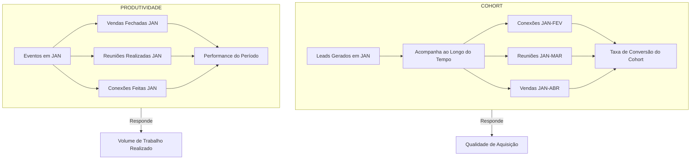

# Análise COHORT vs PRODUTIVIDADE

> **Conceito Fundamental:** Duas perspectivas diferentes de analisar os mesmos dados de leads e vendas.

---

## ⚠️ REGRA OBRIGATÓRIA

**TODA análise, relatório, dashboard ou consulta de dados DEVE seguir uma das duas abordagens:**

| Escolha | Filtro | Use Quando |
|---------|--------|------------|
| ✅ **COHORT** | `data_mql_lead_recebido` | Avaliar qualidade de aquisição, ROI, conversão |
| ✅ **PRODUTIVIDADE** | `data_sql_fechada`, `data_mql_conectado`, etc. | Metas operacionais, faturamento, KPIs de período |

**❌ NUNCA:**
- Misturar as duas abordagens na mesma análise
- Filtrar por data de geração E contar eventos do mesmo período
- Criar métricas híbridas sem justificativa clara

**Por que isso é crítico?**
- Um lead gerado em Janeiro pode vender em Março
- Se você filtrar Janeiro por geração E vendas em Janeiro, perde essa venda
- Resultado: números incorretos e decisões erradas

---

## 📖 Visão Geral

Ao analisar dados de leads e vendas, existem duas abordagens fundamentais que respondem perguntas diferentes:

| Abordagem | Pergunta Principal | Filtro Principal |
|-----------|-------------------|------------------|
| **COHORT** | "O que aconteceu com os leads gerados em X?" | Data de **geração** do lead |
| **PRODUTIVIDADE** | "O que foi produzido no período X?" | Data do **evento** |

---

## 🎯 COHORT - Análise de Coorte

### Definição

**Cohort** (ou análise de coorte) agrupa leads pela **data de geração** e acompanha o que aconteceu com **aquele grupo específico** ao longo do tempo.

### Como Funciona

```
Leads gerados em JANEIRO/2026 (Cohort)
├── 1000 leads gerados
├── 200 conectados (20%)
├── 100 reuniões marcadas (10%)
├── 50 vendas fechadas (5%)
└── Timeline: pode se estender por meses
```

### Perguntas que Responde

- "Dos leads gerados em janeiro, quantos viraram vendas?"
- "Qual a taxa de conversão dos leads de fevereiro?"
- "Quanto tempo em média um lead de março demora para fechar?"
- "Qual cohort teve melhor performance?"

### Exemplo Prático

```sql
-- COHORT: Leads gerados em Janeiro e suas conversões
SELECT 
    DATE_TRUNC('month', data_mql_lead_recebido) AS cohort_mes,
    COUNT(*) AS total_leads,
    COUNT(data_mql_conectado) AS conectados,
    COUNT(data_sql_reuniao_marcada) AS reunioes_marcadas,
    COUNT(data_sql_fechada) AS vendas_fechadas,
    ROUND(100.0 * COUNT(data_mql_conectado) / COUNT(*), 2) AS taxa_conexao,
    ROUND(100.0 * COUNT(data_sql_fechada) / COUNT(*), 2) AS taxa_conversao
FROM oportunidades
WHERE data_mql_lead_recebido >= '2026-01-01'
  AND data_mql_lead_recebido < '2026-02-01'
GROUP BY DATE_TRUNC('month', data_mql_lead_recebido);
```

### Características

| Aspecto | Descrição |
|---------|-----------|
| **Foco** | Origem do lead |
| **Período** | Pode atravessar meses |
| **Acumulação** | Dados acumulam ao longo do tempo |
| **Uso principal** | Avaliar qualidade de aquisição, ROI de campanhas |

### Quando Usar

- ✅ Avaliar qualidade de campanhas de marketing
- ✅ Medir ROI de aquisição por canal
- ✅ Comparar performance entre períodos de aquisição
- ✅ Entender tempo de ciclo de vendas
- ✅ Analisar retenção e churn

---

## ⚡ PRODUTIVIDADE - Análise de Performance

### Definição

**Produtividade** analisa eventos que **ocorreram** em um período específico, independente de quando o lead foi gerado.

### Como Funciona

```
Eventos de VENDAS em JANEIRO/2026
├── 50 vendas fechadas
│   ├── 20 vindas de leads de dezembro/2025
│   ├── 15 vindas de leads de janeiro/2026
│   └── 15 vindas de leads de novembro/2025
└── Foco: o que foi PRODUZIDO no mês
```

### Perguntas que Responde

- "Quantas vendas fechamos este mês?"
- "Quantas reuniões aconteceram na última semana?"
- "Qual o volume de conexões realizadas ontem?"
- "Como está a produtividade da equipe em tempo real?"

### Exemplo Prático

```sql
-- PRODUTIVIDADE: Vendas fechadas em Janeiro (independente da origem)
SELECT 
    DATE_TRUNC('month', data_sql_fechada) AS mes_producao,
    COUNT(*) AS vendas_fechadas,
    SUM(valor) AS receita_total,
    AVG(valor) AS ticket_medio
FROM oportunidades
WHERE data_sql_fechada >= '2026-01-01'
  AND data_sql_fechada < '2026-02-01'
GROUP BY DATE_TRUNC('month', data_sql_fechada);
```

### Características

| Aspecto | Descrição |
|---------|-----------|
| **Foco** | Resultado do período |
| **Período** | Delimitado pelo filtro |
| **Acumulação** | Snapshot do período |
| **Uso principal** | Metas operacionais, dashboards em tempo real |

### Quando Usar

- ✅ Acompanhar metas mensais/semanais
- ✅ Dashboards operacionais em tempo real
- ✅ Relatórios de performance da equipe
- ✅ Faturamento do período
- ✅ KPIs operacionais

---

## 🔄 Comparação Visual

### Cenário de Exemplo

Imagine os seguintes dados:

| Lead ID | Data Geração | Data Conexão | Data Venda |
|---------|--------------|--------------|------------|
| L001 | 15/Jan/2026 | 20/Jan/2026 | 05/Fev/2026 |
| L002 | 20/Jan/2026 | 25/Jan/2026 | 28/Jan/2026 |
| L003 | 10/Fev/2026 | 12/Fev/2026 | 20/Fev/2026 |
| L004 | 25/Jan/2026 | 02/Fev/2026 | 10/Fev/2026 |

### Análise COHORT - Janeiro 2026

```
Cohort: Leads gerados em Janeiro (L001, L002, L004)
├── Total de leads: 3
├── Conectados em qualquer data: 3 (100%)
├── Vendas fechadas em qualquer data: 3 (100%)
└── Observação: L001 vendeu em fevereiro, mas conta para o cohort de janeiro
```

### Análise PRODUTIVIDADE - Janeiro 2026

```
Produtividade Janeiro: Eventos que aconteceram em Janeiro
├── Conexões: 3 (L001, L002, L004)
├── Vendas: 1 (apenas L002)
└── Observação: L001 e L004 venderam em fevereiro, não contam aqui
```

### Análise PRODUTIVIDADE - Fevereiro 2026

```
Produtividade Fevereiro: Eventos que aconteceram em Fevereiro
├── Conexões: 1 (L003)
├── Vendas: 3 (L001, L003, L004)
└── Observação: L001 e L004 são leads de janeiro, mas venderam em fevereiro
```

---

## 📊 Diagrama de Fluxo



---

## 🗂️ Mapeamento de Campos por Tipo de Análise

### Campos para COHORT

| Campo | Uso | Descrição |
|-------|-----|-----------|
| `data_mql_lead_recebido` | **Filtro principal** | Data de geração do lead |
| `date_created` | Filtro alternativo | Data de criação do contato |
| `utm_source` | Segmentação | Origem da aquisição |
| `utm_campaign` | Segmentação | Campanha de origem |

### Campos para PRODUTIVIDADE

| Campo | Uso | Descrição |
|-------|-----|-----------|
| `data_mql_conectado` | Filtro de evento | Quando conectou |
| `data_sql_reuniao_marcada` | Filtro de evento | Quando reunião foi marcada |
| `data_sql_reuniao_realizada` | Filtro de evento | Quando reunião aconteceu |
| `data_sql_fechada` | Filtro de evento | Quando venda foi fechada |
| `data_mql_perdido` | Filtro de evento | Quando lead foi perdido |

---

## ⚠️ Erros Comuns

### Erro 1: Misturar as Análises

```sql
-- ❌ ERRADO: Filtrar por data de geração e contar vendas do mês
SELECT COUNT(data_sql_fechada) AS vendas_janeiro
FROM oportunidades
WHERE data_mql_lead_recebido >= '2026-01-01'
  AND data_sql_fechada >= '2026-01-01'; -- Mistura cohort com produtividade
```

### Correção

```sql
-- ✅ COHORT: Leads de janeiro que venderam (quando venderam)
SELECT COUNT(data_sql_fechada) AS conversoes_total
FROM oportunidades
WHERE data_mql_lead_recebido >= '2026-01-01'
  AND data_mql_lead_recebido < '2026-02-01';

-- ✅ PRODUTIVIDADE: Vendas de janeiro (de qualquer lead)
SELECT COUNT(*) AS vendas_periodo
FROM oportunidades
WHERE data_sql_fechada >= '2026-01-01'
  AND data_sql_fechada < '2026-02-01';
```

### Erro 2: Interpretar Errado os Números

| Situação | Interpretação COHORT | Interpretação PRODUTIVIDADE |
|----------|---------------------|----------------------------|
| Lead gerado em Jan, vendeu em Fev | Conta para cohort de Janeiro | Conta para vendas de Fevereiro |
| 100 vendas em Fevereiro | Pode incluir leads de Dez/Jan | É o faturamento de Fevereiro |

---

## 📈 Métricas por Tipo de Análise

### Métricas de COHORT

| Métrica | Fórmula | Interpretação |
|---------|---------|---------------|
| Taxa de Conversão | Vendas / Leads do Cohort | Qualidade da aquisição |
| Tempo Médio de Ciclo | AVG(Data Venda - Data Geração) | Eficiência do funil |
| Taxa de Conexão | Conectados / Leads do Cohort | Efetividade do SDR |
| LTV por Cohort | Receita Total / Leads | Valor do cohort |

### Métricas de PRODUTIVIDADE

| Métrica | Fórmula | Interpretação |
|---------|---------|---------------|
| Vendas do Período | COUNT(Vendas no período) | Volume de fechamentos |
| Receita do Período | SUM(Valor no período) | Faturamento |
| Reuniões Realizadas | COUNT(Reuniões no período) | Atividade comercial |
| Conexões Realizadas | COUNT(Conexões no período) | Atividade SDR |

---

## 🎯 Casos de Uso no Sistema

### Dashboard de Marketing → COHORT

```typescript
// Filtro: Leads gerados no período
const cohortFilter = {
  data_mql_lead_recebido: {
    gte: startDate,
    lt: endDate
  }
};

// Métricas: O que aconteceu com esses leads
const metricas = {
  totalLeads: count(),
  taxaConversao: count(data_sql_fechada) / count(),
  taxaConexao: count(data_mql_conectado) / count()
};
```

### Dashboard de Vendas → PRODUTIVIDADE

```typescript
// Filtro: Eventos no período
const produtividadeFilter = {
  data_sql_fechada: {
    gte: startDate,
    lt: endDate
  }
};

// Métricas: O que foi produzido
const metricas = {
  vendasFechadas: count(),
  receitaTotal: sum(valor),
  ticketMedio: avg(valor)
};
```

---

## 📚 Referências

- [Document_GHL.md](Document_GHL.md) - Regras de negócio do sistema
- [TABELAS-DADOS.md](TABELAS-DADOS.md) - Estrutura das tabelas
- [DASHBOARD-MODULOS.md](DASHBOARD-MODULOS.md) - Módulos do dashboard

---

*Documento criado em 2026-02-27*
