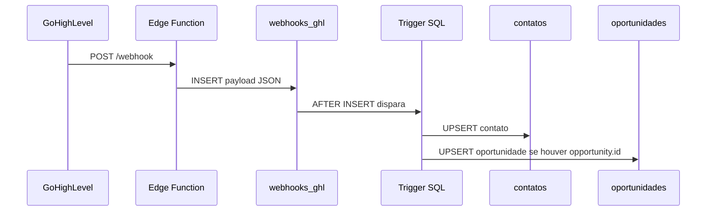
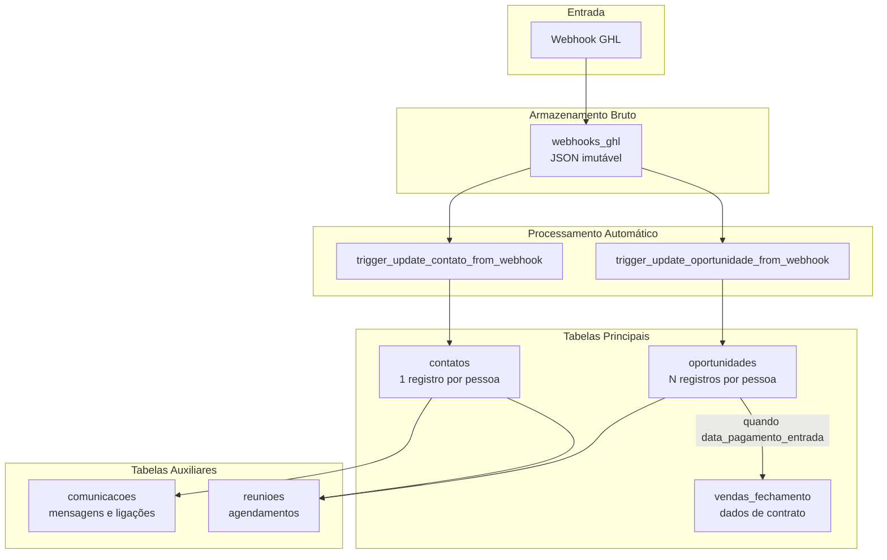
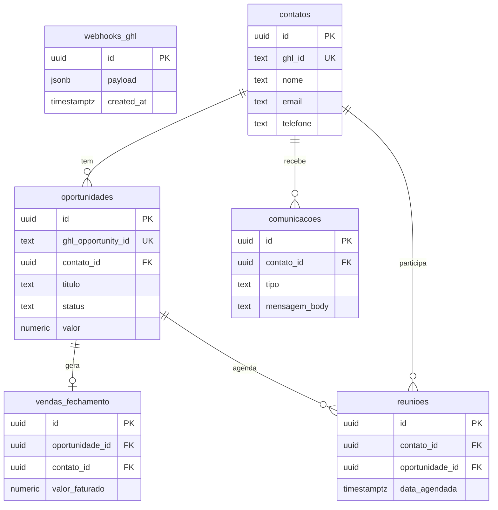

# Guia Completo do Modelo de Dados para IA

> **Versão:** 1.0
> **Última Atualização:** Fevereiro 2026
> **Propósito:** Documentação consolidada para IAs entenderem o fluxo de dados e relações entre tabelas

---

## 📚 Índice

1. [Visão Geral do Sistema](#1-visão-geral-do-sistema)
2. [Fluxo de Dados Completo](#2-fluxo-de-dados-completo)
3. [Conceito Fundamental: Lead = Oportunidade](#3-conceito-fundamental-lead--oportunidade)
4. [Tabelas Principais e Como São Populadas](#4-tabelas-principais-e-como-são-populadas)
5. [Relacionamentos Entre Tabelas](#5-relacionamentos-entre-tabelas)
6. [Como Consultar Dados Corretamente](#6-como-consultar-dados-corretamente)
7. [Anti-Patterns: O Que NÃO Fazer](#7-anti-patterns-o-que-não-fazer)
8. [Troubleshooting de Dados](#8-troubleshooting-de-dados)

---

## 1. Visão Geral do Sistema

### 1.1 As 3 Camadas de Dados

O sistema segue uma arquitetura em **3 camadas**:

```
┌─────────────────────────────────────────────────────────────────┐
│                    CAMADA 1: FONTES EXTERNAS                    │
├─────────────────────────────────────────────────────────────────┤
│  GoHighLevel (GHL)  │  Meta Ads API  │  Notion (Criativos)      │
└─────────┬───────────┴───────┬────────┴──────────┬──────────────┘
          │                   │                   │
          ▼                   ▼                   ▼
┌─────────────────────────────────────────────────────────────────┐
│                    CAMADA 2: DADOS BRUTOS (RAW)                 │
├─────────────────────────────────────────────────────────────────┤
│  webhooks_ghl       │  meta_ads_raw_insights  │  (N/A)          │
│  (JSON imutável)    │  (JSON imutável)        │                 │
└─────────┬───────────┴───────┬─────────────────┴────────────────┘
          │                   │
          ▼                   ▼
┌─────────────────────────────────────────────────────────────────┐
│                    CAMADA 3: DADOS PROCESSADOS                  │
├─────────────────────────────────────────────────────────────────┤
│  contatos           │  meta_ads_insights                        │
│  oportunidades      │  meta_ads_campaigns                       │
│  vendas_fechamento  │  meta_ads_insights_breakdowns             │
│  comunicacoes       │                                           │
│  reunioes           │                                           │
└─────────────────────────────────────────────────────────────────┘
```

### 1.2 Princípios Fundamentais

| Princípio | Descrição | Impacto na Prática |
|-----------|-----------|-------------------|
| **Raw-First** | Dados brutos NUNCA são alterados | Sempre consulte `webhooks_ghl` para auditoria |
| **Idempotência** | Funções podem ser re-executadas sem duplicar | Use `ON CONFLICT DO UPDATE` |
| **Multi-Workspace** | Tabelas de configuração são isoladas por workspace | Sempre filtre por `workspace_id` |
| **Trigger-Based** | Dados são extraídos automaticamente via triggers | Não precisa chamar funções manuais |
| **API-First para datas** | `data_lead_recebido` vem da API GHL, não do webhook | Webhook não toca esse campo — ver `sync-opp-dates` |

### 1.3 data_lead_recebido — Fonte Especial: API GHL

> ⚠️ **`data_lead_recebido` NÃO é extraída do webhook.** O campo `date_created` do webhook é impreciso e os campos customizados sofriam inversão MM/DD. A data confiável vem da API REST.

**Fluxo:**
1. Webhook chega → `extrair_dados_ghl()` insere oportunidade com `data_lead_recebido = NULL`
2. Edge function `sync-opp-dates` roda a cada 10 min (cron) → `GET /opportunities/{id}` → extrai `createdAt`
3. UPDATE: `data_lead_recebido = createdAt` (ISO 8601 UTC, imutável na API)

**Não confundir:** o webhook ainda é a fonte de verdade para UTM, nome, email, e todas as outras datas de pipeline (`data_conectado`, `data_fechado`, etc). Só `data_lead_recebido` vai pela API.

### 1.4 Pipeline Recuperação — Excluído das Análises

**`pipeline_id = 'Sn1Guqcm6zwZNTVOOf5L'` (nome: "Recuperação")** = leads antigos reativados em novo pipeline. **NÃO** representa novos leads gerados — excluído de todos os painéis de tráfego, pré-vendas e cohort.

---

## 2. Fluxo de Dados Completo

### 2.1 Fluxo de Webhooks GHL



### 2.2 O Que Acontece Quando um Webhook Chega

**Passo a passo:**

1. **GHL envia webhook** → Edge Function recebe
2. **Edge Function** → Insere JSON completo em `webhooks_ghl`
3. **Trigger `trigger_update_contato_from_webhook`** dispara
   - Extrai `contact_id` do payload
   - Faz UPSERT na tabela `contatos`
4. **Trigger `trigger_update_oportunidade_from_webhook`** dispara
   - Verifica se existe `opportunity.id` no payload
   - Se existir, faz UPSERT na tabela `oportunidades`
   - Vincula ao contato via `contato_id`

### 2.3 Diagrama de Fluxo de Dados



---

## 3. Conceito Fundamental: Lead = Oportunidade

### 3.1 A Regra de Ouro

> **LEAD = OPORTUNIDADE CRIADA**
> 
> Cada vez que uma pessoa preenche um formulário, uma **nova oportunidade** é criada.

### 3.2 Exemplo Prático

```
João Silva (1 registro na tabela contatos)
│
├── Oportunidade abc123 (Lead #1)
│   └── Preencheu formulário em 01/02/2026
│
├── Oportunidade def456 (Lead #2)
│   └── Preencheu formulário em 15/02/2026
│
└── Oportunidade ghi789 (Lead #3)
    └── Preencheu formulário em 20/02/2026
```

### 3.3 Implicações no Banco de Dados

| Tabela | O que armazena | Relacionamento |
|--------|----------------|----------------|
| `contatos` | Dados da **PESSOA** | 1 registro por pessoa |
| `oportunidades` | Dados do **LEAD** | N registros por pessoa |
| `vendas_fechamento` | Dados do **CONTRATO** | 1 registro por oportunidade fechada |

**JOIN mais comum:**
```sql
SELECT 
    c.nome,
    c.email,
    o.titulo,
    o.status,
    o.data_mql_lead_recebido
FROM oportunidades o
JOIN contatos c ON c.id = o.contato_id
```

---

## 4. Tabelas Principais e Como São Populadas

### 4.1 `webhooks_ghl` - A Fonte de Verdade

| Aspecto | Descrição |
|---------|-----------|
| **O que é** | Tabela de staging com JSON bruto |
| **Como é populada** | Edge Function insere diretamente |
| **Quando** | Tempo real, a cada webhook recebido |
| **Pode alterar?** | **NUNCA** - é imutável |
| **Para que serve** | Auditoria, reprocessamento, debug |

**Estrutura:**
```sql
webhooks_ghl (
    id UUID PRIMARY KEY,
    payload JSONB,          -- JSON completo do webhook
    created_at TIMESTAMPTZ, -- Quando chegou no Supabase
    processado_em TIMESTAMPTZ -- Quando foi processado
)
```

### 4.2 `contatos` - Dados da Pessoa

| Aspecto | Descrição |
|---------|-----------|
| **O que é** | Dados cadastrais da pessoa física |
| **Como é populada** | Trigger após INSERT em webhooks_ghl |
| **Chave única** | `ghl_id` (contact_id do GHL) |
| **Comportamento** | UPSERT (cria se não existe, atualiza se existe) |

**Fluxo de população:**
```
webhooks_ghl (INSERT)
    ↓
trigger_update_contato_from_webhook
    ↓
extrai: contact_id, full_name, email, phone, utm_*, etc.
    ↓
INSERT INTO contatos ... ON CONFLICT (ghl_id) DO UPDATE
```

**Campos principais:**
| Campo | Origem no Webhook | Observação |
|-------|-------------------|------------|
| `ghl_id` | `contact_id` | Chave única |
| `nome` | `full_name` | - |
| `email` | `email` | Lowercase |
| `telefone` | `phone` | - |
| `date_created` | `date_created` | Data REAL de criação no GHL |
| `utm_source` | `utm_source` | Fonte de tráfego |
| `utm_term` | `utm_term` | Código do anúncio |
| `owner_id` | `Owner ID` | SDR responsável |

### 4.3 `oportunidades` - Dados do Lead

| Aspecto | Descrição |
|---------|-----------|
| **O que é** | Dados da oportunidade/lead |
| **Como é populada** | Trigger após INSERT em webhooks_ghl |
| **Chave única** | `ghl_opportunity_id` |
| **Condição** | Só cria se `opportunity.id` existir no payload |

**Fluxo de população:**
```
webhooks_ghl (INSERT)
    ↓
trigger_update_oportunidade_from_webhook
    ↓
verifica: opportunity.id existe no payload?
    ↓ SIM
extrai: opportunity.*, customData.*
    ↓
INSERT INTO oportunidades ... ON CONFLICT (ghl_opportunity_id) DO UPDATE
```

**Campos de DATA importantes:**

| Campo DB | Campo GHL | Fallbacks | Significado |
|----------|-----------|-----------|-------------|
| `data_mql_lead_recebido` | `mqlleads_recebidos` | `d_mqlleads_recebidos` → `date_created` | **Data de criação do lead** |
| `data_mql_contato_1..8` | `mqlcontato1..8` | `d_mqlcontato1..8` | Tentativas de contato |
| `data_mql_conectado` | `mqlconectado` | - | Quando conseguiu falar |
| `data_mql_reuniao_marcada` | `mqlreunio_marcada` | `sqlreunio_agendada` | Reunião agendada |
| `data_sql_reuniao_realizada` | `sqlreunio_realizada` | - | Reunião realizada |
| `data_sql_fechada` | `sqlfechada` | - | **Venda fechada** |

### 4.4 `vendas_fechamento` - Dados do Contrato

| Aspecto | Descrição |
|---------|-----------|
| **O que é** | Dados de fechamento (contrato, pagamento) |
| **Como é populada** | Trigger quando `data_pagamento_entrada` é preenchida |
| **Condição** | Venda só é considerada fechada quando este campo existe |

**Campos principais:**
- Dados do contratante (nome, CPF/CNPJ, endereço)
- Dados do pagamento (entrada, parcelas, forma)
- **`valor_faturado`** = calculado automaticamente (entrada + parcelas)

---

## 5. Relacionamentos Entre Tabelas

### 5.1 Diagrama de Relacionamentos



### 5.2 JOINs Mais Comuns

**1. Oportunidades com dados do contato:**
```sql
SELECT 
    o.titulo,
    o.status,
    o.data_mql_lead_recebido,
    c.nome,
    c.email,
    c.utm_source
FROM oportunidades o
JOIN contatos c ON c.id = o.contato_id
WHERE o.data_mql_lead_recebido >= '2026-02-01'
```

**2. Vendas com dados completos:**
```sql
SELECT 
    v.valor_faturado,
    v.data_pagamento_entrada,
    o.titulo,
    c.nome,
    c.email
FROM vendas_fechamento v
JOIN oportunidades o ON o.id = v.oportunidade_id
JOIN contatos c ON c.id = v.contato_id
WHERE v.data_pagamento_entrada >= '2026-02-01'
```

**3. Contato com todas as oportunidades:**
```sql
SELECT 
    c.nome,
    c.email,
    COUNT(o.id) as total_oportunidades,
    SUM(CASE WHEN o.status = 'won' THEN 1 ELSE 0 END) as vendas
FROM contatos c
LEFT JOIN oportunidades o ON o.contato_id = c.id
GROUP BY c.id, c.nome, c.email
```

---

## 6. Como Consultar Dados Corretamente

### 6.1 Regra COHORT vs PRODUTIVIDADE

> **TODA consulta DEVE seguir uma das duas abordagens:**

| Abordagem | Filtra Por | Pergunta |
|-----------|------------|----------|
| **COHORT** | Data de **geração** do lead | "O que aconteceu com os leads de X?" |
| **PRODUTIVIDADE** | Data do **evento** | "O que produzimos no período X?" |

**Exemplo COHORT (Leads de Janeiro):**
```sql
-- Leads criados em Janeiro e suas vendas (quando venderam)
SELECT 
    COUNT(*) as total_leads,
    COUNT(data_sql_fechada) as vendas,
    COUNT(data_sql_fechada)::float / COUNT(*) * 100 as taxa_conversao
FROM oportunidades
WHERE data_mql_lead_recebido >= '2026-01-01'
  AND data_mql_lead_recebido < '2026-02-01'
```

**Exemplo PRODUTIVIDADE (Vendas de Janeiro):**
```sql
-- Vendas fechadas em Janeiro (de qualquer lead)
SELECT 
    COUNT(*) as vendas_fevereiro,
    SUM(valor) as faturamento
FROM oportunidades
WHERE data_sql_fechada >= '2026-01-01'
  AND data_sql_fechada < '2026-02-01'
```

### 6.2 Campos de Data Corretos

| Objetivo | Campo Correto | Campo ERRADO |
|----------|---------------|--------------|
| Data de criação do lead | `data_mql_lead_recebido` | ~~`created_at`~~ |
| Data de criação do contato | `contatos.date_created` | ~~`contatos.created_at`~~ |
| Data de venda | `data_sql_fechada` | ~~`updated_at`~~ |
| Data de reunião | `data_sql_reuniao_realizada` | ~~`created_at`~~ |

### 6.3 ⚠️ REGRA DE TIMEZONE (OBRIGATÓRIO)

> **TODAS as datas no banco estão em UTC. SEMPRE converta para `America/Sao_Paulo` ao exibir ou filtrar!**
>
> 📖 Documentação completa: [PADRAO-TIMEZONE.md](PADRAO-TIMEZONE.md)

**Por que?** O GHL envia `2026-02-21T00:04:11.514Z` (meia-noite UTC). Em São Paulo (UTC-3), isso é `2026-02-2021:04:11` - **um dia diferente!**

### 6.4 Queries Prontas para Uso (COM CONVERSÃO DE TIMEZONE)

**Total de leads por mês:**
```sql
SELECT
    DATE_TRUNC('month', data_mql_lead_recebido AT TIME ZONE 'America/Sao_Paulo') as mes,
    COUNT(*) as leads
FROM oportunidades
WHERE data_mql_lead_recebido IS NOT NULL
GROUP BY 1
ORDER BY 1 DESC
```

**Taxa de conversão por cohort:**
```sql
SELECT
    DATE_TRUNC('month', data_mql_lead_recebido AT TIME ZONE 'America/Sao_Paulo') as mes_cohort,
    COUNT(*) as leads,
    COUNT(data_sql_fechada) as vendas,
    ROUND(COUNT(data_sql_fechada)::numeric / COUNT(*) * 100, 2) as taxa_conversao
FROM oportunidades
WHERE data_mql_lead_recebido IS NOT NULL
GROUP BY 1
ORDER BY 1 DESC
```

**Funil de vendas:**
```sql
SELECT
    COUNT(*) as total_leads,
    COUNT(data_mql_conectado) as conectados,
    COUNT(data_mql_reuniao_marcada) as reunioes_marcadas,
    COUNT(data_sql_reuniao_realizada) as reunioes_realizadas,
    COUNT(data_sql_fechada) as vendas
FROM oportunidades
WHERE (data_mql_lead_recebido AT TIME ZONE 'America/Sao_Paulo')::date >= '2026-02-01'
```

---

## 7. Anti-Patterns: O Que NÃO Fazer

### 7.1 ❌ Usar `created_at` do Supabase como data de negócio

**ERRADO:**
```sql
-- ❌ NÃO FAÇA ISSO
SELECT COUNT(*) FROM oportunidades
WHERE created_at >= '2026-02-01'
```

**CORRETO:**
```sql
-- ✅ Use a data real do GHL
SELECT COUNT(*) FROM oportunidades
WHERE (data_mql_lead_recebido AT TIME ZONE 'America/Sao_Paulo')::date >= '2026-02-01'
```

**Por que?** `created_at` é quando o registro foi inserido no Supabase, não quando o lead foi criado no GHL.

### 7.2 ❌ Ignorar conversão de timezone

**ERRADO:**
```sql
-- ❌ NÃO FAÇA ISSO - Vai retornar dias errados!
SELECT
    DATE_TRUNC('month', data_mql_lead_recebido) as mes,
    COUNT(*) as leads
FROM oportunidades
GROUP BY 1
```

**CORRETO:**
```sql
-- ✅ Sempre converta para America/Sao_Paulo
SELECT
    DATE_TRUNC('month', data_mql_lead_recebido AT TIME ZONE 'America/Sao_Paulo') as mes,
    COUNT(*) as leads
FROM oportunidades
GROUP BY 1
```

**Por que?** O banco armazena em UTC. Meia-noite UTC = 21:00 do dia anterior em São Paulo. Sem conversão, você agrupa leads no dia errado.

### 7.3 ❌ Filtrar por data sem converter

**ERRADO:**
```sql
-- ❌ Pode incluir/excluir dias errados!
WHERE data_mql_lead_recebido::date = '2026-02-20'
```

**CORRETO:**
```sql
-- ✅ Converta ANTES de comparar
WHERE (data_mql_lead_recebido AT TIME ZONE 'America/Sao_Paulo')::date = '2026-02-20'
```

### 7.2 ❌ Misturar COHORT e PRODUTIVIDADE na mesma query

**ERRADO:**
```sql
-- ❌ NÃO FAÇA ISSO - mistura duas lógicas
SELECT 
    COUNT(*) as leads_janeiro,
    COUNT(data_sql_fechada) as vendas_fevereiro
FROM oportunidades
WHERE data_mql_lead_recebido >= '2026-01-01'
  AND data_sql_fechada >= '2026-02-01'
```

**Por que?** Isso cria uma métrica híbrida sem sentido analítico claro.

### 7.3 ❌ Assumir que 1 contato = 1 lead

**ERRADO:**
```sql
-- ❌ NÃO FAÇA ISSO
SELECT COUNT(*) FROM contatos as total_leads
```

**CORRETO:**
```sql
-- ✅ Contabilize oportunidades
SELECT COUNT(*) FROM oportunidades as total_leads
```

**Por que?** Um contato pode ter múltiplas oportunidades (leads).

### 7.4 ❌ Alterar dados em `webhooks_ghl`

**ERRADO:**
```sql
-- ❌ NUNCA FAÇA ISSO
UPDATE webhooks_ghl SET payload = '...' WHERE id = '...'
DELETE FROM webhooks_ghl WHERE ...
```

**Por que?** Esta tabela é **imutável**. É a fonte de verdade para auditoria.

### 7.5 ❌ Ignorar campos com fallback

**ERRADO:**
```sql
-- ❌ Pode deixar dados nulos
SELECT parse_date_flexible(payload->'customData'->>'{{opportunity.mqlleads_recebidos}}')
```

**CORRETO:**
```sql
-- ✅ Use COALESCE com fallbacks
SELECT COALESCE(
    parse_date_flexible(payload->'customData'->>'{{opportunity.mqlleads_recebidos}}'),
    parse_date_flexible(payload->'customData'->>'{{opportunity.d_mqlleads_recebidos}}'),
    payload->>'date_created'
)
```

---

## 8. Troubleshooting de Dados

### 8.1 Campo não está sendo preenchido

**Passos de diagnóstico:**

1. **Verificar se existe no webhook:**
```sql
SELECT COUNT(*)
FROM webhooks_ghl
WHERE payload->'customData'->>'{{opportunity.campo}}' IS NOT NULL
  AND payload->'customData'->>'{{opportunity.campo}}' != ''
```

2. **Verificar se o trigger está ativo:**
```sql
SELECT * FROM pg_trigger 
WHERE tgname LIKE '%oportunidade%';
```

3. **Verificar logs de erro:**
```sql
SELECT * FROM meta_ads_sync_log 
WHERE status = 'error' 
ORDER BY started_at DESC LIMIT 10;
```

### 8.2 Dados duplicados

**Verificar duplicatas:**
```sql
SELECT ghl_opportunity_id, COUNT(*)
FROM oportunidades
GROUP BY ghl_opportunity_id
HAVING COUNT(*) > 1
```

**Resolver duplicatas:**
```sql
-- Manter apenas o registro mais recente
DELETE FROM oportunidades o1
WHERE EXISTS (
    SELECT 1 FROM oportunidades o2
    WHERE o2.ghl_opportunity_id = o1.ghl_opportunity_id
      AND o2.updated_at > o1.updated_at
)
```

### 8.3 Dados de data incorretos

**Verificar datas no futuro:**
```sql
SELECT id, ghl_opportunity_id, data_mql_lead_recebido
FROM oportunidades
WHERE data_mql_lead_recebido > NOW()
```

**Verificar datas muito antigas:**
```sql
SELECT id, ghl_opportunity_id, data_mql_lead_recebido
FROM oportunidades
WHERE data_mql_lead_recebido < '2020-01-01'
```

### 8.4 Contato sem oportunidades

**Encontrar contatos órfãos:**
```sql
SELECT c.id, c.nome, c.email, c.date_created
FROM contatos c
LEFT JOIN oportunidades o ON o.contato_id = c.id
WHERE o.id IS NULL
ORDER BY c.date_created DESC
```

**Por que acontece?** O contato foi criado mas nunca preencheu um formulário que gera oportunidade.

---

## 📚 Documentação Relacionada

| Documento | Descrição |
|-----------|-----------|
| [`TABELAS-SISTEMA.md`](TABELAS-SISTEMA.md) | Referência completa de todas as tabelas |
| [`AI-INSTRUCTIONS.md`](AI-INSTRUCTIONS.md) | Instruções para extração de dados |
| [`Document_GHL.md`](Document_GHL.md) | Regras de negócio do GHL |
| [`webhooks-ghl/REGRAS-EXTRACAO.md`](webhooks-ghl/REGRAS-EXTRACAO.md) | Regras técnicas de extração |
| [`ANALISE-COHORT-VS-PRODUTIVIDADE.md`](ANALISE-COHORT-VS-PRODUTIVIDADE.md) | Análise detalhada COHORT |

---

*Documento criado em Fevereiro 2026*
*Manter sincronizado com mudanças no schema do banco*
