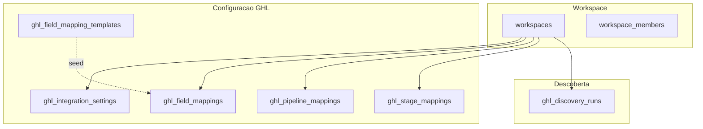

# GHL Mapeamento de Campos — Fundação Multi-Conta

> Documentação das tabelas de mapeamento GHL criadas na **Fase 1** da expansão do Empire para múltiplas contas GoHighLevel.

---

## 🎯 Propósito

O Empire nasceu acoplado a uma única conta GHL, com campos customizados e pipelines hard-coded nas funções de extração. Para replicar o sistema em outros workspaces, foi criada uma camada de **mapeamento configurável por workspace** que traduz campos lógicos do Empire (`data_conectado`, `utm_source`, etc.) para as chaves reais de cada conta GHL.

---

## 🏗️ Modelo de Dados

### Visão geral

---

## 📋 Tabelas

### `ghl_integration_settings`

Armazena configuração de webhook e identificação da localização GHL por workspace.

| Coluna | Tipo | Descrição |
|--------|------|-----------|
| `id` | UUID | PK |
| `workspace_id` | UUID | FK → `workspaces(id)` ON DELETE CASCADE |
| `ghl_location_id` | TEXT | ID da localização GHL |
| `webhook_secret` | TEXT | Segredo para validar assinatura de webhooks |
| `webhook_url` | TEXT | URL onde o GHL deve enviar webhooks |
| `is_active` | BOOLEAN | Se a integração está ativa |
| `created_at` | TIMESTAMPTZ | Criação |
| `updated_at` | TIMESTAMPTZ | Última atualização |

**Segurança:**
- A `ghl_api_key` **não** é armazenada nesta tabela. Ela deve ser configurada como secret `GHL_API_KEY` nas edge functions do Supabase (`supabase secrets set GHL_API_KEY="..."`).
- Aplicação React nunca lê, envia ou exibe a API key.

---

### `ghl_field_mappings`

Mapeamento de campos lógicos do Empire para chaves reais do GHL.

| Coluna | Tipo | Descrição |
|--------|------|-----------|
| `id` | UUID | PK |
| `workspace_id` | UUID | FK → `workspaces(id)` ON DELETE CASCADE |
| `logical_name` | TEXT | Nome lógico interno (ex: `data_conectado`) |
| `ghl_field_key` | TEXT | Chave canônica no GHL (ex: `{{opportunity.mqlconectado}}`) |
| `ghl_field_id` | TEXT | UUID do custom field no GHL, quando aplicável |
| `field_type` | TEXT | `date`, `text`, `number`, `tag`, `opportunity_field`, `contact_field` |
| `variations` | JSONB | Array de chaves alternativas para fallback |
| `is_required` | BOOLEAN | Se o campo é obrigatório para o workspace |
| `enabled` | BOOLEAN | Se o mapeamento está ativo |
| `created_at` | TIMESTAMPTZ | Criação |
| `updated_at` | TIMESTAMPTZ | Última atualização |

**Exemplo:**

| logical_name | ghl_field_key | variations |
|--------------|---------------|------------|
| `data_conectado` | `{{opportunity.mqlconectado}}` | `["{{opportunity.mqlconectado}}", "{{opportunity.d_mqlconectado}}"]` |
| `utm_source` | `utm_source` | `["utm_source"]` |

---

### `ghl_pipeline_mappings`

Mapeia pipelines do GHL para categorias do sistema Empire.

| Coluna | Tipo | Descrição |
|--------|------|-----------|
| `id` | UUID | PK |
| `workspace_id` | UUID | FK → `workspaces(id)` ON DELETE CASCADE |
| `ghl_pipeline_id` | TEXT | ID do pipeline no GHL |
| `ghl_pipeline_name` | TEXT | Nome do pipeline no GHL |
| `system_category` | TEXT | `pre_vendas`, `vendas`, `recuperacao`, `excluir`, `outro` |
| `is_excluded` | BOOLEAN | Se o pipeline deve ser ignorado |
| `created_at` | TIMESTAMPTZ | Criação |
| `updated_at` | TIMESTAMPTZ | Última atualização |

---

### `ghl_stage_mappings`

Mapeia estágios (colunas) de cada pipeline para estágios canônicos do Empire.

| Coluna | Tipo | Descrição |
|--------|------|-----------|
| `id` | UUID | PK |
| `workspace_id` | UUID | FK → `workspaces(id)` ON DELETE CASCADE |
| `ghl_pipeline_id` | TEXT | ID do pipeline no GHL |
| `ghl_stage_id` | TEXT | ID do stage no GHL |
| `ghl_stage_name` | TEXT | Nome do stage no GHL |
| `system_stage` | TEXT | `novo`, `conectado`, `agendado`, `reuniao_realizada`, `fechado`, `perdido` |
| `created_at` | TIMESTAMPTZ | Criação |
| `updated_at` | TIMESTAMPTZ | Última atualização |

---

### `ghl_field_mapping_templates`

Templates globais e reutilizáveis usados para semear o mapeamento inicial de novos workspaces.

| Coluna | Tipo | Descrição |
|--------|------|-----------|
| `id` | UUID | PK |
| `name` | TEXT | Nome do template (padrão: `Empire Default`) |
| `logical_name` | TEXT | Nome lógico interno |
| `ghl_field_key` | TEXT | Chave canônica no GHL |
| `field_type` | TEXT | Tipo do campo |
| `variations` | JSONB | Variações de chave |
| `is_required` | BOOLEAN | Obrigatoriedade |
| `created_at` | TIMESTAMPTZ | Criação |
| `updated_at` | TIMESTAMPTZ | Última atualização |

**Template padrão `Empire Default`:**
- Todos os campos de data de oportunidade do Empire (`data_tentativa_1..8`, `data_conectado`, `data_perdido`, `data_qualificado`, `data_agendamento_reuniao`, `data_no_show`, `data_pendencias_preenchimento`, etc.).
- Campos de vendas (`data_no_show_vendas`, `data_perdido_vendas`, `data_agendamento_vendas`, `data_realizacao_vendas`, `data_negociacao`, `data_fechado`).
- Campos de texto de oportunidade (`vendedor_closer`, `lost_reason`, `resumo_ia`, `percepcao_closer`, `data_ultima_atividade`, `opportunity_source`).
- Campos de contato UTM/TT (`utm_source`, `utm_medium`, `utm_campaign`, `utm_term`, `utm_content`, `tt_source`, `tt_medium`, `tt_campaign`, `tt_term`, `tt_content`).

---

### `ghl_discovery_runs`

Log de auditoria das operações de descoberta de campos/pipelines no GHL.

| Coluna | Tipo | Descrição |
|--------|------|-----------|
| `id` | UUID | PK |
| `workspace_id` | UUID | FK → `workspaces(id)` ON DELETE CASCADE |
| `source` | TEXT | Origem da descoberta (`contact_custom_fields`, `opportunity_custom_fields`, `pipelines`) |
| `payload` | JSONB | Resposta bruta ou resumo da descoberta |
| `status` | TEXT | `success`, `error`, `partial` |
| `created_at` | TIMESTAMPTZ | Criação |

---

## 🔐 Segurança e RLS

Todas as tabelas novas possuem **Row Level Security ativado**.

| Operação | Regra |
|----------|-------|
| `SELECT` | Qualquer membro ativo do workspace pode ler. |
| `INSERT` / `UPDATE` / `DELETE` | Apenas `owner` ou `admin` do workspace. |
| `service_role` | Acesso total para rotinas internas. |

A tabela `ghl_field_mapping_templates` é global e **somente leitura** para usuários autenticados.

---

## 🔄 Fluxo de Uso

1. **Onboard de novo workspace:**
   - A API key do GHL é configurada como secret `GHL_API_KEY` nas edge functions do Supabase.
   - Administrador cadastra `ghl_integration_settings` com `ghl_location_id` e `webhook_url`.
   - Sistema copia o template `Empire Default` para `ghl_field_mappings` do workspace.

2. **Descoberta:**
   - Edge function ou rotina interna consulta a API GHL e registra o resultado em `ghl_discovery_runs`.
   - Com base na descoberta, o administrador ajusta `ghl_field_mappings`, `ghl_pipeline_mappings` e `ghl_stage_mappings`.

3. **Extração de dados:**
   - A função `extrair_dados_ghl()` (Fase 4) consulta `ghl_field_mappings` do workspace para saber quais chaves extrair do webhook, respeitando `variations` como fallbacks.

---

## ⚠️ Regras Críticas

1. **`ghl_api_key` nunca no banco nem no frontend React.** Configure-a apenas como secret `GHL_API_KEY` nas edge functions do Supabase.
2. **Não alterar `extrair_dados_ghl()` ainda.** A adaptação para usar o mapeamento é da **Fase 4**.
3. **Todas as tabelas de mapeamento são isoladas por `workspace_id`.**
4. **Pipeline `excluir` / `is_excluded = true`** devem ser ignorados pelos painéis.

---

## 📁 Arquivos Relacionados

- Migration: `supabase/migrations/20260707000000_create_ghl_mapping_foundation.sql`
- Regras de negócio GHL: [`docs/Document_GHL.md`](Document_GHL.md)
- Mapeamento técnico legado de webhooks: [`docs/webhooks-ghl/MAPEAMENTO-CAMPOS.md`](webhooks-ghl/MAPEAMENTO-CAMPOS.md)

---

*Última atualização: 2026-07-08 15:14 BRT*
