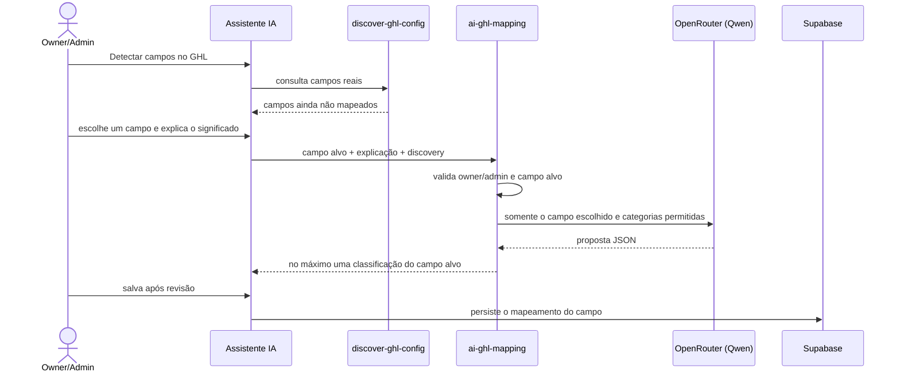

# Assistente de Mapeamento GHL por IA

> Caminho guiado para classificar campos reais do GoHighLevel sem exigir que a pessoa conheça nomes técnicos ou descreva todo o CRM de uma vez.

**Interface:** `eb-dash2/src/components/ghl-mapping/GhlMappingAssistant.tsx`
**Edge function:** `supabase/functions/ai-ghl-mapping/`

## Fluxo para quem usa o produto

1. A pessoa clica em **Detectar campos no GHL**. Isto apenas consulta a conta; nada é salvo.
2. O sistema mostra os campos reais que ainda não foram mapeados, com origem **Contato** ou **Oportunidade**.
3. A pessoa escolhe um campo e responde, em português simples, para que ele serve.
4. A IA sugere uma única categoria do Empire para aquele campo.
5. A pessoa revisa e clica em **Salvar esta classificação**.
6. O campo some da lista e a pessoa pode continuar com o próximo.

Pipelines e stages continuam disponíveis no **Mapeamento avançado**. O assistente não tenta inferir todo o processo comercial em uma única mensagem.



## Contrato da edge function

### Request

```json
{
  "workspace_id": "uuid",
  "user_description": "Este campo recebe a data em que a reunião foi marcada.",
  "target": {
    "kind": "field",
    "source": "opportunity",
    "key": "{{opportunity.data_agendamento}}"
  },
  "discovery_result": {
    "contact_custom_fields": [],
    "opportunity_custom_fields": [],
    "pipelines": []
  }
}
```

`target` é obrigatório. A edge function recusa uma chave que não exista na discovery recebida para a origem informada.

### Response

```json
{
  "proposal": {
    "fields": [
      {
        "ghl_field_key": "{{opportunity.data_agendamento}}",
        "logical_name": "data_agendamento",
        "confidence": 0.95
      }
    ],
    "pipelines": [],
    "stages": [],
    "explanation": "O campo registra quando a reunião foi agendada.",
    "warnings": [],
    "outcome": "mapped"
  },
  "model_used": "qwen/qwen3.6-plus"
}
```

## Campos fora do vocabulário padrão (escape automático)

A IA **nunca** pode criar um `logical_name` novo — só pode escolher da lista de
campos lógicos do template. Quando o campo escolhido não corresponde a nenhum
conceito do vocabulário, isso **não é erro nem beco sem saída**: o destino dele
já existe e é automático, conforme a origem:

- **Oportunidade:** nada a fazer. Campos fora do contrato são capturados
  automaticamente em `oportunidades.custom_extra` na ingestão do webhook
  (zero-config — ver [`CONTRATO-WEBHOOK-CRM.md`](CONTRATO-WEBHOOK-CRM.md)) e
  aparecem de forma passiva no cartão do lead. Nunca entram em métrica ou funil.
- **Contato:** pode ser mapeado como campo extra (prefixo `extra.*` →
  `contatos.custom_fields`) pelo **modo avançado** — exibição passiva no
  LeadCard, nunca métrica (ver [`GHL-CAMPOS-EXTRAS.md`](GHL-CAMPOS-EXTRAS.md)).

Se um dia o campo precisar virar métrica, isso é decisão de produto: o
`logical_name` precisa ser adicionado ao vocabulário/template por uma migration
— nunca pela IA no calor da classificação.

### Como a tela comunica isso

A edge devolve `outcome` na proposta: `mapped` (sugestão aceita),
`not_in_vocabulary` (a IA sugeriu algo fora do vocabulário — contido no
servidor) ou `unclear` (a IA não conseguiu classificar). Quando o outcome não é
`mapped`, a `explanation` da IA é descartada no servidor (ela descreveria um
mapeamento recusado) e a tela mostra o estado de escape: o que o campo é, para
onde ele vai automaticamente e o caminho do modo avançado — sem botão de salvar,
porque não há o que salvar.

## Guardas de segurança e produto

- Só `owner` e `admin` do workspace podem chamar a função.
- A chave alvo é validada contra a discovery, no servidor.
- Mesmo se o modelo devolver itens extras, a resposta é filtrada no servidor para manter no máximo um campo, a chave escolhida e um `logical_name` permitido.
- Pipelines e stages sempre são descartados nesta rota.
- Categorias já usadas não são oferecidas pela IA para evitar sobrescrever um mapeamento existente; o modo avançado permanece o caminho para uma correção manual.
- A descrição é sanitizada e limitada a 2.000 caracteres.
- `GHL_API_KEY`, `OPENROUTER_API_KEY` e a chave de serviço nunca chegam ao navegador.

## Modelo de IA

- Primário: `qwen/qwen3.6-plus` via OpenRouter.
- Fallback: `deepseek/deepseek-v4-flash`.
- Modelos Anthropic/Claude/OpenAI são proibidos para esta função pelas regras do projeto.

## Arquivos relacionados

- [`GHL-MAPPING-WIZARD.md`](GHL-MAPPING-WIZARD.md) — modo avançado.
- [`GHL-DISCOVERY.md`](GHL-DISCOVERY.md) — consulta da configuração GHL.
- [`GHL-MAPEAMENTO-CAMPOS.md`](GHL-MAPEAMENTO-CAMPOS.md) — tabelas e templates de mapeamento.

*Última atualização: 2026-07-21 BRT*
