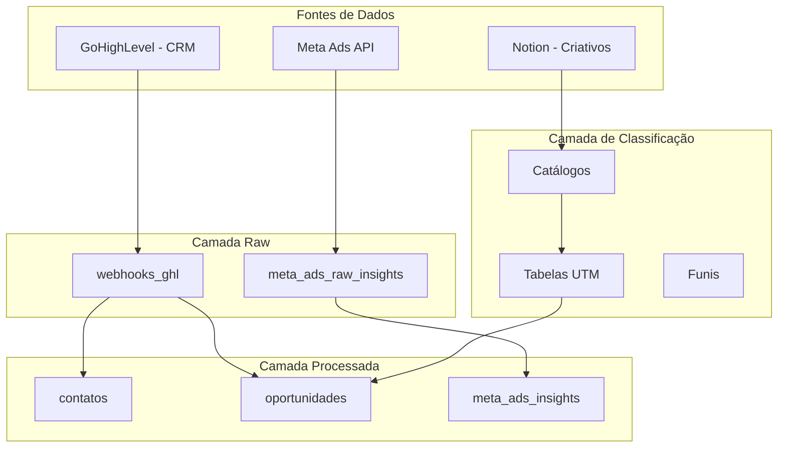
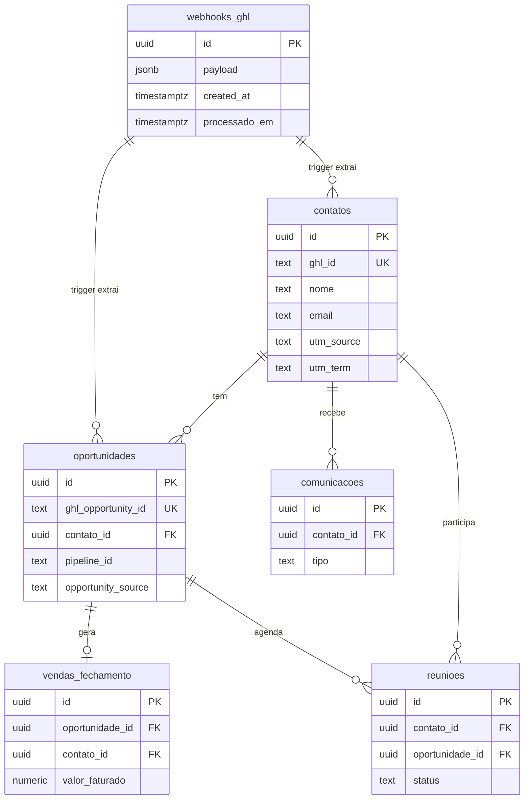
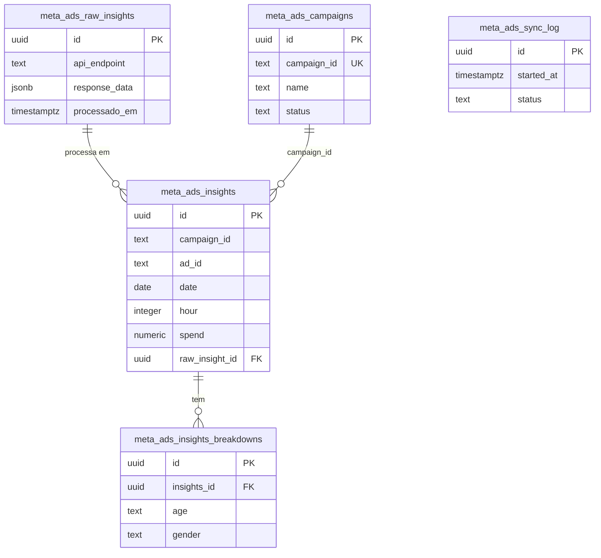
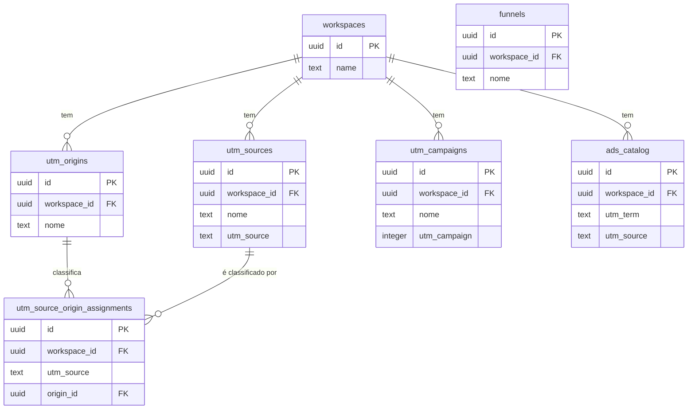

# Documentação Completa das Tabelas do Sistema

> **Versão:** 2.2
> **Última Atualização:** 2026-07-08 15:14 BRT
> **Público:** Desenvolvedores, Analistas de Dados e IA

---

> **🔴 LEIA PRIMEIRO:** Para entender o fluxo de dados e como as tabelas se conectam, consulte [`DATA-MODEL-GUIA-IA.md`](DATA-MODEL-GUIA-IA.md)

---

## Índice

1. [Visão Geral do Sistema](#1-visão-geral-do-sistema)
2. [Tabelas de Dados GHL (GoHighLevel)](#2-tabelas-de-dados-ghl-gohighlevel)
3. [Tabelas de Mapeamento GHL Multi-Conta](#3-tabelas-de-mapeamento-ghl-multi-conta)
4. [Tabelas Meta Ads](#4-tabelas-meta-ads)
5. [Tabelas UTM e Classificação de Tráfego](#5-tabelas-utm-e-classificação-de-tráfego)
6. [Tabelas de Catálogo de Criativos](#6-tabelas-de-catálogo-de-criativos)
7. [Tabelas de Processos de Venda](#7-tabelas-de-processos-de-venda)
8. [Tabelas de Workspace, Permissões e Sub-apps](#8-tabelas-de-workspace-permissões-e-sub-apps)
9. [Tabelas de Disparos](#9-tabelas-de-disparos)
10. [Tabelas do Discador](#10-tabelas-do-discador)
11. [Tabelas de Auditoria IA](#11-tabelas-de-auditoria-ia)
12. [Tabelas de Relatórios Semanais](#12-tabelas-de-relatórios-semanais)
13. [Tabela de Secrets](#13-tabela-de-secrets)
14. [Diagrama de Relacionamentos](#14-diagrama-de-relacionamentos)

---

## 1. Visão Geral do Sistema

### 1.1 Arquitetura de Dados

O sistema é composto por **4 pilares principais** de dados:



### 1.2 Princípios do Sistema

| Princípio | Descrição |
|-----------|-----------|
| **Raw-First** | Dados brutos são preservados antes do processamento |
| **Idempotência** | Funções podem ser re-executadas sem duplicar dados |
| **Multi-Workspace** | Todas as tabelas de configuração são isoladas por workspace |
| **Rastreabilidade** | Logs de sincronização e auditoria em todas as operações |

---

## 2. Tabelas de Dados GHL (GoHighLevel)

### 2.1 `webhooks_ghl` - Payload Bruto

> **Propósito:** Armazenar TODOS os webhooks recebidos do GoHighLevel sem modificação.

| Coluna | Tipo | Descrição |
|--------|------|-----------|
| `id` | UUID | Identificador único do registro |
| `payload` | JSONB | **Payload completo** do webhook conforme recebido do GHL |
| `created_at` | TIMESTAMPTZ | Data/hora de recebimento no Supabase |
| `processado_em` | TIMESTAMPTZ | Data/hora em que foi processado pelas triggers |

**Como é alimentada:**
- Webhooks enviados pelo GoHighLevel para a Edge Function
- Edge Function insere diretamente sem modificação
- **NUNCA** deve ser alterada ou deletada (imutável)

**Para que serve:**
- Fonte de verdade para auditoria
- Reprocessamento de dados se necessário
- Debug de problemas de extração
- Backup completo dos dados originais

**Relacionamentos:**
```
webhooks_ghl (1) ──→ (N) oportunidades [via trigger]
webhooks_ghl (1) ──→ (N) contatos [via trigger]
```

---

### 2.2 `contatos` - Dados de Pessoas

> **Propósito:** Armazenar informações da **PESSOA** (não do lead). Um contato pode ter múltiplas oportunidades.

| Coluna | Tipo | Descrição | Origem |
|--------|------|-----------|--------|
| `id` | UUID | Identificador único no Supabase | Auto-gerado |
| `ghl_id` | TEXT | ID do contato no GoHighLevel | `contact_id` |
| `nome` | TEXT | Nome completo | `full_name` |
| `email` | TEXT | Email do contato | `email` |
| `telefone` | TEXT | Telefone | `phone` |
| `date_created` | TIMESTAMPTZ | **Data real de criação no GHL** | `date_created` |
| `utm_source` | TEXT | Fonte do tráfego | `utm_source` |
| `utm_medium` | TEXT | Meio de aquisição | `utm_medium` |
| `utm_campaign` | TEXT | Campanha | `utm_campaign` |
| `utm_term` | TEXT | **Código do anúncio** | `utm_term` |
| `utm_content` | TEXT | Conteúdo específico | `utm_content` |
| `fbclid` | TEXT | Facebook Click ID | `lastAttributionSource.fbclid` |
| `gclid` | TEXT | Google Click ID | `lastAttributionSource.gclid` |
| `owner_id` | TEXT | ID do owner no GHL | `Owner ID` |
| `owner_name` | TEXT | Nome do SDR responsável | `owner` |
| `country` | TEXT | País | `country` |
| `total_oportunidades_ghl` | INTEGER | Quantas oportunidades a API do GHL retornou na última reconciliação `write` | `reconcile-contact-opportunities` |
| `total_oportunidades_db` | INTEGER | Quantas oportunidades existiam no banco para o contato após a última reconciliação `write` | `reconcile-contact-opportunities` |
| ... | ... | +60 campos adicionais | Ver Document_GHL.md |

**Como é alimentada:**
- Trigger `trigger_update_contato_from_webhook` dispara após INSERT em `webhooks_ghl`
- Função `update_contato_from_webhook()` extrai dados do payload
- Usa `ON CONFLICT (ghl_id) DO UPDATE` para idempotência
- Campos são atualizados via `COALESCE` para não sobrescrever
- Os contadores `total_oportunidades_ghl` e `total_oportunidades_db` são atualizados pela reconciliação noturna de oportunidades

**Para que serve:**
- Identificar a pessoa por trás de cada lead
- Manter histórico de contato independente das oportunidades
- Dados demográficos e de atribuição
- Segmentação por owner, localização, etc.
- Detectar contatos com defasagem entre contagem de oportunidades no GHL e no banco

**Relacionamentos:**
```
contatos (1) ──→ (N) oportunidades
contatos (1) ──→ (N) comunicacoes
contatos (1) ──→ (N) reunioes
contatos (1) ──→ (N) vendas_fechamento
```

---

### 2.3 `oportunidades` - Leads/Oportunidades

> **Propósito:** Armazenar cada **OPORTUNIDADE** criada. **REGRA: Lead = Oportunidade**.

| Coluna | Tipo | Descrição | Origem |
|--------|------|-----------|--------|
| `id` | UUID | Identificador único no Supabase | Auto-gerado |
| `ghl_opportunity_id` | TEXT | ID da oportunidade no GHL | `opportunity.id` |
| `contato_id` | UUID | FK para contatos.id | Relacionamento |
| `titulo` | TEXT | Nome/título da oportunidade | `opportunity.name` |
| `valor` | NUMERIC | Valor potencial do lead | `opportunity.lead_value` |
| `status` | TEXT | Status atual | `opportunity.status` |
| `pipeline_id` | TEXT | ID do pipeline | `opportunity.pipeline_id` |
| `pipeline_stage_id` | TEXT | ID da coluna do pipeline | `opportunity.pipeline_stage_id` |
| `pipeline_name` | TEXT | Nome do pipeline | `pipeline_name` |
| `opportunity_source` | TEXT | Fonte da oportunidade | `opportunity.source` |
| `vendedor_closer` | TEXT | Nome do vendedor | `opportunity.assignedToUsersName` |
| `lost_reason` | TEXT | Motivo de perda | `opportunity.lost_reason` |
| `resumo_ia` | TEXT | Resumo gerado por IA | `opportunity.resumo_ia` |
| `percepcao_closer` | TEXT | Percepção do vendedor | `opportunity.percepo_do_closer` |

**Datas de Criação e Tentativas:**

| Coluna | Descrição | Fallbacks |
|--------|-----------|-----------|
| `data_lead_recebido` | **Data de criação da oportunidade** | `d_mqlleads_recebidos` → `date_created` |
| `data_tentativa_1..8` | Tentativas de contato (SDR) | `d_mqlcontatoN` |

**Datas de Pré-Venda:**

| Coluna | Descrição | Fallbacks |
|--------|-----------|-----------|
| `data_conectado` | Quando conseguiu falar com o lead | - |
| `data_no_show` | Quando o lead não compareceu | `sqlno_show` → `d_mqlno_show` |
| `data_perdido` | Quando foi marcado como perdido | `d_mqlperdido` |
| `data_qualificado` | Quando foi qualificado (virou SQL) | - |
| `data_agendamento_reuniao` | Quando o SDR **criou** o agendamento (MQL pipeline) | `mqlreunio_marcada` → `sqlreunio_agendada` → `d_mqlreunio_marcada` |
| `data_reuniao_agendada` | Data prevista em que a reunião **vai acontecer** (MQL pipeline) | `data_da_reunio` → `d_data_da_reunio` |
| `data_reuniao_realizada` | Data em que a reunião de pré-vendas **foi realizada** (MQL pipeline) | `reuniao_realizada` → `data_da_reunio_realizada` → `d_reuniao_realizada` |

**Datas de Vendas:**

| Coluna | Descrição | Fallbacks |
|--------|-----------|-----------|
| `data_no_show_vendas` | No show na fase de vendas | `d_sqlno_show` |
| `data_perdido_vendas` | Perdido na fase de vendas | `d_sqlperdida` |
| `data_agendamento_vendas` | Reunião de vendas agendada | `d_sqlreunio_agendada` |
| `data_realizacao_vendas` | Reunião de vendas realizada | Prioridade: `data_da_reunio_realizada` → `sqlreunio_realizada` → `d_sqlreunio_realizada` |
| `data_negociacao` | Entrou em negociação | `d_sqlnegociao` |
| `data_fechado` | Venda fechada | - |
| `data_pendencias_preenchimento` | Pendência de preenchimento | `d__sqlpendencias_preenchimento` |

**Como é alimentada:**
- Trigger `trigger_update_oportunidade_from_webhook` após INSERT em `webhooks_ghl`
- Função `update_oportunidade_from_webhook()` extrai dados
- Verifica se `opportunity.id` existe no payload
- Usa `ON CONFLICT (ghl_opportunity_id) DO UPDATE`
- Fallbacks implementados conforme `Document_GHL.md`

**Para que serve:**
- **Tabela principal de leads** do sistema
- Cálculo de métricas de conversão
- Acompanhamento do funil de vendas
- Análise de performance por vendedor, pipeline, etc.

---

### 2.4 `vendas_fechamento` - Dados de Contrato

> **Propósito:** Armazenar dados de fechamento das vendas (contrato, pagamento).

| Coluna | Tipo | Descrição |
|--------|------|-----------|
| `id` | UUID | Identificador único |
| `oportunidade_id` | UUID | FK para oportunidades.id |
| `contato_id` | UUID | FK para contatos.id |
| `nome_contratante` | TEXT | Nome para o contrato |
| `cpf_cnpj_contratante` | TEXT | Documento |
| `logradouro_rua_avenida` | TEXT | Endereço |
| `numero_endereco` | TEXT | Número |
| `complemento_endereco` | TEXT | Complemento |
| `bairro` | TEXT | Bairro |
| `municipio` | TEXT | Cidade |
| `estado_uf` | TEXT | Estado |
| `cep` | TEXT | CEP |
| `produto_vendido` | TEXT | Produto vendido |
| `observacoes_venda` | TEXT | Observações do closer |
| `forma_pagamento` | TEXT | Forma de pagamento |
| `op_vencimentos_parcelas` | TEXT | Cronograma de vencimentos em texto livre (boleto) |
| `op_link_do_contrato_assinado` | TEXT | Link do contrato assinado (Open Claw etc.) |
| `data_da_assinatura_do_contrato` | DATE | Data de assinatura do contrato |
| `valor_entrada` | NUMERIC | Valor da entrada |
| `numero_parcelas` | INTEGER | Quantidade de parcelas |
| `valor_parcela` | NUMERIC | Valor de cada parcela |
| `valor_faturado` | NUMERIC | **Calculado automaticamente** |
| `data_pagamento_entrada` | TIMESTAMPTZ | Data do pagamento |

**Como é alimentada:**
- Trigger que monitora campo `data_pagamento_entrada` nas oportunidades
- Quando preenchido, cria/atualiza registro em `vendas_fechamento`
- `valor_faturado = valor_entrada + (numero_parcelas × valor_parcela)`

**Para que serve:**
- Geração de contratos
- Controle financeiro de vendas
- Relatórios de faturamento
- **Critério:** Venda é considerada fechada quando `data_pagamento_entrada` está preenchido

---

### 2.5 `comunicacoes` - Mensagens e Ligações

> **Propósito:** Armazenar histórico de comunicação com contatos.

| Coluna | Tipo | Descrição |
|--------|------|-----------|
| `id` | UUID | Identificador único |
| `contato_id` | UUID | FK para contatos.id |
| `tipo` | TEXT | `mensagem`, `ligacao` ou `ai_conversation` |
| `mensagem_body` | TEXT | Corpo da mensagem |
| `mensagem_subject` | TEXT | Assunto |
| `ai_summary` | TEXT | Resumo da conversa com IA |
| `ai_transcript` | TEXT | Transcrição da conversa |
| `phone_call_from` | TEXT | Número de origem |
| `phone_call_to` | TEXT | Número de destino |
| `phone_call_duration` | INTEGER | Duração em segundos |
| `phone_call_status` | TEXT | Status da ligação |

**Como é alimentada:**
- Webhooks de mensagem e ligação do GHL
- Extração dos campos `message.*`, `phoneCall.*`, `conversations_ai.*`

**Para que serve:**
- Histórico completo de comunicações
- Análise de atendimento
- Treinamento de IA com transcrições

---

### 2.6 `reunioes` - Agendamentos

> **Propósito:** Armazenar reuniões agendadas.

| Coluna | Tipo | Descrição |
|--------|------|-----------|
| `id` | UUID | Identificador único |
| `contato_id` | UUID | FK para contatos.id |
| `oportunidade_id` | UUID | FK para oportunidades.id |
| `ghl_appointment_id` | TEXT | ID do agendamento no GHL |
| `titulo` | TEXT | Título da reunião |
| `notas` | TEXT | Notas da reunião |
| `usuario_nome` | TEXT | Nome do usuário que agendou |
| `data_agendada` | TIMESTAMPTZ | Data/hora agendada |
| `data_realizada` | TIMESTAMPTZ | Quando de fato ocorreu |
| `status` | TEXT | `agendada`, `realizada`, `cancelada`, `no_show` |

**Como é alimentada:**
- Webhooks de appointment do GHL
- Extração dos campos `appointment.*`

---

## 3. Tabelas de Mapeamento GHL Multi-Conta

> Criadas na Fase 1 da expansão do Empire para múltiplas contas GoHighLevel. Permitem configurar por workspace quais campos, pipelines e estágios do GHL correspondem aos conceitos do Empire.

Documentação completa: [`docs/GHL-MAPEAMENTO-CAMPOS.md`](GHL-MAPEAMENTO-CAMPOS.md).

### 3.1 `ghl_integration_settings` — Credenciais e Webhook

| Coluna | Tipo | Descrição |
|--------|------|-----------|
| `id` | UUID | PK |
| `workspace_id` | UUID | FK → `workspaces(id)` ON DELETE CASCADE |
| `ghl_location_id` | TEXT | ID da localização GHL |
| `webhook_secret` | TEXT | Segredo para validar assinatura de webhooks |
| `webhook_url` | TEXT | URL de recebimento de webhooks |
| `is_active` | BOOLEAN | Integração ativa |
| `created_at` | TIMESTAMPTZ | Criação |
| `updated_at` | TIMESTAMPTZ | Última atualização |

> **Nota de segurança:** a `ghl_api_key` não é armazenada nesta tabela. Ela deve ser configurada como secret `GHL_API_KEY` nas edge functions do Supabase (`supabase secrets set GHL_API_KEY="..."`).

### 3.2 `ghl_field_mappings` — Mapeamento de Campos

| Coluna | Tipo | Descrição |
|--------|------|-----------|
| `id` | UUID | PK |
| `workspace_id` | UUID | FK → `workspaces(id)` ON DELETE CASCADE |
| `logical_name` | TEXT | Nome lógico interno (ex: `data_conectado`) |
| `ghl_field_key` | TEXT | Chave canônica no GHL |
| `ghl_field_id` | TEXT | UUID do custom field no GHL |
| `field_type` | TEXT | `date`, `text`, `number`, `tag`, `opportunity_field`, `contact_field` |
| `variations` | JSONB | Array de chaves alternativas para fallback |
| `is_required` | BOOLEAN | Campo obrigatório |
| `enabled` | BOOLEAN | Mapeamento ativo |
| `created_at` | TIMESTAMPTZ | Criação |
| `updated_at` | TIMESTAMPTZ | Última atualização |

### 3.3 `ghl_pipeline_mappings` — Mapeamento de Pipelines

| Coluna | Tipo | Descrição |
|--------|------|-----------|
| `id` | UUID | PK |
| `workspace_id` | UUID | FK → `workspaces(id)` ON DELETE CASCADE |
| `ghl_pipeline_id` | TEXT | ID do pipeline no GHL |
| `ghl_pipeline_name` | TEXT | Nome do pipeline no GHL |
| `system_category` | TEXT | `pre_vendas`, `vendas`, `recuperacao`, `excluir`, `outro` |
| `is_excluded` | BOOLEAN | Ignorar pipeline |
| `created_at` | TIMESTAMPTZ | Criação |
| `updated_at` | TIMESTAMPTZ | Última atualização |

### 3.4 `ghl_stage_mappings` — Mapeamento de Estágios

| Coluna | Tipo | Descrição |
|--------|------|-----------|
| `id` | UUID | PK |
| `workspace_id` | UUID | FK → `workspaces(id)` ON DELETE CASCADE |
| `ghl_pipeline_id` | TEXT | ID do pipeline no GHL |
| `ghl_stage_id` | TEXT | ID do stage no GHL |
| `ghl_stage_name` | TEXT | Nome do stage no GHL |
| `system_stage` | TEXT | `novo`, `conectado`, `agendado`, `reuniao_realizada`, `fechado`, `perdido` |
| `created_at` | TIMESTAMPTZ | Criação |
| `updated_at` | TIMESTAMPTZ | Última atualização |

### 3.5 `ghl_field_mapping_templates` — Templates Globais

| Coluna | Tipo | Descrição |
|--------|------|-----------|
| `id` | UUID | PK |
| `name` | TEXT | Nome do template (padrão: `Empire Default`) |
| `logical_name` | TEXT | Nome lógico interno |
| `ghl_field_key` | TEXT | Chave canônica no GHL |
| `field_type` | TEXT | Tipo do campo |
| `variations` | JSONB | Variações de chave |
| `is_required` | BOOLEAN | Obrigatoriedade |
| `created_at` | TIMESTAMPTZ | Criação |
| `updated_at` | TIMESTAMPTZ | Última atualização |

### 3.6 `ghl_discovery_runs` — Log de Descoberta

| Coluna | Tipo | Descrição |
|--------|------|-----------|
| `id` | UUID | PK |
| `workspace_id` | UUID | FK → `workspaces(id)` ON DELETE CASCADE |
| `source` | TEXT | Origem da descoberta |
| `payload` | JSONB | Resposta/resumo da descoberta |
| `status` | TEXT | `success`, `error`, `partial` |
| `created_at` | TIMESTAMPTZ | Criação |

**RLS:**
- `SELECT`: qualquer membro ativo do workspace.
- `INSERT`/`UPDATE`/`DELETE`: apenas `owner` ou `admin`.
- `service_role`: acesso total.

---

## 4. Tabelas Meta Ads

### 3.1 `meta_ads_raw_insights` - JSON Bruto da API

> **Propósito:** Armazenar respostas completas da Meta Marketing API (raw-first).

| Coluna | Tipo | Descrição |
|--------|------|-----------|
| `id` | UUID | Identificador único |
| `api_endpoint` | TEXT | Endpoint da API chamado |
| `params` | JSONB | Parâmetros enviados |
| `response_data` | JSONB | **Resposta completa da API** |
| `http_status` | INTEGER | Status HTTP da resposta |
| `records_count` | INTEGER | Quantidade de registros |
| `fetch_started_at` | TIMESTAMPTZ | Início da requisição |
| `fetch_finished_at` | TIMESTAMPTZ | Fim da requisição |
| `processado_em` | TIMESTAMPTZ | Quando foi processado |
| `error_details` | JSONB | Detalhes de erro se houver |

**Como é alimentada:**
- Edge Function `sync-meta-ads` executa a cada hora
- Chama Meta Marketing API
- Salva resposta completa antes de processar

**Para que serve:**
- Fonte de verdade para auditoria
- Reprocessamento de dados
- Debug de problemas de sincronização
- Backup completo dos dados da API

---

### 3.2 `meta_ads_insights` - Métricas Processadas

> **Propósito:** Armazenar métricas de performance dos anúncios em formato estruturado.

| Coluna | Tipo | Descrição |
|--------|------|-----------|
| `id` | UUID | Identificador único |
| `account_id` | TEXT | ID da conta de anúncios |
| `campaign_id` | TEXT | ID da campanha |
| `adset_id` | TEXT | ID do conjunto de anúncios |
| `ad_id` | TEXT | ID do anúncio específico |
| `date` | DATE | Data da métrica |
| `hour` | INTEGER | Hora da métrica (0-23) |
| `spend` | NUMERIC | Valor gasto |
| `impressions` | INTEGER | Quantidade de impressões |
| `clicks` | INTEGER | Quantidade de cliques |
| `reach` | INTEGER | Alcance único |
| `frequency` | NUMERIC | Frequência média |
| `ctr` | NUMERIC | Click-through rate |
| `cpc` | NUMERIC | Cost per click |
| `cpm` | NUMERIC | Cost per mille |
| `cpp` | NUMERIC | Cost per purchase |
| `actions` | JSONB | Array de ações |
| `conversions` | JSONB | Array de conversões |
| `video_metrics` | JSONB | Métricas de vídeo |
| `campaign_name` | TEXT | Nome da campanha |
| `adset_name` | TEXT | Nome do adset |
| `ad_name` | TEXT | Nome do anúncio |
| `raw_insight_id` | UUID | FK para meta_ads_raw_insights |

**Granularidade:** Por hora + por anúncio (ad_id)

**Como é alimentada:**
- Trigger processa `meta_ads_raw_insights` quando `processado_em` é NULL
- Extrai dados do JSON e normaliza
- Usa UPSERT para evitar duplicatas

**Para que serve:**
- Dashboards de performance de anúncios
- Cálculo de ROAS, CPL, CPA
- Análise de criativos
- Correlação com leads do CRM

---

### 3.3 `meta_ads_campaigns` - Metadados de Campanhas

> **Propósito:** Armazenar informações estruturais das campanhas (não métricas).

| Coluna | Tipo | Descrição |
|--------|------|-----------|
| `id` | UUID | Identificador único |
| `campaign_id` | TEXT | ID da campanha na Meta |
| `account_id` | TEXT | ID da conta |
| `name` | TEXT | Nome da campanha |
| `status` | TEXT | Status atual |
| `objective` | TEXT | Objetivo da campanha |
| `daily_budget` | NUMERIC | Orçamento diário |
| `lifetime_budget` | NUMERIC | Orçamento total |
| `start_time` | TIMESTAMPTZ | Data de início |
| `stop_time` | TIMESTAMPTZ | Data de término |

**Como é alimentada:**
- Sincronização periódica (não a cada hora)
- Chamada separada para API de campanhas

---

### 3.4 `meta_ads_insights_breakdowns` - Segmentações

> **Propósito:** Armazenar breakdowns demográficos e técnicos dos insights.

| Coluna | Tipo | Descrição |
|--------|------|-----------|
| `id` | UUID | Identificador único |
| `insights_id` | UUID | FK para meta_ads_insights |
| `age` | TEXT | Faixa etária |
| `gender` | TEXT | Gênero |
| `country` | TEXT | País |
| `region` | TEXT | Região |
| `impression_device` | TEXT | Dispositivo |
| `publisher_platform` | TEXT | Plataforma (Facebook, Instagram) |
| `platform_position` | TEXT | Posição no feed |

**Relacionamento:** 1 insight → N breakdowns

---

### 3.5 `meta_ads_sync_log` - Log de Sincronização

> **Propósito:** Registrar cada execução da sincronização Meta Ads.

| Coluna | Tipo | Descrição |
|--------|------|-----------|
| `id` | UUID | Identificador único |
| `started_at` | TIMESTAMPTZ | Início da execução |
| `finished_at` | TIMESTAMPTZ | Fim da execução |
| `status` | TEXT | `success`, `error`, `partial`, `running` |
| `records_fetched` | INTEGER | Registros buscados |
| `records_inserted` | INTEGER | Registros inseridos |
| `records_updated` | INTEGER | Registros atualizados |
| `error_message` | TEXT | Mensagem de erro |
| `execution_time_ms` | INTEGER | Tempo de execução |

---

### 3.6 `meta_ads_backfill_controle` e `meta_ads_backfill_log`

> **Propósito:** Controlar backfill de dados históricos.

| Tabela | Função |
|--------|--------|
| `meta_ads_backfill_controle` | Define período e status do backfill |
| `meta_ads_backfill_log` | Log de cada dia processado |

---

## 5. Tabelas UTM e Classificação de Tráfego

### 4.1 Visão Geral do Sistema UTM

O sistema UTM é usado para **classificar a origem do tráfego** de cada lead. A classificação segue uma hierarquia:


---

### 4.2 `utm_sources` - Fontes de Tráfego

> **Propósito:** Cadastrar as fontes de tráfego pagas (Facebook, Google, TikTok, etc.).

| Coluna | Tipo | Descrição | Exemplo |
|--------|------|-----------|---------|
| `id` | UUID | Identificador único | - |
| `workspace_id` | UUID | FK para workspaces.id | - |
| `nome` | TEXT | Nome amigável | "Facebook Ads" |
| `slug` | TEXT | Slug para URL | "facebook" |
| `utm_source` | TEXT | Valor do UTM source | "facebook" |
| `public_code` | TEXT | Código público para URL | "fb" |

**Como é alimentada:**
- Cadastro manual via dashboard
- Sincronização com Notion (opcional)

**Para que serve:**
- Classificar leads por fonte de tráfego
- Gerar UTMs automaticamente
- Relatórios de performance por canal

**Exemplos de registros:**
| nome | slug | utm_source | public_code |
|------|------|------------|-------------|
| Facebook Ads | facebook | facebook | fb |
| Google Ads | google | google | gg |
| TikTok Ads | tiktok | tiktok | tt |
| LinkedIn Ads | linkedin | linkedin | li |

---

### 4.3 `utm_sources_plain` - Fontes sem Código Público

> **Propósito:** Cadastrar fontes que não usam código público (orgânicas, diretas).

| Coluna | Tipo | Descrição |
|--------|------|-----------|
| `id` | UUID | Identificador único |
| `workspace_id` | UUID | FK para workspaces.id |
| `nome` | TEXT | Nome amigável |
| `slug` | TEXT | Slug para URL |
| `utm_source` | TEXT | Valor do UTM source |

**Diferença para `utm_sources`:**
- `utm_sources`: Fontes pagas com código público
- `utm_sources_plain`: Fontes sem código público (orgânico, direto, referral)

**Exemplos:**
| nome | slug | utm_source |
|------|------|------------|
| Orgânico Google | organic-google | organic |
| Direto | direct | direct |
| Indicação | referral | referral |

---

### 4.4 `utm_slugs` - Slugs de Identificação

> **Propósito:** Cadastrar slugs amigáveis para uso em URLs curtas.

| Coluna | Tipo | Descrição |
|--------|------|-----------|
| `id` | UUID | Identificador único |
| `workspace_id` | UUID | FK para workspaces.id |
| `nome` | TEXT | Nome descritivo |
| `slug` | TEXT | Slug único |

**Para que serve:**
- Gerar URLs curtas e amigáveis
- Identificação rápida de campanhas

---

### 4.5 `utm_campaigns` - Campanhas

> **Propósito:** Cadastrar as campanhas de marketing com seus códigos numéricos.

| Coluna | Tipo | Descrição |
|--------|------|-----------|
| `id` | UUID | Identificador único |
| `workspace_id` | UUID | FK para workspaces.id |
| `nome` | TEXT | Nome da campanha |
| `utm_campaign` | INTEGER | **Número da campanha** |
| `page_code` | TEXT | Código da página |
| `funnels` | JSONB | Array de funis associados |

**Como é alimentada:**
- Cadastro manual via dashboard
- Sincronização com Notion

**Para que serve:**
- Identificar qual campanha gerou o lead
- Estrutura do UTM: `M01_O1_P13_CR-408_PG5`
  - O número após `M` é o mês
  - O número após `O` é o objetivo
  - O número após `P` é a página/campanha

**Exemplo:**
| nome | utm_campaign | page_code |
|------|--------------|-----------|
| Campanha Black Friday | 13 | bf2026 |
| Campanha Janeiro | 1 | jan26 |

---

### 4.6 `utm_mediums` - Meios de Aquisição

> **Propósito:** Cadastrar os meios de aquisição (botão, stories, feed, etc.).

| Coluna | Tipo | Descrição |
|--------|------|-----------|
| `id` | UUID | Identificador único |
| `workspace_id` | UUID | FK para workspaces.id |
| `nome` | TEXT | Nome do meio |
| `utm_medium` | INTEGER | **Número do meio** |

**Exemplos:**
| nome | utm_medium |
|------|------------|
| Botão CTA | 1 |
| Stories | 2 |
| Feed | 3 |
| Reels | 4 |

---

### 4.7 `utm_terms` - Termos/Códigos de Anúncio

> **Propósito:** Cadastrar os códigos de termo (identificadores de anúncio).

| Coluna | Tipo | Descrição |
|--------|------|-----------|
| `id` | UUID | Identificador único |
| `workspace_id` | UUID | FK para workspaces.id |
| `nome` | TEXT | Nome do termo |
| `utm_term` | INTEGER | **Número do termo** |

**Para que serve:**
- Identificar versões específicas de anúncios
- Usado em conjunto com `ads_catalog`

---

### 4.8 `utm_objectives` - Objetivos de Campanha

> **Propósito:** Cadastrar os objetivos das campanhas (conversão, alcance, etc.).

| Coluna | Tipo | Descrição |
|--------|------|-----------|
| `id` | UUID | Identificador único |
| `workspace_id` | UUID | FK para workspaces.id |
| `nome` | TEXT | Nome do objetivo |
| `objective_code` | TEXT | Código do objetivo |

**Exemplos:**
| nome | objective_code |
|------|----------------|
| Conversão | CONV |
| Alcance | REACH |
| Engajamento | ENG |
| Tráfego | TRAF |

---

### 4.9 `utm_origins` - Origens (Pago vs Orgânico)

> **Propósito:** Classificar fontes como Pago ou Orgânico.

| Coluna | Tipo | Descrição |
|--------|------|-----------|
| `id` | UUID | Identificador único |
| `workspace_id` | UUID | FK para workspaces.id |
| `nome` | TEXT | Nome da origem |

**Valores típicos:**
| nome |
|------|
| Pago |
| Orgânico |

**Para que serve:**
- Classificar leads como tráfego pago ou orgânico
- Análise de performance por tipo de tráfego
- Calcular ROAS apenas para tráfego pago

---

### 4.10 `utm_source_origin_assignments` - Relacionamento Source → Origin

> **Propósito:** Definir qual origem (pago/orgânico) cada source pertence.

| Coluna | Tipo | Descrição |
|--------|------|-----------|
| `id` | UUID | Identificador único |
| `workspace_id` | UUID | FK para workspaces.id |
| `utm_source` | TEXT | Valor do UTM source |
| `origin_id` | UUID | FK para utm_origins.id |

**Exemplos:**
| utm_source | origin_id |
|------------|-----------|
| facebook | (Pago) |
| google | (Pago) |
| organic | (Orgânico) |
| referral | (Orgânico) |

**Para que serve:**
- Automatizar classificação de leads
- Query para saber se lead é pago ou orgânico:
```sql
SELECT o.nome as origem
FROM utm_source_origin_assignments a
JOIN utm_origins o ON o.id = a.origin_id
WHERE a.utm_source = 'facebook'
-- Resultado: "Pago"
```

---

## 6. Tabelas de Catálogo de Criativos

### 5.1 `ads_catalog` - Catálogo de Anúncios Pagos

> **Propósito:** Cadastrar todos os anúncios pagos com seus parâmetros completos.

| Coluna | Tipo | Descrição |
|--------|------|-----------|
| `id` | UUID | Identificador único |
| `workspace_id` | UUID | FK para workspaces.id |
| `month_number` | INTEGER | Mês do anúncio (1-12) |
| `objective_name` | TEXT | Nome do objetivo |
| `objective_code` | TEXT | Código do objetivo |
| `public_name` | TEXT | Nome do público |
| `public_code` | TEXT | Código do público |
| `utm_source` | TEXT | Fonte do anúncio |
| `creative_id` | TEXT | ID do criativo |
| `page_name` | TEXT | Nome da página |
| `page_code` | TEXT | Código da página |
| `utm_campaign_number` | INTEGER | Número da campanha |
| `utm_medium_name` | TEXT | Nome do meio |
| `utm_medium_number` | INTEGER | Número do meio |
| `utm_term` | TEXT | Termo do anúncio |
| `url` | TEXT | URL completa |
| `shortened_url` | TEXT | URL encurtada |

**Como é alimentada:**
- Cadastro manual via dashboard
- Sincronização com Notion (database "Paid")

**Para que serve:**
- **Match entre UTM Term e anúncio completo**
- Quando um lead chega com `utm_term = "M01_O1_P13_CR-408_PG5"`:
  - Sistema busca no `ads_catalog`
  - Encontra o anúncio correspondente
  - Recupera nome completo, público, criativo, etc.

**Estrutura do UTM Term:**
```
M01_O1_P13_CR-408_PG5
│   │  │   │    │
│   │  │   │    └── PG = Público (public_code)
│   │  │   └────── CR = Criativo (creative_id)
│   │  └────────── P = Página/Campanha (utm_campaign_number)
│   └────────────── O = Objetivo (objective_code)
└────────────────── M = Mês (month_number)
```

---

### 5.2 `organic_catalog` - Catálogo de Conteúdo Orgânico

> **Propósito:** Cadastrar posts e conteúdos orgânicos.

| Coluna | Tipo | Descrição |
|--------|------|-----------|
| `id` | UUID | Identificador único |
| `workspace_id` | UUID | FK para workspaces.id |
| `profile` | TEXT | Perfil da rede social |
| `utm_source_name` | TEXT | Nome da fonte |
| `utm_source` | TEXT | Valor UTM source |
| `utm_campaign_name` | TEXT | Nome da campanha |
| `utm_campaign` | INTEGER | Número da campanha |
| `utm_medium_name` | TEXT | Nome do meio |
| `utm_medium` | INTEGER | Número do meio |
| `utm_term_name` | TEXT | Nome do termo |
| `utm_term` | INTEGER | Número do termo |
| `utm_content` | TEXT | Conteúdo específico |
| `url` | TEXT | URL completa |
| `shortened_url` | TEXT | URL encurtada |

**Como é alimentada:**
- Cadastro manual via dashboard
- Sincronização com Notion (database "Organic")

**Para que serve:**
- Rastrear leads de conteúdo orgânico
- Atribuir conversões a posts específicos
- Análise de performance de conteúdo

---

### 5.3 `notion_creatives` - Criativos Sincronizados do Notion

> **Propósito:** Cache de criativos sincronizados do Notion.

| Coluna | Tipo | Descrição |
|--------|------|-----------|
| `id` | UUID | Identificador único |
| `workspace_id` | UUID | FK para workspaces.id |
| `notion_page_id` | TEXT | ID da página no Notion |
| `database_type` | TEXT | `paid` ou `organic` |
| `external_id` | TEXT | ID externo |
| `name` | TEXT | Nome do criativo |
| `status` | TEXT | Status atual |
| `available_date` | DATE | Data de disponibilidade |
| `format` | TEXT | Formato do criativo |
| `cta_objective` | TEXT | CTA e objetivo |
| `videos_folder_url` | TEXT | URL da pasta de vídeos |
| `final_asset_url` | TEXT | URL do asset final |
| `profile` | TEXT | Perfil associado |
| `raw_properties` | JSONB | Propriedades brutas do Notion |
| `synced_at` | TIMESTAMPTZ | Última sincronização |

**Como é alimentada:**
- Edge Function `sync-notion-creatives`
- Sincronização manual ou agendada

---

### 5.4 `notion_sync_runs` - Log de Sincronização Notion

> **Propósito:** Registrar cada execução da sincronização com Notion.

| Coluna | Tipo | Descrição |
|--------|------|-----------|
| `id` | UUID | Identificador único |
| `workspace_id` | UUID | FK para workspaces.id |
| `database_type` | TEXT | `paid` ou `organic` |
| `request_source` | TEXT | `manual` ou `cron` |
| `status` | TEXT | `running`, `success`, `error` |
| `started_at` | TIMESTAMPTZ | Início |
| `finished_at` | TIMESTAMPTZ | Fim |
| `records_synced` | INTEGER | Registros sincronizados |
| `records_created` | INTEGER | Registros criados |
| `records_updated` | INTEGER | Registros atualizados |
| `error_message` | TEXT | Mensagem de erro |

---

## 7. Tabelas de Processos de Venda

### 6.1 `funnels` - Funis de Venda

> **Propósito:** Cadastrar os funis de venda disponíveis.

| Coluna | Tipo | Descrição |
|--------|------|-----------|
| `id` | UUID | Identificador único |
| `workspace_id` | UUID | FK para workspaces.id |
| `nome` | TEXT | Nome do funil |

**Para que serve:**
- Classificar leads por funil
- Associar campanhas a funis específicos
- Análise de performance por funil

---

### 6.2 `sales_processes` - Processos de Venda

> **Propósito:** Definir processos de venda que podem ser atribuídos a campanhas.

| Coluna | Tipo | Descrição |
|--------|------|-----------|
| `id` | UUID | Identificador único |
| `workspace_id` | UUID | FK para workspaces.id |
| `nome` | TEXT | Nome do processo |

**Para que serve:**
- Definir qual processo de venda deve ser seguido
- Diferentes campanhas podem ter diferentes processos

---

### 6.3 `sales_process_assignments` - Atribuição Processo → Campanha

> **Propósito:** Relacionar processos de venda com campanhas.

| Coluna | Tipo | Descrição |
|--------|------|-----------|
| `id` | UUID | Identificador único |
| `workspace_id` | UUID | FK para workspaces.id |
| `utm_campaign_id` | UUID | FK para utm_campaigns.id |
| `sales_process_id` | UUID | FK para sales_processes.id |

**Para que serve:**
- Quando um lead chega de uma campanha específica
- Sistema sabe qual processo de venda aplicar

---

## 8. Tabelas de Workspace, Permissões e Sub-apps

### 7.1 `workspaces` - Workspaces

> **Propósito:** Isolar dados de diferentes clientes/empresas.

| Coluna | Tipo | Descrição |
|--------|------|-----------|
| `id` | UUID | Identificador único |
| `name` | TEXT | Nome do workspace |
| `owner_id` | UUID | FK para auth.users.id |
| `settings` | JSONB | Configurações do workspace |

**Para que serve:**
- Multi-tenancy do sistema
- Cada cliente tem seu workspace
- Isolamento completo de dados

---

### 7.2 `workspace_members` - Membros do Workspace

> **Propósito:** Definir quem tem acesso a cada workspace.

| Coluna | Tipo | Descrição |
|--------|------|-----------|
| `id` | UUID | Identificador único |
| `workspace_id` | UUID | FK para workspaces.id |
| `user_id` | UUID | FK para auth.users.id |
| `role` | TEXT | `owner`, `admin` ou `member` |
| `invited_by` | UUID | Quem convidou |
| `joined_at` | TIMESTAMPTZ | Data de entrada |
| `is_active` | BOOLEAN | Se está ativo |

---

### 7.2-A `metas` - Metas do Dashboard com Vigência

> **Propósito:** Guardar metas de MQL, custo/MQL e agendamentos com intervalo explícito próprio, sem depender do filtro de data visível da UI.

| Coluna | Tipo | Descrição |
|--------|------|-----------|
| `id` | UUID | Identificador único |
| `workspace_id` | UUID | FK para `workspaces.id` |
| `tipo` | TEXT | Ex.: `mql_count_trafego`, `custo_mql_trafego`, `agendamentos_sdr` |
| `referencia` | TEXT | `global` ou nome do SDR |
| `valor` | NUMERIC(12,2) | Valor-alvo da meta |
| `periodo` | TEXT | Campo legado/compatibilidade; padrão atual = `customizado` |
| `periodo_inicio` | DATE | Início da vigência |
| `periodo_fim` | DATE | Fim da vigência |
| `created_at` | TIMESTAMPTZ | Criação |
| `updated_at` | TIMESTAMPTZ | Última atualização |

**Regras importantes:**
- `periodo_inicio <= periodo_fim`
- metas iguais podem coexistir em períodos diferentes
- o banco bloqueia sobreposição de vigência para o mesmo `workspace_id + tipo + referencia`
- a UI seleciona a meta ativa priorizando a que contém a data atual em São Paulo

> **Status atual:** tabela mantida por compatibilidade. O módulo `/metas` usa o novo domínio abaixo e o hook `useMetas` atua como adaptador legado.

---

### 7.2-B `goal_metric_definitions` - Catálogo de Indicadores de Metas

> **Propósito:** definir quais indicadores existem no módulo `Metas`, com modo de análise, unidade, tracking e provider de cálculo.

| Coluna | Tipo | Descrição |
|--------|------|-----------|
| `id` | UUID | Identificador único |
| `area_key` | TEXT | Área do indicador: `trafego`, `prevendas`, `vendas` |
| `metric_key` | TEXT | Chave técnica do indicador |
| `metric_name` | TEXT | Nome exibido na UI |
| `analysis_mode` | TEXT | `cohort` ou `produtividade` |
| `aggregation_type` | TEXT | Tipo de agregação (`count`, `currency`, `average`, etc.) |
| `unit` | TEXT | Unidade do indicador |
| `target_direction` | TEXT | `maximize` ou `minimize` |
| `tracking_mode` | TEXT | `cumulative`, `snapshot` ou `budget_capped` |
| `provider_key` | TEXT | Chave da engine frontend que calcula a performance |
| `legacy_tipo` | TEXT | Tipo legado mapeado para compatibilidade com `metas` |
| `supported_scope_types` | TEXT[] | Escopos permitidos para o indicador |
| `metadata` | JSONB | Metadados extras |
| `is_active` | BOOLEAN | Se o indicador está ativo |

---

### 7.2-C `goal_definitions` - Identidade Lógica da Meta

> **Propósito:** representar a meta em nível lógico por workspace + indicador + escopo.

| Coluna | Tipo | Descrição |
|--------|------|-----------|
| `id` | UUID | Identificador único |
| `workspace_id` | UUID | FK para `workspaces.id` |
| `metric_definition_id` | UUID | FK para `goal_metric_definitions.id` |
| `scope_type` | TEXT | `workspace`, `user`, `channel`, `campaign`, etc. |
| `scope_id` | TEXT | Identificador do escopo |
| `scope_label` | TEXT | Nome exibido na UI |
| `notes` | TEXT | Observações da meta |
| `is_active` | BOOLEAN | Se a definição está ativa |
| `metadata` | JSONB | Dados auxiliares |

**Unicidade:** não permite duas definições iguais para o mesmo `workspace + indicador + escopo`.

---

### 7.2-D `goal_versions` - Versões da Meta

> **Propósito:** guardar o alvo e a vigência de cada versão da meta, preservando histórico.

| Coluna | Tipo | Descrição |
|--------|------|-----------|
| `id` | UUID | Identificador único |
| `goal_definition_id` | UUID | FK para `goal_definitions.id` |
| `target_value` | NUMERIC(14,2) | Valor-alvo da versão |
| `period_start` | DATE | Início da vigência |
| `period_end` | DATE | Fim da vigência |
| `cadence` | TEXT | Cadência lógica da versão (`customizado` na V1) |
| `notes` | TEXT | Observações da versão |
| `metadata` | JSONB | Dados auxiliares |

**Regras importantes:**
- `period_start <= period_end`
- o banco bloqueia sobreposição de versões para a mesma `goal_definition`
- histórico é preservado; alterações relevantes criam nova versão

---

### 7.2-E `goal_snapshots` - Snapshots de Acompanhamento

> **Propósito:** guardar a leitura histórica do acompanhamento da meta em uma data específica.

| Coluna | Tipo | Descrição |
|--------|------|-----------|
| `id` | UUID | Identificador único |
| `goal_version_id` | UUID | FK para `goal_versions.id` |
| `snapshot_date` | DATE | Data do snapshot |
| `actual_value` | NUMERIC(14,2) | Realizado naquele snapshot |
| `ideal_value` | NUMERIC(14,2) | Ideal acumulado naquele snapshot |
| `projected_value` | NUMERIC(14,2) | Projeção de fechamento |
| `status` | TEXT | `scheduled`, `on_track`, `at_risk`, `off_track`, `completed`, `no_data` |
| `payload` | JSONB | Resumo serializado do cálculo |

**Regra importante:** `UNIQUE (goal_version_id, snapshot_date)` para garantir uma leitura por dia por versão.

---

### 7.3 `dashboard_user_permissions` - Permissões de Módulos

> **Propósito:** Controlar acesso a módulos específicos do dashboard.

| Coluna | Tipo | Descrição |
|--------|------|-----------|
| `id` | UUID | Identificador único |
| `workspace_id` | UUID | FK para workspaces.id |
| `user_id` | UUID | FK para auth.users.id |
| `module_key` | TEXT | Chave do módulo |
| `can_view` | BOOLEAN | Pode visualizar |
| `can_edit` | BOOLEAN | Pode editar |
| `granted_by` | UUID | Quem concedeu |

**Módulos disponíveis:**
- `traqueamento` - Módulo de rastreamento
- `settings` - Configurações
- `users` - Gerenciamento de usuários

---

### 7.4 `dashboard_user_lead_filters` - Filtros de Lead

> **Propósito:** Definir quais leads cada usuário pode ver.

| Coluna | Tipo | Descrição |
|--------|------|-----------|
| `id` | UUID | Identificador único |
| `workspace_id` | UUID | FK para workspaces.id |
| `user_id` | UUID | FK para auth.users.id |
| `filter_name` | TEXT | Nome do filtro |
| `logic` | TEXT | `AND` ou `OR` |
| `rules` | JSONB | Array de regras |
| `is_active` | BOOLEAN | Se está ativo |

**Estrutura de regras:**
```json
[
  {"field": "utm_source", "operator": "equals", "value": "facebook"},
  {"field": "pipeline_name", "operator": "in", "value": ["Vendas", "Negociação"]}
]
```

---

### 7.5 `permission_audit_log` - Log de Auditoria

> **Propósito:** Registrar todas as alterações de permissão.

| Coluna | Tipo | Descrição |
|--------|------|-----------|
| `id` | UUID | Identificador único |
| `workspace_id` | UUID | FK para workspaces.id |
| `action` | TEXT | `granted`, `revoked`, `updated` |
| `target_user_id` | UUID | Usuário afetado |
| `performed_by` | UUID | Quem fez a alteração |
| `module_key` | TEXT | Módulo afetado |
| `old_value` | JSONB | Valor anterior |
| `new_value` | JSONB | Novo valor |

---

### 7.6 `workspace_apps` - Apps Ativados por Workspace

> **Propósito:** Controlar quais sub-apps estão ativos em cada workspace.

| Coluna | Tipo | Descrição |
|--------|------|-----------|
| `id` | UUID | Identificador único |
| `workspace_id` | UUID | FK para workspaces.id |
| `app_slug` | TEXT | Slug canônico do app |
| `is_active` | BOOLEAN | App está ativo no workspace |
| `settings` | JSONB | Configurações específicas do app |
| `created_at` | TIMESTAMPTZ | Criação |
| `updated_at` | TIMESTAMPTZ | Última atualização |

---

### 7.7 `app_feature_role_permissions` - Permissões de Feature por Papel

> **Propósito:** Definir permissões de visualização/edição de features por role dentro de cada app.

| Coluna | Tipo | Descrição |
|--------|------|-----------|
| `id` | UUID | Identificador único |
| `workspace_id` | UUID | FK para workspaces.id |
| `app_slug` | TEXT | Slug do app |
| `feature_key` | TEXT | Chave da feature |
| `role` | TEXT | `owner`, `admin`, `member` |
| `can_view` | BOOLEAN | Pode visualizar |
| `can_edit` | BOOLEAN | Pode editar |
| `created_at` | TIMESTAMPTZ | Criação |
| `updated_at` | TIMESTAMPTZ | Última atualização |

---

### 7.8 `app_feature_user_overrides` - Overrides de Permissão por Usuário

> **Propósito:** Sobrescrever permissões de feature para usuários específicos.

| Coluna | Tipo | Descrição |
|--------|------|-----------|
| `id` | UUID | Identificador único |
| `workspace_id` | UUID | FK para workspaces.id |
| `app_slug` | TEXT | Slug do app |
| `feature_key` | TEXT | Chave da feature |
| `user_id` | UUID | FK para auth.users.id |
| `can_view` | BOOLEAN | Pode visualizar |
| `can_edit` | BOOLEAN | Pode editar |
| `granted_by` | UUID | Quem concedeu o override |
| `created_at` | TIMESTAMPTZ | Criação |
| `updated_at` | TIMESTAMPTZ | Última atualização |

---

### 7.9 `secrets` - Secrets do Projeto

> **Propósito:** Armazenar secrets sensíveis do projeto de forma segura, acessíveis apenas via `service_role`.

| Coluna | Tipo | Descrição |
|--------|------|-----------|
| `id` | UUID | Identificador único |
| `name` | TEXT | Nome do secret (ex: `GHL_API_KEY`) |
| `value` | TEXT | Valor criptografado do secret |
| `created_at` | TIMESTAMPTZ | Criação |
| `updated_at` | TIMESTAMPTZ | Última atualização |

> **Acesso:** leitura restrita a `service_role` via função `get_secret(name)`.

---

## 9. Tabelas de Disparos

### 9.1 `disparos` - Campanhas de Disparo

> **Propósito:** Configurar campanhas de acompanhamento baseadas em tags dos contatos.

| Coluna | Tipo | Descrição |
|--------|------|-----------|
| `id` | UUID | Identificador único |
| `workspace_id` | UUID | FK para workspaces.id |
| `nome` | TEXT | Nome da campanha |
| `tag_trigger` | TEXT | Tag que identifica o lead no disparo |
| `tag_respondeu` | TEXT | Tag de resposta |
| `tag_parou` | TEXT | Tag de parada |
| `tag_erro` | TEXT | Tag de erro |
| `tag_nao_respondeu` | TEXT | Tag de não resposta |
| `tag_converteu` | TEXT | Tag de conversão |
| `custo_por_mensagem` | NUMERIC | Custo estimado por mensagem WhatsApp |
| `is_active` | BOOLEAN | Se o disparo está ativo |
| `created_at` | TIMESTAMPTZ | Criação |
| `updated_at` | TIMESTAMPTZ | Última atualização |

---

### 9.2 `disparo_tags` - Tags Vinculadas a Disparos

> **Propósito:** Relacionar tags aos disparos para métricas e filtros.

| Coluna | Tipo | Descrição |
|--------|------|-----------|
| `id` | UUID | Identificador único |
| `workspace_id` | UUID | FK para workspaces.id |
| `disparo_id` | UUID | FK para disparos.id |
| `tag` | TEXT | Nome da tag |
| `tipo` | TEXT | `trigger`, `respondeu`, `parou`, `erro`, `nao_respondeu`, `converteu` |
| `created_at` | TIMESTAMPTZ | Criação |

---

### 9.3 `disparo_campos_custom` - Campos Customizados de Disparo

> **Propósito:** Definir campos manuais customizados para acompanhar métricas de disparo.

| Coluna | Tipo | Descrição |
|--------|------|-----------|
| `id` | UUID | Identificador único |
| `workspace_id` | UUID | FK para workspaces.id |
| `disparo_id` | UUID | FK para disparos.id |
| `nome` | TEXT | Nome do campo |
| `tipo` | TEXT | `number`, `currency`, `percent` |
| `ordem` | INTEGER | Ordem de exibição |
| `created_at` | TIMESTAMPTZ | Criação |
| `updated_at` | TIMESTAMPTZ | Última atualização |

---

### 9.4 `disparo_campos_custom_valores` - Valores dos Campos Customizados

> **Propósito:** Armazenar os valores preenchidos manualmente para cada campo customizado por disparo e data.

| Coluna | Tipo | Descrição |
|--------|------|-----------|
| `id` | UUID | Identificador único |
| `workspace_id` | UUID | FK para workspaces.id |
| `disparo_campo_custom_id` | UUID | FK para disparo_campos_custom.id |
| `valor` | NUMERIC | Valor preenchido |
| `data` | DATE | Data de referência |
| `created_at` | TIMESTAMPTZ | Criação |
| `updated_at` | TIMESTAMPTZ | Última atualização |

---

### 9.5 `whatsapp_pricing_config` - Preços de WhatsApp

> **Propósito:** Configurar o custo estimado por mensagem WhatsApp para cálculo de custo de disparos.

| Coluna | Tipo | Descrição |
|--------|------|-----------|
| `id` | UUID | Identificador único |
| `workspace_id` | UUID | FK para workspaces.id |
| `custo_por_mensagem` | NUMERIC | Custo unitário estimado |
| `moeda` | TEXT | Moeda (padrão `BRL`) |
| `created_at` | TIMESTAMPTZ | Criação |
| `updated_at` | TIMESTAMPTZ | Última atualização |

---

## 10. Tabelas do Discador

### 10.1 `discagem_scores` - Score Composto do Discador

> **Propósito:** Armazenar o score 0-1000 de cada oportunidade para priorização do discador de pré-vendas e recuperação.

| Coluna | Tipo | Descrição |
|--------|------|-----------|
| `id` | UUID | Identificador único |
| `workspace_id` | UUID | FK para workspaces.id |
| `oportunidade_id` | UUID | FK para oportunidades.id |
| `escopo` | TEXT | `prevenda` ou `recuperacao` |
| `score` | INTEGER | Score composto (0-1000) |
| `fatores` | JSONB | JSON com os fatores que compuseram o score |
| `task_id` | UUID | Task do GHL associada (se houver) |
| `created_at` | TIMESTAMPTZ | Criação |
| `updated_at` | TIMESTAMPTZ | Última atualização |

---

## 11. Tabelas de Auditoria IA

### 11.1 `sdr_ia_config` - Configuração dos Critérios da Auditoria IA

> **Propósito:** Permitir que owner/admin configurem quais tags, pipelines, UTMs e canais entram na aba Auditoria IA.

| Coluna | Tipo | Descrição |
|--------|------|-----------|
| `id` | UUID | Identificador único |
| `workspace_id` | UUID | FK para workspaces.id |
| `incluir_tags` | TEXT[] | Lista de tags que incluem um lead na auditoria |
| `excluir_tags` | TEXT[] | Lista de tags que excluem um lead |
| `incluir_pipelines` | TEXT[] | Pipelines permitidos |
| `excluir_pipelines` | TEXT[] | Pipelines excluídos |
| `incluir_utm_sources` | TEXT[] | UTM sources permitidos |
| `excluir_utm_sources` | TEXT[] | UTM sources excluídos |
| `prazo_sem_follow_up_dias` | INTEGER | Prazo para considerar "sem follow-up" |
| `is_active` | BOOLEAN | Se a configuração está ativa |
| `created_at` | TIMESTAMPTZ | Criação |
| `updated_at` | TIMESTAMPTZ | Última atualização |

---

## 12. Tabelas de Relatórios Semanais

### 12.1 `weekly_snapshots` - Snapshots Semanais por Módulo

> **Propósito:** Armazenar snapshots semanais consolidados por workspace e módulo.

| Coluna | Tipo | Descrição |
|--------|------|-----------|
| `id` | UUID | Identificador único |
| `workspace_id` | UUID | FK para workspaces.id |
| `module_key` | TEXT | Módulo (ex: `trafego`, `prevendas`, `vendas`) |
| `week_start` | DATE | Início da semana |
| `week_end` | DATE | Fim da semana |
| `metrics` | JSONB | Métricas consolidadas |
| `created_at` | TIMESTAMPTZ | Criação |
| `updated_at` | TIMESTAMPTZ | Última atualização |

**Unicidade:** `UNIQUE(workspace_id, module_key, week_start)`.

---

### 12.2 Tabelas tipadas por módulo

Além de `weekly_snapshots`, existem tabelas tipadas para cada módulo (ex: `weekly_trafego`, `weekly_prevendas`, `weekly_vendas`, `weekly_metas`, etc.). Elas guardam os mesmos dados de forma estruturada para queries analíticas.

Documentação completa: [`docs/PLANO-RELATORIOS-SEMANAIS.md`](PLANO-RELATORIOS-SEMANAIS.md).

---

## 13. Tabela de Secrets

### 13.1 `secrets` e `get_secret(name)`

> **Propósito:** Armazenar secrets do projeto (ex: `GHL_API_KEY`) de forma segura no banco, acessível apenas via `service_role`.

| Coluna | Tipo | Descrição |
|--------|------|-----------|
| `id` | UUID | Identificador único |
| `name` | TEXT | Nome do secret |
| `value` | TEXT | Valor criptografado |
| `created_at` | TIMESTAMPTZ | Criação |
| `updated_at` | TIMESTAMPTZ | Última atualização |

**Acesso:** a função `get_secret(p_name text)` retorna o valor apenas para requisições `service_role`.

---

## 14. Diagrama de Relacionamentos

### 8.1 Fluxo de Dados GHL



### 8.2 Fluxo de Dados Meta Ads



### 8.3 Sistema de Classificação UTM



---

## Apêndice: Queries Úteis

### Classificar Lead como Pago ou Orgânico

```sql
SELECT 
    c.nome,
    c.utm_source,
    o.nome as origem
FROM contatos c
LEFT JOIN utm_source_origin_assignments a 
    ON a.utm_source = c.utm_source
LEFT JOIN utm_origins o 
    ON o.id = a.origin_id
WHERE c.id = :contato_id;
```

### Encontrar Anúncio pelo UTM Term

```sql
SELECT *
FROM ads_catalog
WHERE LOWER(utm_term) LIKE LOWER('%M01_O1_P13_CR-408_PG5%')
LIMIT 1;
```

### Performance de Campanha com Leads

```sql
SELECT 
    m.campaign_name,
    SUM(m.spend) as investimento,
    COUNT(DISTINCT o.id) as leads,
    SUM(m.spend) / NULLIF(COUNT(DISTINCT o.id), 0) as cpl
FROM meta_ads_insights m
LEFT JOIN contatos c 
    ON c.utm_campaign::text = m.campaign_id
LEFT JOIN oportunidades o 
    ON o.contato_id = c.id
WHERE m.date BETWEEN '2026-02-01' AND '2026-02-28'
GROUP BY m.campaign_name;
```

---

## 15. Status de Preenchimento — Tabela `oportunidades`

> Baseado em 4770 registros totais (snapshot março 2026).

### 9.1 Visão Geral

| Campo | Preenchido | % | Observação |
|-------|------------|---|------------|
| `ghl_opportunity_id` | 4770 | 100% | OK |
| `pipeline_id` | 4770 | 100% | OK |
| `pipeline_stage_id` | 4770 | 100% | OK |
| `status` | 4770 | 100% | OK |
| `titulo` | 4770 | 100% | OK |
| `valor` | 4770 | 100% | OK |
| `data_lead_recebido` | 4770 | 100% | Com fallback para date_created |
| `opportunity_source` | 4596 | 97% | customData |
| `data_tentativa_1` | 1804 | 38% | Depende de ação do SDR |
| `data_tentativa_2` | 1242 | 26% | Depende de ação do SDR |
| `data_tentativa_3` | 1072 | 22% | Depende de ação do SDR |
| `data_conectado` | 1372 | 29% | Depende de conexão |
| `resumo_ia` | 1421 | 30% | Só algumas têm IA |
| `lost_reason` | 1255 | 26% | Só perdidas têm motivo |
| `data_agendamento_reuniao` | 627 | 13% | Depende de agendamento |
| `vendedor_closer` | 816 | 17% | Nem todas têm vendedor |
| `data_realizacao_vendas` | 356 | 7% | Depende de reunião |
| `percepcao_closer` | 348 | 7% | Só vendedor preenche |
| `data_negociacao` | 201 | 4% | Depende de negociação |
| `data_fechado` | 43 | 1% | Só vendas fechadas |
| `data_qualificado` | 0 | 0% | Campo não documentado no GHL |

### 9.2 Gap Histórico — Resolvido (Fev/2026)

**Descoberta:** Não havia gap real. A análise inicial parecia mostrar "webhooks perdidos", mas eram webhooks duplicados — cada oportunidade pode ter múltiplos webhooks.

| Campo | Oportunidades Únicas | Extraídos | Gap Real |
|-------|---------------------|-----------|----------|
| mqlno_show | 236 | 236 | 0 |
| mqlperdido | 915 | 916 | 0 |
| sqlperdida | 245 | 245 | 0 |
| sqlreunio_realizada | 356 | 356 | 0 |
| sqlnegociao | 201 | 201 | 0 |

**Conclusão:** Todos os dados disponíveis nos webhooks foram corretamente extraídos.

### 9.3 Nota sobre PostgREST max_rows

A tabela `oportunidades` tem >1000 registros/mês em períodos longos (fev/2026 = 1163). Qualquer query sem paginação via `.range()` retorna no máximo 1000 linhas sem aviso. Ver regra obrigatória em `CLAUDE.md`.

---

*Documento atualizado em Março 2026*
