# UML — Modelo de Acesso e Multi-Tenant

| Campo | Valor |
|---|---|
| Status | Engenharia reversa validada pelo dono em 2026-07-13; correção P0 aplicada e retestada no banco de teste; seção Meta Ads atualizada em 2026-07-16 com gaps pós-backfill; hardening P0/P2 de isolamento de dados de negócio em 2026-07-17; **round 2 cross-tenant + sweep SECURITY DEFINER + RPCs Clara/Meta fail-closed + contrato de webhook CRM aplicados em produção em 2026-07-19; guard anti-agregação Meta Ads em 2026-07-20** |
| Atualizado em | 2026-09-01 BRT |
| Escopo | Workspaces, agência, membership, autorização RLS e isolamento Meta Ads, ingestão GHL e contrato de webhook. **2026-07-24:** dois triggers de domínio aplicados em produção na ingestão GHL — `marcar_conectado_ao_perder` (BEFORE em `oportunidades`: `lost` sem `data_conectado` → preenche via COALESCE) e `capturar_instagram_do_webhook` (AFTER INSERT em `webhooks_ghl`, guard `WHEN payload ? 'Qual é o seu @ do instagram?'` → grava `contatos.print_instagram` por `ghl_id`, latest-wins). Ambos aditivos/isolados, não tocam `extrair_dados_ghl_v2`. **2026-08-03:** terceiro trigger de domínio — `preservar_atribuicao_contato` (BEFORE UPDATE em `contatos`), guard de atribuição contra webhook com `utm_*` vazia; também aditivo e sem tocar nas funções de extração. **2026-08-06:** quarto trigger de domínio — `zz_reatribuir_oportunidade_contato` (AFTER INSERT em `webhooks_ghl`, migration `20261016000000`): quando o GHL mescla dois contatos duplicados, a oportunidade migra para o contato vencedor mas o PASSO 2b de `extrair_dados_ghl`/`_v2` **não atualiza `contato_id`** — a oportunidade ficava presa ao contato perdedor (lead com '0 ligações' no painel de discagem e link de CRM morto). O trigger reatribui `oportunidades.contato_id` e `discagem_scores.contato_id`, resolvendo o contato **sempre dentro do `workspace_id` do próprio webhook** (sem isso, `ghl_id` repetido entre contas cruzaria tenants). Prefixo `zz_` é obrigatório: triggers AFTER INSERT disparam em ordem alfabética e este precisa rodar depois de `auto_extrair_dados_ghl`. Aditivo, não toca as funções de extração. **2026-08-06 (2):** quinto trigger de domínio — `normalizar_telefone_contato` (BEFORE INSERT OR UPDATE OF telefone em `contatos`, migration `20261017000000`), apoiado na função `normalizar_telefone_ddi_duplicado(TEXT)`. Remove o DDI `55` duplicado (`+5555...`, 15 dígitos) quando sobra celular brasileiro válido; **não toca em 13 dígitos**, onde `55` é DDD legítimo de Santa Maria/RS. Entra como trigger porque `extrair_dados_ghl_v2` grava `telefone = mapped->>phone` sem COALESCE — um UPDATE pontual seria sobrescrito pelo webhook seguinte (mesma raiz da pendência histórica de telefone sobrescrito em produção). |
| Fontes | `supabase/migrations/20261023000000_notion_creatives_legenda_do_anuncio.sql`, `supabase/migrations/20261022000000_rpc_sincronizar_notion_criativos_manual.sql`, `supabase/migrations/20261017000000_normalizar_telefone_ddi_duplicado.sql`, `supabase/migrations/20261016000000_reatribuir_oportunidade_ao_contato_do_webhook.sql`, `supabase/migrations/20261014000000_discagem_score_redesenho_cadencia.sql`, `supabase/migrations/20261013000000_fix_sync_ghl_conversations_tenant.sql`, `supabase/migrations/20261012000000_preservar_atribuicao_utm_webhook_vazio.sql`, `20261010000000_marcar_conectado_ao_perder.sql`, `20261010000001_capturar_instagram_do_webhook.sql`, `supabase/migrations/20260218000000_baseline_public_schema.sql`, `20260225102000_fix_workspace_members_rls_recursion.sql`, `20260720000000_fase1_agency_modelo.sql`, `20260929000000_fix_jobs_tenant_context.sql`, `20260930000000_fix_sdr_endpoint_e_backfill_owner_name.sql`, `20261004000000_fix_cross_tenant_rls_p0_round2.sql`, `20261004000002_fix_clara_dashboard_rpc_cross_tenant_p0.sql`, `20261004000003_fix_meta_ads_rpcs_cross_tenant_p0.sql`, `20261006000000_fix_cross_tenant_security_definer_sweep_p0.sql`, `20261006000001_contrato_webhook_campo_escape.sql`, `20261006000002_contrato_webhook_validacao_ingest.sql`, `20261007000000_fix_meta_ads_date_guard_e_cura_janela_2026_07.sql`, `20261008000000_omnx_desk_credential_self_service.sql`, `20261009000000_fix_extrair_dados_ghl_v2_restaura_fixes_e_custom_extra.sql`, `20261009000001_disparo_metricas_periodo_rpc.sql`, `20261009000002_rpc_disparo_metricas_perf_fix.sql`, `20261009000003_rpc_disparo_metricas_otimiza_agregacao.sql`, `20261009000004_harden_weekly_current_cohort_job.sql`, `docs/NIVEIS-DE-ACESSO.md`, `docs/META-ADS-ISOLAMENTO-AUDITORIA.md`, `docs/CONTRATO-WEBHOOK-CRM.md`, `docs/VALIDACAO-MULTITENANT.md` |

Este documento representa o sistema real e a correção do P0 de autorização.
O diagrama de sequência registra o vetor confirmado no Supabase de teste e o
fluxo corrigido, que preserva o modelo desejado e elimina a transição indevida
de privilégio.

## Entidades e relacionamentos

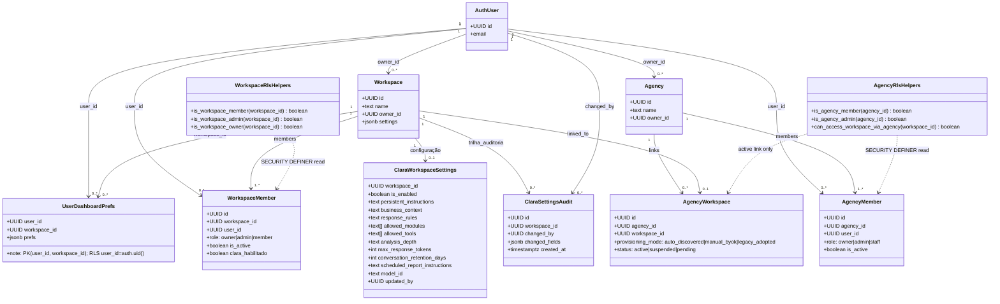

## Adoção do workspace legado (P0.2)

O workspace já existente é adotado sem cópia, movimentação ou alteração de dados.
O operador `service_role` cria somente o vínculo `AgencyWorkspace` com
`provisioning_mode = legacy_adopted`; a reversão remove exclusivamente esse vínculo.
A credencial GHL global permanece intacta até um cutover separado para o Vault.

## Meta Ads por sub-conta

Cada `Workspace` resolve sua própria credencial `meta` no Vault e informa o
próprio `workspace_id` nos syncs e backfills. `MetaAdsAccountDaily` é único por
`(workspace_id, account_id, date)`; novas escritas sem workspace são rejeitadas
por `CHECK`.

> ✅ **Estado atual (2026-07-16):** isolamento implementado e testado. Existe a
> tabela `WorkspaceMetaAdAccount` com seed do workspace Default, as constraints
> `UNIQUE` incluem `workspace_id`, as policies RLS são fail-closed e as edge
> functions validam o vínculo conta ↔ workspace. Aplicação em produção depende de
> auditoria dos dados legados. Ver
> [`docs/META-ADS-ISOLAMENTO-AUDITORIA.md`](META-ADS-ISOLAMENTO-AUDITORIA.md).
>
> 🔄 **Fase 15 (2026-07-17):** um workspace pode ter **N contas Meta ativas**.
> `WorkspaceMetaAdAccount` passa a ser também o escopo de iteração dos syncs
> (uma linha ativa por conta). A credencial `meta` continua única por workspace
> (um token) e carrega `metadata.ad_account_ids: string[]`; o RPC
> `save_workspace_credential` sincroniza a tabela atomicamente a partir dessa
> lista. Design: [`docs/FASE-15-MULTI-CONTA-META.md`](FASE-15-MULTI-CONTA-META.md).

Usuários de agência leem os totais apenas quando
`can_access_workspace_via_agency(workspace_id)` retorna verdadeiro.

### Entidades Meta Ads (modelo alvo)

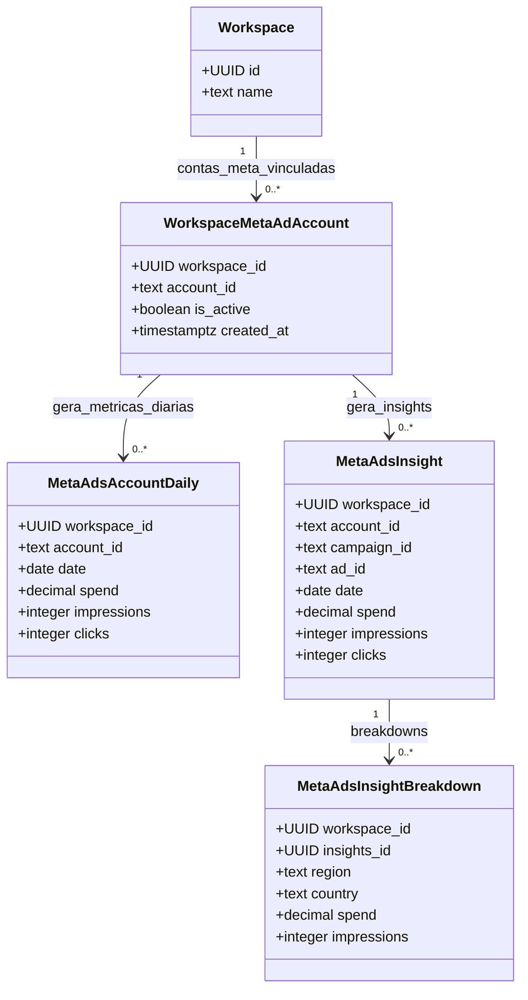

### Invariantes

- `WorkspaceMetaAdAccount` é a única fonte de verdade do vínculo conta ↔ workspace.
- `MetaAdsInsight` deve ser único por `(workspace_id, ad_id, date)`.
- `MetaAdsInsightBreakdown` deve ser único por `(workspace_id, insights_id, region, country)`.
- `workspace_id` é obrigatório em todas as tabelas Meta Ads; escritas sem ele são rejeitadas.
- O sync deve validar que a `account_id` retornada pela API Meta está cadastrada para o workspace; caso contrário, falha fechada e registra em log/dead-letter.
- **(Fase 15)** A lista `metadata.ad_account_ids` da credencial `meta` é apenas a interface de configuração: `save_workspace_credential` ativa/desativa as linhas de `WorkspaceMetaAdAccount` na mesma transação — nunca divergem.
- **(Fase 15)** Os syncs iteram somente contas `is_active = true` do workspace; falha de uma conta não aborta as demais (isolamento de falha por conta).
- **(Fase 15)** Save sem lista de contas preserva a lista existente (merge defensivo); remoção explícita desativa a linha e libera a conta para outro workspace.
- **(2026-07-20)** Guard anti-agregação: `processar_meta_ads_raw` e
  `processar_meta_ads_raw_region_breakdown` ignoram insights com
  `date_stop <> date_start` (contabilizados em `insights_agregados_ignorados`
  com `RAISE WARNING`) — uma linha agregada de N dias nunca mais vira dado
  diário silenciosamente. Instalada junto com a cura da janela 2026-07
  (DELETE dos 7 raws envenenados de 07/07–07/13 e de suas linhas infladas).

## Isolamento de dados de negócio (hardening P0/P2 — 2026-07-17)

Auditoria de `pg_policies` em produção (2026-07-17) confirmou 8 tabelas com
leitura/escrita cross-tenant (policies `USING (true)` ou "membro de qualquer
workspace"). As migrations `20260927000000` (P0) e `20260928000000` (P2)
fecharam o modelo:

- **P0 — ganharam `workspace_id NOT NULL` + policy por linha:** `ghl_tasks`,
  `maquina_de_conteudo`, `webhooks_ghl`, `reunioes`, `bot_context` (leitura por
  `is_workspace_member`, escrita por `is_workspace_admin`). Backfill por
  mapeamento real (`contato_id`→`contatos`, `location_id`→RPC fail-closed);
  triggers `set_workspace_id_*` fecham o gap para inserts novos.
  `stevo_whatsapp_calls` já tinha a coluna — só a policy foi reescrita.
- **`audit_log`:** `workspace_id` nullable; linha sem workspace é invisível para
  `authenticated` (só `service_role`); leitura por `is_workspace_admin`.
- **`app_config`:** permanece global por design, mas `anon` só lê o whitelist
  `key IN ('supabase_anon_key')` (fim do `USING (true)`).
- **P2 — fim da brecha `workspace_id IS NULL OR ...`:** 12 tabelas `weekly_*`,
  `ghl_users`, `ghl_calendars` e `meta_ads_sync_log` tiveram backfill +
  `SET NOT NULL` + policies somente por linha. `contatos` perdeu o DEFAULT
  "workspace mais antigo" (insert sem workspace agora falha).
- **Edge functions:** `bot-chat` filtra `bot_context` por workspace;
  `compute-weekly-reports`, `notion-creatives-sync` e
  `external-form-submissions` perderam os fallbacks de env global (fail-closed).

Cobertura provada pela suite: `workspace-isolation.test.ts` (139 testes, 99
tabelas com `workspace_id` na prova ampla) + `p0-cross-tenant-rls-fix.test.ts`
(30 testes) — 592/592 verde no banco de teste em 2026-07-17.

### Round 2 + sweep SECURITY DEFINER (2026-07-19) — o modelo NÃO tinha fechado em 17/07

A validação adversarial de 2026-07-18/19 (`docs/VALIDACAO-MULTITENANT.md`,
`docs/VARREDURA-CROSS-TENANT-COMPLETA.md` — 161 funções SECURITY DEFINER e 13
views auditadas) provou vazamentos que a rodada de 17/07 não cobriu. As
migrations `20261004000000`, `20261004000002`, `20261004000003` e
`20261006000000` fecharam o modelo de novo:

- **Policies PERMISSIVE combinam com OR:** a policy antiga "membro de QUALQUER
  workspace" anulava a nova correta. Correção = DROP da antiga (não basta criar
  a certa). Removidas em `contatos`, `oportunidades`, `comunicacoes`,
  `vendas_fechamento` e `meta_ads_raw_insights`.
- **Tabelas sistêmicas viraram service_role-only:** `ghl_opp_reconcile_runs`
  (runs "all_contacts" varrem todos os workspaces) e `ghl_custom_field_mappings`
  (legada pré-multi-tenant) perderam as 4 policies `authenticated`.
- **`meta_ads_backfill_controle` e `meta_ads_backfill_log`:** ganharam
  `workspace_id NOT NULL` + backfill fail-closed (guard `RAISE EXCEPTION` se
  restar órfão) + trigger `set_workspace_id_*` + policy por linha.
- **RPCs de dashboard/Clara com guard de posse (P0 confirmado com escrita
  cross-tenant real):** `get_lead_full`, `get_opp_id_by_email`,
  `buscar_lead_para_venda`, `auditoria_sdr_ia`, `list_weekly_email_schedules`,
  `delete_weekly_email_schedule` (admin + `ERRCODE 42501`).
- **⚠️ Efeito colateral do hardening acima, achado em 2026-08-07 —
  `auditoria_sdr_ia`:** ao adicionar o guard, as migrations `20261004000002` e
  `20261006000000` **reescreveram o corpo** da função, que passou a devolver uma
  linha por contato com `tipo='auditoria'`/`severidade='info'` em vez de detectar
  problemas. O guard ficou correto; a lógica de negócio se perdeu. Como o
  frontend descarta tipos fora do vocabulário, o painel exibiu **0 problemas em
  silêncio** por ~3 semanas. Restaurado + 7º tipo `reclamacao_lead` pela
  migration `20261018000000` (guard preservado; `anon` segue sem EXECUTE,
  verificado por `has_function_privilege`). **Regra:** guard novo em função
  existente parte de `pg_get_functiondef`, nunca de reescrita de memória.
- **Padrão de bypass de service_role vigente:** `auth.role() = 'service_role'`
  — **nunca `auth.uid() IS NULL`**, que é bypassável pela anon key sem sessão
  (bug residual da migration `20261004000002`, corrigido pela `20261006000000`,
  que é a versão vigente das 6 funções).
- **⚠️ Limite do padrão acima, achado em 2026-08-05:** `service_role` como
  passe-livre só é seguro em função que **também recebe o workspace** e o aplica
  como filtro. `buscar_lead_para_venda(p_telefone, p_email)` não recebia — e o
  chamador real (`crm-buscar-lead`) usa a service role key, então o guard era
  sempre verdadeiro e a busca varria **todos** os workspaces (reproduzido em
  produção: telefone só existente no tenant de demonstração retornou contato +
  oportunidades). Migration `20261015000000` troca a assinatura para
  `buscar_lead_para_venda(p_workspace_id, p_telefone, p_email)`: workspace
  obrigatório, sempre filtrado, `NULL` retorna vazio; `service_role` passa a
  significar apenas "pode informar o workspace", nunca "vê tudo". A assinatura
  antiga de 2 argumentos é **removida** (manter as duas criaria overload
  ambíguo — mesma classe de bug de `BUG-FIX-TAGS-NULL.md`).
  **✅ Aplicado em produção em 2026-08-05**, por rollout de 2 migrations sem janela:
  `20261015000000` cria a assinatura nova (a antiga segue viva) → deploy de
  `crm-buscar-lead` e `crm-sync-stats` → `20261015000001` remove a antiga. As duas
  assinaturas **não** colidem (`p_workspace_id` sem DEFAULT), o que foi verificado
  em produção antes de escolher o caminho. Prova pós-aplicação: telefone exclusivo
  do tenant de demonstração retorna 0 quando pedido como `Default` e 0 sem
  workspace; a busca real do desk segue funcionando.
- **RPCs Meta Ads fail-closed:** `analisar_meta_crm_cruzado`,
  `analisar_meta_ads_por_regiao` e `analisar_meta_ads` passaram a exigir
  `p_workspace_id` obrigatório + `is_workspace_member`, com
  `REVOKE` de `anon`/`PUBLIC` (`analisar_meta_crm_cruzado` era executável pela
  anon key sem login e agregava dados de todos os workspaces).
- **IDORs fechados:** `get_clara_campaigns_crm`, `get_clara_creatives_crm`,
  `buscar_reengajamento`, `update_weekly_email_schedule` (2 sobrecargas) e
  `send_weekly_report_test` ganharam guard de posse — antes, qualquer
  autenticado lia o dashboard Clara de outro tenant e podia trocar
  `recipient_emails` de agendamento alheio para exfiltrar relatório.
- **Sub-app Criativos:** `get_creative_metrics` (2 sobrecargas),
  `get_campaign_creatives`, `get_campaign_summary` e `get_objectives` ganharam
  guard + filtro de workspace no join Meta×CRM; view `v_creative_metrics`
  (BYPASSRLS, código morto) teve SELECT revogado de todos.
- **Funções legadas de evento (ev-jun-26/PG33), zero-workspace-aware:**
  `get_ranking_criativos`, `get_compras_evento`, `get_leads_do_criativo` e 9
  outras viraram service_role-only.
- **Oráculos de enumeração/LGPD fechados:** `get_user_workspace_ids`,
  `get_user_admin_workspace_ids`, `get_user_owner_workspace_ids` (revelavam
  workspaces de qualquer usuário) e `get_user_auth_events` (IP/data de login —
  PII) viraram service_role-only.
- **Views com bypass de RLS:** `v_creative_metrics`, `v_disparo_metricas`,
  `v_creative_status_counts`, `v_weekly_snapshots_status`, `v_weekly_dashboard`
  e `ai_conversation_stats` agora usam `security_invoker = true`.
- **Helpers de cron/worker/onboarding:** `mark_weekly_reprocess_queue_processed`,
  `setup_workspace_apps_and_permissions`, `sync_tags_from_webhook_*`,
  `get_cron_jobs`, `get_cron_runs` — service_role-only (callers reais já usam
  service_role).

**Riscos aceitos e documentados (não corrigidos):**
`get_contact_workspace_id` e `get_opportunity_workspace_id` permanecem
executáveis por `authenticated` (usadas em 30+ policies RLS; revogar quebraria
a RLS autenticada — ficam como "oráculo" de metadado). Ver
`docs/STATUS-MULTITENANT-2026-07-19.md`.

### Invariantes globais de autorização (vigentes desde 2026-07-19)

1. Bypass de service role em função SECURITY DEFINER é SEMPRE
   `auth.role() = 'service_role'` — nunca `auth.uid() IS NULL`.
2. RPC sensível não tem `EXECUTE` para `anon`/`PUBLIC`; grant mínimo é
   `authenticated` + guard `is_workspace_member` no topo.
3. Criar a policy correta não basta: a antiga permissiva precisa ser DROPada
   (OR de PERMISSIVE).
4. View que agrega dado de negócio usa `security_invoker = true`.
5. Tabela sistêmica de fila/log/run é service_role-only.

## Fluxo crítico: ingestão GHL (webhook → extração → fila de jobs)

Documentado aqui pela primeira vez em 2026-07-21, após os fixes
`20260929000000` (jobs morriam com `missing_tenant` — ~53k/dia na enchente de
14/07) e `20260930000000` (endpoint `/followers` era 404 eterno: 4.642.230
jobs `sync-opp-sdr` na história, 100% sem dados).

```mermaid
sequenceDiagram
  actor GHL as GoHighLevel
  participant Hook as webhook-ghl (edge)
  participant WH as webhooks_ghl
  participant Ext as extrair_dados_ghl_v2
  participant Enq as enqueue_ghl_api_job
  participant Jobs as ghl_api_jobs
  participant SDR as sync-opp-sdr (edge)
  participant API as GHL API

  GHL->>Hook: evento (contact/opportunity/...)
  Hook->>Hook: valida contrato (nunca bloqueia; desvio → webhook_contract_mismatches)
  Hook->>WH: INSERT payload + workspace_id (via location_id, fail-closed)
  Hook->>Ext: processa webhook
  Ext->>Ext: extrai contato/oportunidade/venda/comunicação/reunião
  Note over Ext: campos fora do contrato → oportunidades.custom_extra
  Ext->>Enq: PASSO 2.6 — job sync-opp-sdr (context com workspace_id + location_id)
  Enq->>Jobs: INSERT promovendo tenant do context para as COLUNAS
  Note over Jobs: worker multi-tenant: coluna > context; sem tenant → job morre fail-closed
  SDR->>Jobs: drain do job
  SDR->>API: GET /opportunities/{id} (NÃO /followers — endpoint inexistente, 404 eterno)
  API-->>SDR: objeto com array followers
  SDR->>SDR: resolve followers → ghl_users; fallback contatos.owner_name
```

Invariantes:

- **Webhook parcial nunca apaga atribuição** (desde 2026-08-03). O trigger
  `preservar_atribuicao_contato` (BEFORE UPDATE em `contatos`) intercepta toda
  escrita: valor novo preenchido sobrescreve (re-atribuição preservada), valor
  novo vazio/`NULL` mantém o que já existia. Cobre as 21 colunas de atribuição
  (`utm_*`, `tt_*`, `ad_id`, `ad_name`, `ad_group_id`, `fbclid`, `gclid`,
  `gbraid`, `wbraid`, `referrer`, `url`).
  Necessário porque **`extrair_dados_ghl` e `extrair_dados_ghl_v2` gravam
  `utm_source = COALESCE(NULLIF(TRIM(payload->>'utm_source'),''), NULLIF(TRIM(lastAttributionSource->>'utmSource'),''))`
  — sem fallback para o valor já gravado. O GHL manda webhook de atualização com
  `utm_*` vazias minutos depois da criação, e isso apagava a origem do lead (ele
  permanecia no pipeline, mas sumia de todo relatório de tráfego).
  O guard fica no trigger e **não** dentro das funções de extração: elas têm
  ~30 KB, já divergiram do repositório, e o trigger cobre v1, v2, crons, edge
  functions e backfills de uma vez. Reversão: `DROP TRIGGER`.
  Ver [`BUG-FIX-UTM-APAGADA-POR-WEBHOOK-VAZIO.md`](BUG-FIX-UTM-APAGADA-POR-WEBHOOK-VAZIO.md).
- Todo job enfileirado grava o tenant nas **colunas** `workspace_id`/`location_id`
  de `ghl_api_jobs` (a RPC promove do `context`; assinatura inalterada).
- `sdr_name` é primário e `contatos.owner_name` é o fallback documentado —
  todo `sdr_name` existente veio desse fallback, não da API.
- A validação de contrato no ingest é observabilidade pura: `webhooks_ghl`
  continua recebendo 100% do tráfego autenticado.

> ✅ **Regressão CORRIGIDA em produção em 2026-07-21:** a migration
> `20261006000001_contrato_webhook_campo_escape.sql` recriou
> `extrair_dados_ghl_v2` a partir do corpo antigo `20260827000000` e, por ter
> timestamp posterior, sobrescreveu os fixes de 20260906 (location aninhado),
> 20260929 (tenant no context) e 20260930 (URL sem `/followers`). A migration
> `20261009000000` restaurou o corpo completo de 20260930 **mantendo** o
> `custom_extra` do contrato (diff: apenas as 4 linhas de `custom_extra` +
> comment). Verificado por introspecção pós-aplicação: `ghl_payload_location_id`,
> `custom_extra` e `workspace_id` no context presentes; URL sem `/followers`.
> Efeito da regressão enquanto ativa: 9 jobs mortos por `missing_tenant` em 19/07.
>
> **A ingestão zerada de 20–21/07 NÃO foi causada por esta função:** a causa
> raiz era o gateway do Supabase com `verify_jwt = true` na `webhook-ghl` (a
> função não tinha seção em `supabase/config.toml`; o deploy v60 de 19/07
> aplicou o default). O gateway barrava todo POST sem `Authorization` antes de
> chegar na função — provado por probe (`UNAUTHORIZED_NO_AUTH_HEADER` vs.
> resposta própria da função com Bearer). Corrigido em 2026-07-21: seções
> `verify_jwt = false` no `config.toml` para as 6 funções públicas
> (`webhook-ghl`, `webhook-compras`, `crm-registrar-venda`, `crm-buscar-lead`,
> `external-form-submissions`, `telegram-bot`) + redeploy das 3 quebradas
> (`external-form-submissions` e `telegram-bot` estavam igualmente barradas).
> **Lição permanente: função pública de webhook sem seção no `config.toml` é
> bomba-relógio — o próximo deploy a derruba.**

## Contrato de webhook CRM OMNX (2026-07-19)

O mapeamento deixa de ser reativo e vira contrato fixo de chaves
(`docs/CONTRATO-WEBHOOK-CRM.md`). Campos do cliente fora do contrato não são
descartados silenciosamente: caem em `oportunidades.custom_extra` (jsonb,
zero-config, **só exibição passiva — nunca métrica/funil**, mesmo princípio de
`contatos.custom_fields`).

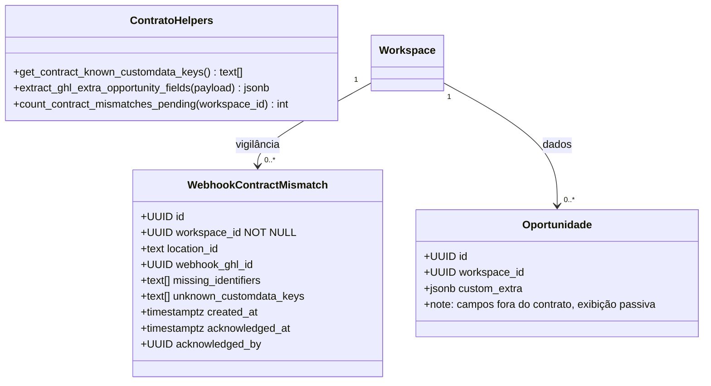

Invariantes: mismatch nunca bloqueia nem descarta o evento; só owner/admin do
workspace lê e reconhece mismatches (RLS por membership com
`role IN ('owner','admin')`); `anon` sem qualquer acesso; a contagem para a UI
passa por `count_contract_mismatches_pending` (SECURITY DEFINER, 7 dias, sem
expor payload).

## Fluxo crítico: sync Meta Ads multi-conta (Fase 15)

```mermaid
sequenceDiagram
  actor Admin as Owner/Admin
  participant RPC as save_workspace_credential
  participant Cred as workspace_integration_credentials
  participant Map as workspace_meta_ad_accounts
  participant Sync as sync-meta-ads
  participant Meta as Meta Graph API
  participant DB as Tabelas meta_ads_*

  Admin->>RPC: meta token + metadata.ad_account_ids
  RPC->>RPC: normaliza ids (act_\d+) e valida formato
  RPC->>Cred: upsert credencial (Vault + metadata com lista)
  RPC->>Map: ativa ids da lista; desativa ausentes (mesma transação)
  Note over RPC,Map: falha em qualquer passo = rollback de tudo
  loop a cada execução (cron ou manual)
    Sync->>Cred: resolve token meta (Vault, fail-closed)
    Sync->>Map: lê contas is_active do workspace
    loop para cada conta ativa
      Sync->>Meta: insights da conta (params.account_id)
      Meta-->>Sync: dados ou erro
      Sync->>DB: raw + processamento com workspace_id + account_id
      Note over Sync: erro de uma conta não aborta as demais
    end
  end
```

**Evolução para a abordagem 2 (uma credencial por conta):** adicionar
`credential_id uuid NULL` em `WorkspaceMetaAdAccount`; o sync resolve o token por
linha em vez de um token único do workspace. Contrato de leitura e formato das
tabelas de dados permanecem inalterados (já são por conta).

## Fluxo crítico: registro de venda omnx-desk isolado por tenant

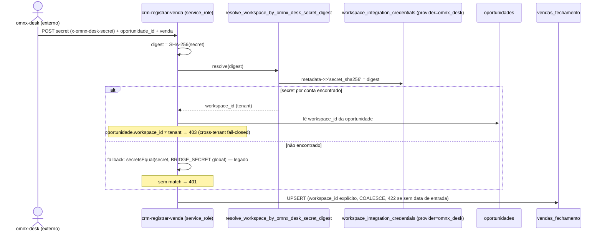

Isolamento real = "a oportunidade precisa pertencer ao workspace dono do secret".
O secret global é transição (comportamento atual, sem regressão); aposentar após
seedar o 1º secret por conta. RPC é `service_role`-only (ver `NIVEIS-DE-ACESSO.md`).
Desde a migration `20261008000000`, o cadastro do secret por conta é **self-service**
(Administração → Integrações → omnx-desk): `save_workspace_credential` aceita o
provider `omnx_desk` e grava `metadata.secret_sha256` na mesma transação do segredo
no Vault — digest e segredo nunca divergem.

## Fluxo atual confirmado: takeover indevido

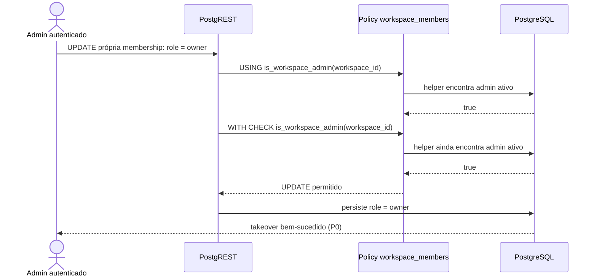

## Fluxo alvo: gestão sem elevação de privilégio

```mermaid
sequenceDiagram
  actor Actor as Owner ou Admin autenticado
  participant API as PostgREST
  participant RLS as RLS workspace_members
  participant Guard as Trigger de transição
  participant DB as PostgreSQL
  Actor->>API: UPDATE membership
  API->>RLS: valida acesso ao workspace
  RLS-->>API: somente owner/admin ativo
  API->>Guard: compara papel do ator, OLD e NEW
  alt ator é owner
    Guard->>DB: permite mudança de papel/estado
    Guard->>DB: recusa remover ou desativar último owner ativo
  else ator é admin
    Guard->>DB: recusa role, user_id e workspace_id diferentes
    Guard->>DB: recusa alterar owner
    Guard->>DB: permite somente campos operacionais autorizados
  else member ou inativo
    Guard-->>API: recusa
  end
  API-->>Actor: sucesso ou erro de autorização
```

## Invariantes da correção

1. Todo workspace mantém pelo menos um membro `owner` ativo.
2. Apenas owner pode alterar `role`, `workspace_id` ou `user_id` de uma membership.
3. Admin não promove a si mesmo, não rebaixa/desativa owner e não transfere membership entre workspaces.
4. `agency_members` segue escrita apenas por `service_role`.
5. Tabelas de negócio continuam isoladas por `workspace_id` e RLS.

## Validação necessária

Modelo validado pelo dono em 2026-07-13: **somente owner altera papéis ou afeta
outro owner**; admin gerencia membros sem poder mudar ownership.

## Fluxo crítico: assistente de mapeamento GHL por campo

```mermaid
sequenceDiagram
  actor Admin as Owner/Admin
  participant UI as GhlMappingAssistant
  participant Discovery as discover-ghl-config
  participant AI as ai-ghl-mapping
  participant Vault as Credencial OpenRouter do workspace
  participant Qwen as OpenRouter Qwen
  participant DB as ghl_field_mappings

  Admin->>UI: Detectar campos no GHL
  UI->>Discovery: discovery autenticada
  Discovery-->>UI: campos de contato/oportunidade
  UI->>UI: remove campos já mapeados
  Admin->>UI: escolhe campo + explica uso
  UI->>AI: target(field, source, key) + descrição
  AI->>AI: valida membership owner/admin e target na discovery
  AI->>Vault: resolve chave por workspace_id (fail-closed)
  AI->>Qwen: campo alvo + categorias permitidas
  Qwen-->>AI: proposta JSON
  AI->>AI: filtra para chave alvo e logical_name permitido
  Note over AI: outcome = mapped | not_in_vocabulary | unclear; explanation da IA é descartada quando não mapped (evita contradição na UI)
  AI-->>UI: no máximo uma proposta de campo + outcome
  Admin->>UI: confirma salvamento
  UI->>DB: upsert somente do campo escolhido
```

## Fluxo crítico: Clara isolada por conta

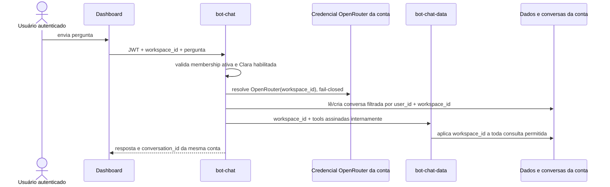

Invariantes: `workspace_id` é obrigatório nas novas conversas e sessões; uma
conversa legada sem conta não é reutilizada; SQL livre e a análise regional ficam
indisponíveis até terem contrato de isolamento por conta.

## Fluxo crítico: gestão da chave OpenRouter

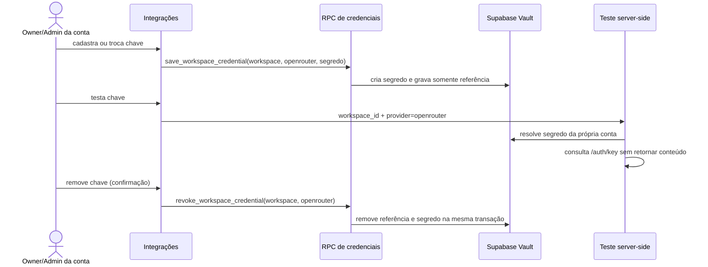

## Fluxo crítico: telemetria e chamadas internas da Clara

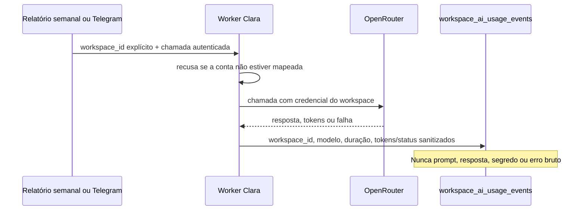

## Fluxo crítico: configuração isolada da Clara

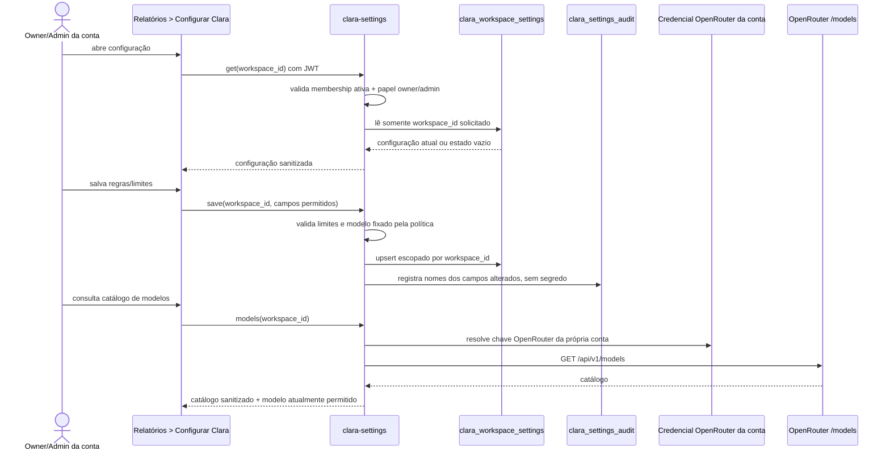

Invariantes: somente owner/admin ativo lê ou altera a configuração; `workspace_id`
vem do pedido mas é sempre validado contra membership antes de qualquer leitura;
o catálogo nunca leva a chave ao cliente; auditoria guarda só metadados da
alteração; e, enquanto a política do projeto estiver vigente, `model_id` fica
restrito a `qwen/qwen3.6-plus`.

## Criativos: coluna "Legenda do anúncio" (2026-09-01)

Migration `20261023000000` — `notion_creatives.ad_caption TEXT` (aditiva,
idempotente, anulável, sem default e sem backfill).

**Por que coluna nova e não reaproveitar `copy_text`.** A reunião de 2026-08-28
separou explicitamente as duas coisas: `copy_text` é o texto da **postagem**
(MEL-07, 00:38:22) e `ad_caption` é o texto que aparece **acima do criativo no
anúncio veiculado** (MEL-08, 00:38:51). Juntar perderia informação.

**Sem impacto em RLS ou em escrita existente.** As policies de `notion_creatives`
são por linha, não por coluna; nenhum caminho de escrita anterior muda de
comportamento. O sync do Notion não grava esta coluna — ela é preenchida só pelo
formulário nativo.

**Janela deploy × migration (importante).** Neste projeto o deploy do frontend e
a aplicação de migration são passos separados. Enquanto `20261023000000` não
estiver aplicada, o frontend que já está no ar escreveria numa coluna
inexistente, e **todo cadastro e toda edição de criativo falhariam**. Por isso
`useCreateCreative`/`useUpdateCreativeFull` têm um guard: se o PostgREST devolver
`PGRST204`/`42703` citando `ad_caption`, a escrita é reenviada sem o campo e o
usuário recebe um aviso explícito de que só a legenda não foi salva. O guard é
temporário e pode ser removido depois que a migration estiver em produção.

## Sincronização manual do Notion (Criativos) — 2026-09-01

**Problema.** O botão "Sincronizar" da Biblioteca de Criativos chamava a edge
function `notion-creatives-sync` direto do navegador. Depois do hardening
multi-tenant isso é impossível por construção, em duas camadas:

1. `requireServiceRoleCaller` (guard de cron, `docs/SEGURANCA-CRON-CALLER-GUARD.md`)
   rejeita o JWT do usuário logado → **401**;
2. a function exige `workspace_id` no body (fail-closed do isolamento) e o
   frontend não mandava → **400**.

O usuário via só "Erro ao sincronizar" e concluiu que o sync travava em 1.000
registros (reunião de criativos de 2026-08-28, BUG-02). Os dois fatos eram
independentes: o 1.000 era truncamento de **leitura** no frontend (teto
`max_rows` do PostgREST), corrigido em código, sem tocar no banco.

**Correção.** Migration `20261022000000` — RPC
`enqueue_notion_creatives_sync(p_workspace_id uuid, p_database_type text)`,
`SECURITY DEFINER`. Ela é a ponte que faltava, **sem afrouxar o guard**: valida o
chamador e dispara a function pelo lado do banco, com a `service_role_key` que
nunca chega ao navegador. É o mesmo caminho do cron `notion_sync_creatives_job`
(`net.http_post` + `get_secret`), só que para um workspace e sob demanda.

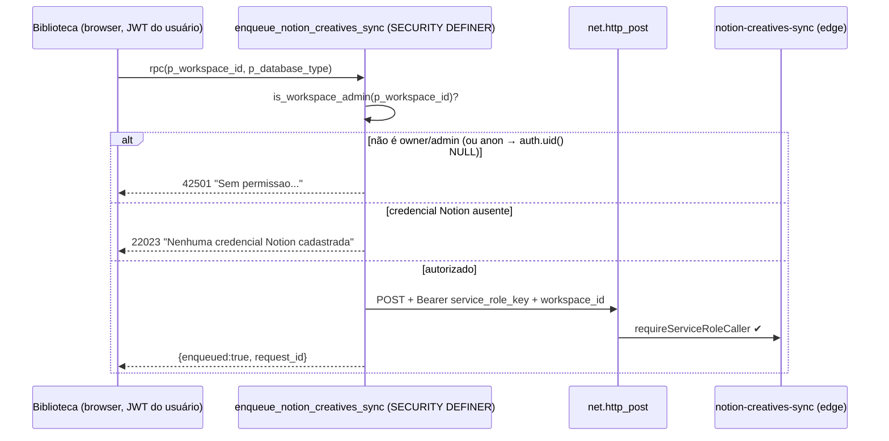

**Invariantes.**

- `p_workspace_id` é sempre validado por `is_workspace_admin()`, que resolve
  `auth.uid()` internamente — não existe caminho para pedir sync de workspace
  alheio, e `anon` cai fora porque `auth.uid()` é NULL.
- EXECUTE revogado de `PUBLIC`/`anon`; concedido a `authenticated` e `service_role`.
- O guard `requireServiceRoleCaller` da edge function **permanece intacto**: a
  única porta nova é a RPC, e ela checa papel antes de emprestar a chave.
- O disparo é assíncrono (`net.http_post` enfileira). A UI diz "sincronização
  iniciada", nunca "concluída".

## Financeiro da venda: quem é a fonte de verdade (2026-08-31)

`vendas_fechamento` recebe escrita por **dois caminhos** e eles disputavam as
mesmas colunas:

1. **`crm-registrar-venda`** (ponte omnx-desk → CRM) — faz UPSERT por
   `oportunidade_id` com o cronograma completo em `pagamentos` e deriva
   `valor_entrada` / `numero_parcelas` / `valor_parcela` a partir dele.
2. **`extrair_vendas_fechamento_do_webhook`** (trigger AFTER INSERT em
   `webhooks_ghl`) — lê os mesmos campos de `payload->'customData'`, preenchidos
   à mão pelo closer no GHL.

`valor_faturado` é coluna **GENERATED ALWAYS**
(`valor_entrada + numero_parcelas × valor_parcela`), então qualquer escrita nessas
três colunas redefine o faturamento exibido em todos os painéis.

Na prática os campos do GHL são digitados **em milhares** (`"20"` para R$ 20.000,
`"5.6"` para R$ 5.600). Como o trigger rodava depois e sobrescrevia via
`COALESCE(EXCLUDED..., existente)`, o valor cru vencia o valor bom do desk —
duas vendas de R$ 48.000 de agosto/2026 apareciam como R$ 48,00 e R$ 28.020,00.

**Regra a partir da migration `20261021000000`:** quando a linha tem
`origem IN ('omnx_desk','empiredesk')`, o trigger **preserva** os cinco campos
financeiros (`forma_pagamento`, `valor_entrada`, `numero_parcelas`,
`valor_parcela`, `data_pagamento_entrada`). Para `origem = 'ghl'` nada muda: o
webhook segue como fonte única. Todos os demais campos (endereço, contrato,
observações) continuam com o COALESCE de antes, nos dois caminhos.

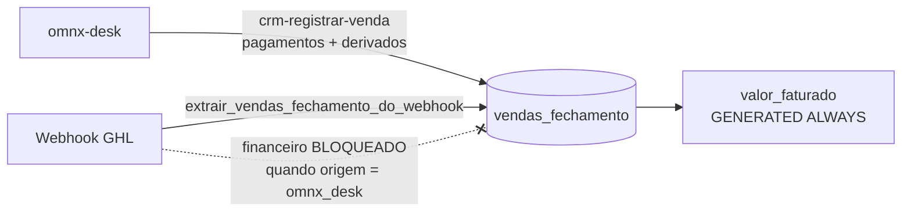

## RPC: métricas de Campanhas WhatsApp por período (2026-07-22)

O app "Disparos" foi renomeado na UI para **Campanhas WhatsApp** (slug, rotas
`/disparos` e tabelas `disparos*` inalterados — só labels visíveis mudaram) e o
dashboard ganhou filtros de período, status, tipo de mensagem e busca.

- **`rpc_disparo_metricas(p_from timestamptz, p_to timestamptz)`** — mesma
  agregação de `v_disparo_metricas`, mas com filtro opcional de período sobre a
  data de aplicação da tag de trigger (`p_from` inclusivo, `p_to` exclusivo;
  NULLs = sem filtro, equivalente à view). `SECURITY INVOKER`: o isolamento por
  workspace vem da RLS de `disparos`, `disparo_tags`, `contatos` e
  `whatsapp_pricing_config`. `EXECUTE` revogado de `anon`/`PUBLIC`, grant para
  `authenticated` e `service_role` (invariantes globais #2 e #4).
- **Performance (medido em produção, 2026-07-22):** a primeira versão
  (`(p_from IS NULL OR ...)`) estourava o statement timeout do PostgREST sem
  filtro. A forma vigente usa range contínuo `COALESCE(p_from, '-infinity')` e
  agregação por `unnest` único das tags do contato + hash join (em vez de
  `contato_tem_tag` por combinação contato × tag). Cache quente: ~1-2s; a view
  antiga levava ~5s no mesmo workspace (11k contatos). Breadcrumb do app usa
  `ROUTE_LABELS['disparos'] = 'Campanhas WhatsApp'` (sem entrada, o fallback
  capitalizava a URL e mostrava "Disparos").
- Limitação herdada e documentada em `20260705000018`: a "data do trigger" é
  `contatos.updated_at` (melhor aproximação sem coluna dedicada de "tag
  aplicada em") — uma mudança de tag posterior move o contato de período.
- Filtros de status/tipo/busca são client-side sobre o resultado da RPC; só o
  período precisa agir na agregação no banco.

## Hardening: job cohort da semana atual (2026-07-23)

`weekly_reports_current_week_cohort_job()` é um job de cron interno. A função
roda como `SECURITY DEFINER`, usa somente objetos com schema explícito e fixa
`search_path = pg_catalog`; `EXECUTE` é revogado de `PUBLIC`, `anon` e
`authenticated`, permanecendo apenas para `service_role`. O cron continua
executando como proprietário do banco, sem precisar de permissão pública.

## RPC: campanhas `[cp]` órfãs (2026-07-31)

`listar_campanhas_cp_orfas(p_workspace_id uuid)` devolve as tags com prefixo
`[cp]` presentes em `contatos` do workspace que **não** têm linha
correspondente em `utm_campaigns` (comparação por `lower(nome) = lower(tag)`),
com contagem de contatos e primeira/última data.

- **Por que existe:** campanha `[cp]` não é casada por `utm_campaign`, e sim
  pela tag do contato contra o `nome` cadastrado — comparação de texto inteiro,
  sensível a espaço e acento (`matchesCampaign`, `eb-dash2/src/hooks/useAquisicao.ts`).
  Tag sem cadastro **desaparece do filtro sem erro e sem log**; em 2026-07-31
  havia tags nessa situação escondendo leads havia meses. A RPC torna a falha
  visível na aba Traqueamento → Cods UTM → UTM Campaign, com ação de cadastro
  na própria tela.
- **Autorização:** `SECURITY DEFINER` com `search_path = public` e checagem
  explícita de `public.is_workspace_member(p_workspace_id)` (`service_role`
  isento); retorna vazio — nunca erro — para não membro. `EXECUTE` revogado de
  `PUBLIC` **e de `anon` explicitamente** (invariantes globais #2 e #4; um
  `REVOKE ... FROM PUBLIC` não remove grant explícito de `anon`), com grant
  para `authenticated` e `service_role`.
- **Fonte:** `supabase/migrations/20261011000001_rpc_campanhas_cp_orfas.sql`.
  Migration irmã `20261011000000_fix_campanhas_cp_invisiveis.sql` corrige o
  passado (renomes de grafia + cadastro das tags com ≥ 50 contatos); só dados,
  sem DDL.

## Sync de conversas GHL por tenant (2026-08-04)

O sync de mensagens do GHL (`sync-ghl-conversations` → `comunicacoes`) ficou
**21 dias parado em produção** (última mensagem do workspace real: 2026-07-14
12:11). Duas causas encadeadas, mais três defeitos silenciosos descobertos na
investigação.

**Causa 1 — guard de `service_role` desatualizado (HTTP 401).** O lote de
Edge Functions deployado em 2026-07-14 12:56 levou a v1.0 de
`_shared/require-service-role.ts`, que compara o token com a env var
`SUPABASE_SERVICE_ROLE_KEY`. A v1.2 (claim `role` do JWT, imune a rotação de
chave) entrou no git em 2026-07-15 — um dia **depois**. Como o valor no Vault
(`get_secret('service_role_key')`) e a env do runtime divergiram, as 12 funções
congeladas naquele deploy passaram a responder 401 a **todo** disparo de cron.
Corrigido por **redeploy** em 2026-08-04 (sem migration). Verificação: 401 por
ciclo caiu de 4 → 1 (o remanescente era o próprio `sync-ghl-conversations`,
deixado por último de propósito).

**Causa 2 — cron sem tenant.** `sync_ghl_conversations_job()` disparava **uma**
chamada com body `{"mode":"incremental"}`, sem `workspace_id` nem
`location_id`. A função exige tenant desde a Fase 2 e falha fechado. Agora a
função itera `workspace_integration_credentials (provider='ghl')` ×
`ghl_integration_settings (is_active)` e dispara **uma chamada por workspace** —
mesmo padrão de `sync_ghl_users_job` (`20260808000000`) e dos crons Meta
(`20260728000000`). `timeout_milliseconds := 150000` porque o default do
`pg_net` (5s) descartaria a resposta e deixaria o log preso em `running`.

**Defeitos silenciosos corrigidos junto:**

1. `ghl_conversations_sync_log` não tinha `workspace_id`. O marco temporal do
   incremental (`getLastIncrementalSyncTime`) filtrava só por `mode`/`status`:
   com 2+ workspaces, o primeiro a terminar avançava o relógio do outro, que
   perdia a janela **permanentemente** (o incremental nunca volta atrás).
   Coluna adicionada (nullable de propósito — o log abre antes de resolver a
   credencial, e falha de tenant também precisa ser registrada) + índice
   `idx_ghl_conv_sync_log_ws_mode_finished`.
2. O CHECK de `mode` aceitava só `incremental`/`full_backfill`. O modo
   `backfill_by_contact` — usado pelo caminho do webhook de mensagem —
   **violava a constraint**, então o INSERT do log falhava e a execução rodava
   sem registro nenhum. CHECK ampliado.
3. `finishSyncLog` descartava `stats.last_error`: um upsert que falhava em
   **todas** as conversas ainda terminava como `success` com `error_message`
   NULL. Foi o que manteve o problema invisível. Agora o erro é persistido.

**Status `partial` (novo).** Execução que estoura o orçamento com janela por ler
não pode virar marco temporal — marcada como `success`, ela avançava o relógio
por cima de dados não lidos. `partial` não entra no filtro de
`getLastIncrementalSyncTime`.

**Invariantes da correção (Edge Function):**

- `comunicacoes.workspace_id` é escrito **explicitamente** por
  `mapMessageToRow`. A coluna é `NOT NULL` e o trigger
  `set_workspace_id_comunicacoes` só resolve via `contato_id`; quando a conversa
  é de contato que ainda não existe em `contatos`, `contato_id` é NULL, o
  trigger devolve NULL e o upsert do **lote inteiro** era rejeitado.
- Toda leitura de `contatos` filtra por `workspace_id` (`syncPage`,
  `syncByContactBatch`, `syncSingleContact`). Sem isso o backfill varria a base
  inteira — inclusive os contatos fictícios do tenant de demonstração — contra a
  location real do cliente.
- `backfill_by_contact` com `contactId` faz re-sync **daquele** contato
  (`syncSingleContact`). Antes o `contactId` do webhook era ignorado e o lote por
  offset sincronizava sempre o primeiro contato da tabela.
- Paginação do incremental é por **cursor de data**, não por `?page=N` (a
  paginação da API GHL é quebrada: toda página devolve as mesmas conversas). O
  cursor é a data da última conversa **efetivamente processada**, e a leitura é
  `sort=asc` — com `desc` o cursor não avança.
- `deadline` verificado **dentro** do laço de conversas, não só entre páginas.
  Sem isso a plataforma mata a função no meio, o log fica preso em `running`
  para sempre e o marco nunca avança (observado no 1º ciclo pós-correção: 2.157
  mensagens gravadas, execução morta aos ~3min).
- Janela do incremental tem **teto de 24h**. Sem o teto, uma parada longa faz o
  incremental tentar puxar semanas em uma execução, estourar e falhar de novo a
  cada ciclo. Buraco maior que 24h é trabalho do backfill.

**Fontes:** `supabase/migrations/20261013000000_fix_sync_ghl_conversations_tenant.sql`,
`supabase/functions/sync-ghl-conversations/index.ts`,
`supabase/functions/_shared/require-service-role.ts`,
`docs/COMUNICACOES-GHL-SYNC.md`.

**Pendências registradas:** (a) backfill das ~31 mil mensagens de 14/07 a 04/08;
(b) alinhar `get_secret('service_role_key')` com a env do runtime — enquanto
divergirem, qualquer deploy que reintroduza o guard v1.0 quebra em silêncio;
(c) workspace `Burn-in Interno` tem credencial `ghl` ativa apontando para uma
location real com conversa viva, sem nenhum contato local — decidir se remove.

## Redesenho da fila de discagem (2026-08-04)

`recalcular_discagem_scores()` (cron `recalcular-discagem-scores`, jobid 62, a
cada 5 min) alimenta `discagem_scores`, a fila que o SDR disca. Medição em
produção: **97,9% da fila tinha apenas DOIS scores** (3.357 linhas com 200 e 721
com 95), ou seja, a ordem entre milhares de leads era arbitrária.

**Causa raiz:** todos os componentes do score de cadência eram cegos. `sinal_resposta`
e `recencia` usavam janela de 24h; `engajamento_canal` e `fadiga` contavam toques
dos últimos 14 dias — mas o lead mediano da fila tem ~162 dias e ~153 dias desde
o último toque. Todos zeravam, sobrando só `qualificacao_mql` (1000 ou 300), que
sozinho produzia os dois valores. O sinal existia e não era lido: 764 leads nunca
tocados, 1.781 que já responderam alguma vez.

**Redesenho:** janelas curtas trocadas por histórico completo — sinal de
engajamento 30% (já respondeu alguma vez, decai, piso 300), pausa respeitada 25%
(nunca tocado = 1000; tocado há <2d = 0), fadiga histórica 20%, qualificação em
degraus sql/mql/conectado/nmql 15%, frescor 10%. Faixas não se sobrepõem:
`horario_marcado` 900–1000, `respondeu` 800–899, `lead_novo` 600–799, `cadencia`
0–599. Resultado simulado: **367 scores distintos (vs 40); 349 só na cadência (vs 2)**.

**Mudança estrutural:** a fila passa a ser RECONSTRUÍDA a partir de uma tabela
temporária, em vez de DELETE + UPSERT. Isso elimina por construção a classe de
bug em que a condição existia no DELETE mas não no WHERE do INSERT — era o caso
de "já ligou hoje", cujo DELETE era anulado pelo INSERT do mesmo run (5 leads
medidos na fila hoje já tinham recebido ligação no dia).

**Invariantes novas da fila** (tudo no WHERE da construção, não em DELETE avulso):
lead sem telefone não entra (95); tag de bloqueio explícito não entra (88); quem
já pagou não entra — cruzando `vendas_fechamento.data_pagamento_entrada`, a regra
canônica do projeto, e não `status`, que deixava passar (1); duplicata por
`(contato_id, escopo)` colapsa via `DISTINCT ON` (285 linhas excedentes); linha
com `status` NULL some — o antigo `WHERE o.status != 'open'` nunca a removia,
porque `NULL != 'open'` é NULL e não TRUE.

**Armadilha de linguagem corrigida (achado da revisão):** `GREATEST`/`LEAST`
**ignoram NULL** no PostgreSQL, então `COALESCE(GREATEST(0, <expr com NULL>), default)`
nunca dispara o default — `GREATEST(0, NULL)` é 0. A versão anterior da migration
caía nisso e lia "nunca tocado" como "tocado agora mesmo", invertendo exatamente
o público que o redesenho quer priorizar. Forma correta: testar o NULL
explicitamente com `CASE` ANTES de aplicar o piso.

**Performance:** a condição `(t.deleted = false OR t.deleted IS NULL)` em
`ghl_tasks` impedia o planner de usar o índice parcial
`ghl_tasks_contato_id_idx (WHERE NOT completed AND NOT deleted)` — o `OR` era
código morto (`deleted` é NOT NULL, 0 linhas NULL em produção) e custava 9x mais
I/O: **410 ms / 119.345 buffers → 90 ms / 13.017 buffers**. Recálculo completo:
~735 ms → ~400 ms, sem índice novo. Índice em `comunicacoes` foi deliberadamente
NÃO criado (não cobre `channel`, logo não evita o heap — seria só amplificação de
escrita na tabela de ingestão mais quente).

**Segurança:** a função cria tabela TEMP e é `SECURITY DEFINER`; `search_path`
passou a ser `public, pg_temp` — sem declarar `pg_temp`, ele é pesquisado
implicitamente PRIMEIRO, que é o vetor clássico de sequestro de nome.
`EXECUTE` revogado de `PUBLIC`/`anon`/`authenticated`, mantido em `service_role`.

**`buscar_reengajamento` estava 100% quebrada:** fazia `SELECT c.body`, mas a
coluna em `comunicacoes` é `mensagem_body`. Toda chamada levantava erro e o
frontend engolia (`if (rErr) return`), então o bloco "Reengajar" nunca renderizou
desde que foi escrito. Corrigida junto, com `Recuperação` incluída nos pipelines
e o limiar de "esgotado" ajustado de 6 para 8 (o campo agora conta toques
históricos, não ligações em 14 dias).

**Frontend** (`useDiscagemScore.ts`, `DiscagemTab.tsx`): a fila era buscada sem
paginação e o PostgREST corta em 1.000 — com o filtro de SDR aplicado DEPOIS do
corte, sobre dados ordenados por score DESC. Em `Default/recuperacao` (2.076
linhas) isso deixava **1.076 leads invisíveis**. Agora pagina com `.range()` e
ordem determinística (`score DESC, oportunidade_id ASC` — sem o desempate um lead
podia repetir entre páginas ou sumir de todas). O contador "Ligações hoje" passou
a filtrar `workspace_id`: a view `comunicacoes_com_remetente` não expõe a coluna
e junta `ghl_users` sem filtro de workspace, então somava contas para quem tem
acesso a duas.

**Fonte:** `supabase/migrations/20261014000000_discagem_score_redesenho_cadencia.sql`.

> ⚠️ **Uma invariante desta seção foi substituída em 2026-08-26** — ver a seção
> seguinte: a deduplicação deixou de ser por `(contato_id, escopo)` e passou a
> ser só por `contato_id`. A fila também passou a excluir quem tem hora marcada,
> o que nenhuma versão desde 2026-06-28 fazia.

---

## Fila de discagem: agendamento e unicidade por contato (2026-08-26)

Aplicada em produção em 2026-08-26 (migration `20261020000000`). Três reclamações
do time de pré-vendas no mesmo dia, com duas raízes distintas.

**Lacuna (casos "está agendada" e "já fez a reunião, está em perdido").** Desde
2026-06-28 **nada na fila olhava para agendamento**. A regra
`AND o.data_agendamento_vendas IS NULL` foi criada em `20260627100000` e removida
**de propósito no dia seguinte** por `20260628010000`, com justificativa
registrada: o campo produzia falso-negativo — uma oportunidade nova podia nascer
já com o valor copiado do histórico pelo webhook e sumia da fila sem motivo. A
aposta feita ali foi que `pipeline_name` bastaria. O redesenho de 2026-08-04 não
mexeu nisso, só manteve o comportamento de junho.

**Por que a aposta não se sustenta.** Ela pressupõe um contato = uma
oportunidade. No caso reportado a lead tinha **duas** oportunidades abertas: o
agendamento em `Auto Agendamento` e a fila exibindo a outra, em estágio
"Chegada" e legitimamente ainda em pré-vendas — o `pipeline_name` dela está
correto. Nenhum filtro por linha resolveria, nem o original. Por isso o
compromisso passou a ser avaliado **por contato**, na CTE `compromissos`.

**Qual sinal foi usado — e a armadilha que quase passou.** A primeira versão
desta correção usava só o appointment sincronizado
(`data_reuniao_agendada_ts` + `appointment_status`), com o argumento de que é
"fato vindo da API" e não campo de pipeline sujeito a cópia por webhook. O
argumento é bom; o dado, não. Contagem sobre as 3.685 linhas da fila antes de
aplicar:

| Campo | Linhas preenchidas |
|---|---|
| `data_reuniao_agendada_ts` | 32 |
| `appointment_status` | 21 |
| `data_agendamento_vendas` | 84 |
| `data_agendamento_reuniao` | 103 |

O sinal "correto" está praticamente vazio e **não pegaria nem o caso
reportado**: a lead agendada tem `data_agendamento_reuniao`,
`data_agendamento_vendas` e `data_auto_agendamento` em 25/08, e
`last_appointment_sync_at` **NULL** — o `sync-appointment-dates` nunca passou por
ela. O sinal real disponível hoje é a data do agendamento vinda do pipeline.

**Como o falso-negativo de junho é neutralizado:** por uma **janela de 14 dias**.
O problema de 2026-06-28 era oportunidade nova nascer com a data *copiada do
histórico* — data velha, logo fora da janela, logo não bloqueia. O campo volta a
ser usado, mas só enquanto o compromisso é plausivelmente real.

| Situação | Sai da fila? |
|---|---|
| `data_reuniao_agendada_ts` conhecido e ainda à frente (tolerância de 2h) | sim, em qualquer escopo |
| só a data do agendamento, dentro de 14 dias, sem desfecho | sim, em qualquer escopo |
| agendamento com mais de 14 dias e sem desfecho | **não** — dado velho não congela lead |
| `data_no_show` / `data_no_show_vendas` preenchida | **não** — devolver ao SDR é o trabalho |
| `appointment_status` = `cancelled` / `canceled` / `noshow` / `invalid` | **não**, mesma razão |
| `appointment_status` = `rescheduled` | sim — remarcada ainda é hora marcada |
| reunião realizada (`data_reuniao_realizada`, `data_realizacao_vendas`, `showed`, `completed`) | sai **só de pré-vendas**; Recuperação continua vendo, por design |

As duas grafias de "cancelada" estão na lista porque o GHL emite ambas.

**Escopo duplicado (caso "batendo e voltando de rec pra 1º contato").** O
`DISTINCT ON` usava `(contato_id, escopo)`, então um contato com uma oportunidade
em `Recuperação` e outra em `Pré-Vendas MQL` entrava nas **duas filas ao mesmo
tempo** — 110 contatos em produção. Com recálculo a cada 5 min e uma tela por
escopo, duas pessoas diferentes podiam ligar para o mesmo lead no mesmo dia. A
chave passou a ser só `contato_id`, com desempate `(escopo = 'pre_vendas') DESC`.

**Resultado medido, antes → depois:**

| | Antes | Depois |
|---|---|---|
| Fila pré-vendas | 1.580 | 1.546 |
| Fila recuperação | 2.105 | 1.997 |
| Contatos em duas filas | 110 | **0** |
| Contato repetido na fila | — | **0** |

**Custo:** `compromissos` é uma agregação por contato sobre `oportunidades`
(~4.800 linhas), lida uma vez por execução, contra os ~400 ms do recálculo
completo num cron de 5 min. Desprezível.

**Fonte:** `supabase/migrations/20261020000000_discagem_excluir_agendados_e_dedup_por_contato.sql`.

---

## `ghl_users`: unicidade por conta e sync isolado (2026-08-25)

**Migration:** `20261019000000_ghl_users_unique_por_workspace.sql` — aplicada em
produção em 2026-08-25, junto com o deploy da edge function `sync-ghl-users`.

**Constraint.** `UNIQUE (ghl_id)` global → índice parcial
`UNIQUE (workspace_id, ghl_id) WHERE workspace_id IS NOT NULL`. Nenhuma FK
dependia da unicidade antiga (só `auth_user_id` e `workspace_id` são FKs).

**Por quê.** Uma mesma pessoa pode ter acesso a dois locations do GHL e aparecer
na listagem de usuários dos dois. Com unicidade global cabia só uma linha — e o
sync de cada conta a puxava para si (`UPDATE ... SET workspace_id`), transferindo
o time real para a sub-conta de teste.

**Fluxo corrigido de `sync-ghl-users`** (uma execução por workspace, disparada
por `sync_ghl_users_job()` iterando `workspace_integration_credentials`):

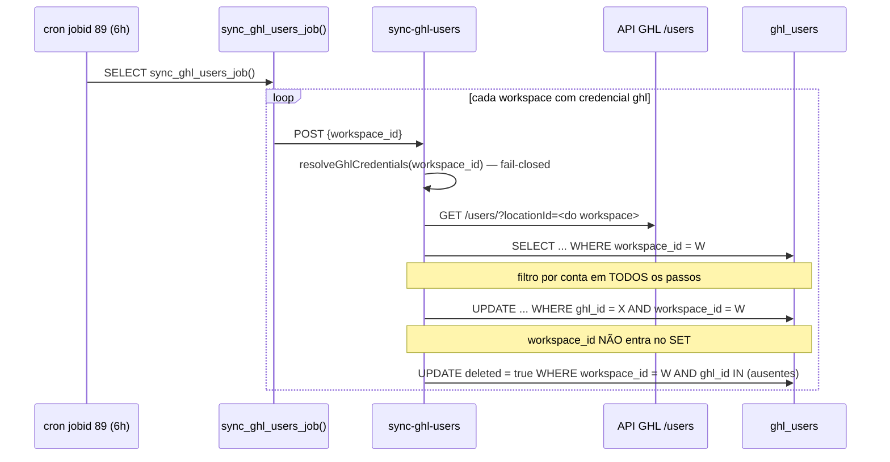

**Regra que isso firma.** Toda rotina que roda *uma vez por workspace* filtra por
`workspace_id` em **leitura, escrita e exclusão**. O passo de reconciliação
("o que está no banco e não veio na API") é onde a falta do filtro deixa de ser
vazamento e vira **perda de dado**: sem ele, a última execução marca o time das
outras contas como excluído.

Detalhe do incidente em
[`BUG-FIX-SYNC-GHL-USERS-CROSS-WORKSPACE.md`](BUG-FIX-SYNC-GHL-USERS-CROSS-WORKSPACE.md).

---

## RPC: location ID do CRM visível ao membro (2026-08-24)

**Migration:** `20261013000000_rpc_workspace_ghl_location_id.sql` — aplicada em produção em 2026-08-24.

**Problema.** O link "Abrir no CRM" do card do lead precisa de
`ghl_integration_settings.ghl_location_id`. Essa tabela guarda também o
`webhook_secret`, então a RLS dela libera `SELECT` apenas para `owner`/`admin`.
O frontend fazia `SELECT` direto em três lugares (`useGhlLocationId`,
`useLeads`, `InscricoesPage`) — para quem tem role `member` (SDR e
pré-vendedor) a query voltava **vazia sem erro**, o helper devolvia `null` e a
UI escondia o link em silêncio. Ou seja: o link nunca existiu justamente para
quem mais precisa abrir o contato no CRM.

**Correção.** RPC `get_workspace_ghl_location_id(p_workspace_id UUID) → TEXT`,
`SECURITY DEFINER`, `STABLE`, `search_path` fixo. Devolve **somente** o
`ghl_location_id` — identificador público, que já aparece na própria URL do CRM
— e nunca o `webhook_secret`.

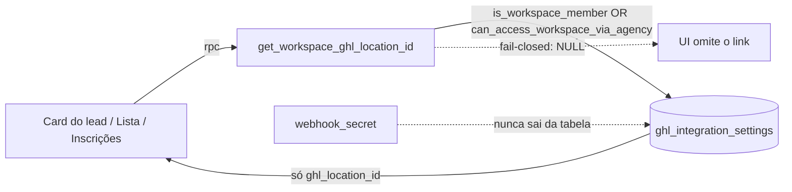

**Invariantes.**

- `anon` **não** tem `EXECUTE` (REVOKE explícito — grant a `anon` não é revogado
  por `REVOKE ... FROM PUBLIC`, armadilha já documentada em
  `FIX-FLAKINESS-SUITE-ISOLAMENTO.md`).
- Sem vínculo com o workspace (outro tenant, ou sem sessão) → `NULL`, nunca erro
  que sirva de oráculo de existência.
- A RLS de `ghl_integration_settings` **não foi afrouxada**: `SELECT` direto
  segue restrito a `owner`/`admin`.

**Verificação em produção (2026-08-24, JWT simulado):** membro comum recebe o
location; usuário de outro workspace recebe `NULL`; `anon` recebe
`permission denied`; `SELECT` direto na tabela devolve 0 linhas para o membro.
