# Sistema de Faturamento — Tabela `vendas_fechamento`

> **Documento técnico obrigatório**
> Última atualização: 2026-08-04 BRT
> Status: ✅ OPERACIONAL
>
> **Nota (2026-07-11):** a integração OpenClaw (mencionada nas seções de histórico de
> bugs abaixo) foi **removida** por decisão do dono — ver
> [`docs/REMOCAO-OPENCLAW.md`](REMOCAO-OPENCLAW.md). Os campos `op_link_do_contrato_assinado`,
> `data_da_assinatura_do_contrato` e os demais dados de venda **continuam existindo e
> em uso** (LeadCard, relatórios) — só o disparo automático para o OpenClaw ao assinar
> foi desligado. As entradas do histórico abaixo (seção 9) não foram reescritas — são
> changelog, refletem o estado do sistema em cada data histórica.

---

## 📋 Índice

1. [Visão Geral](#1-visão-geral)
2. [Arquitetura do Sistema](#2-arquitetura-do-sistema)
3. [Fluxo de Dados](#3-fluxo-de-dados)
4. [Schema da Tabela](#4-schema-da-tabela)
5. [Trigger e Funções](#5-trigger-e-funções)
6. [Nomes de Campos no GHL](#6-nomes-de-campos-no-ghl)
7. [Cálculo de Faturamento](#7-cálculo-de-faturamento)
8. [Verificação e Troubleshooting](#8-verificação-e-troubleshooting)
9. [Histórico de Bugs e Fixes](#9-histórico-de-bugs-e-fixes)

---

## 1. Visão Geral

### Propósito

A tabela `vendas_fechamento` armazena **dados financeiros de vendas fechadas**:
- Valor pago na entrada
- Quantidade de parcelas
- Valor de cada parcela
- **Valor total faturado (calculado automaticamente)**
- Dados do contrato (nome, CPF/CNPJ, endereço, produto, etc)

### Relacionamento com Outras Tabelas

```
webhooks_ghl (evento de oportunidade com dados de faturamento)
        ↓
   [trigger dispara]
        ↓
extrair_vendas_fechamento_do_webhook()
        ↓
vendas_fechamento ← oportunidades ← contatos
```

---

## 2. Arquitetura do Sistema

### Componentes

| Componente | Tipo | Arquivo | Status |
|-----------|------|---------|--------|
| **Tabela** | SQL | Schema Supabase | ✅ Existe |
| **Trigger** | PL/pgSQL | `20260318040000_create_trigger...` | ✅ Ativo |
| **Função** | PL/pgSQL | `extrair_vendas_fechamento_do_webhook()` | ✅ Corrigida em 20260323030000 |
| **Backfill inicial** | SQL | `20260318050000_backfill...` e `20260318060000_fix...` | ✅ Completo |
| **Backfill forma/produto** | SQL | `20260323030000_fix_forma_pagamento...` | ✅ Completo (47 registros) |

### Fluxo Automático

```mermaid
graph LR
    A["GHL Envia Webhook<br/>(oportunidade com dados faturamento)"] -->|INSERT| B["webhooks_ghl"]
    B -->|AFTER INSERT| C["Trigger:<br/>tr_extrair_vendas_fechamento"]
    C -->|Executa| D["Função:<br/>extrair_vendas_fechamento_do_webhook"]
    D -->|Extrai campos do payload| E["CTE: Seleciona dados"]
    E -->|UPSERT| F["vendas_fechamento"]
    F -->|Calcula automaticamente| G["valor_faturado = <br/>entrada + parcelas × valor_parcela"]
    G -->|Dashboard lê| H["Painéis de faturamento<br/>em tempo real"]
```



---

## 3. Fluxo de Dados

### Entrada (Webhook GHL)

> ⚠️ **ATENÇÃO:** Os nomes abaixo são os nomes REAIS confirmados via webhook real (2026-03-23). Qualquer diferença — espaço, underscore, abreviação — faz o campo retornar NULL silenciosamente.

```json
{
  "id": "opp_123",
  "contact_id": "contact_456",
  "customData": {
    "{{opportunity.valor_a_ser_pago_de_entrada}}": "5000.00",
    "{{opportunity.numero_parcelas}}": "10",
    "{{opportunity.valor_parcela}}": "5000.00",
    "{{ opportunity.data_pagamento_entrada }}": "2026-03-20",
    "{{ opportunity.nome_contratante }}": "João da Silva",
    "{{ opportunity.cpf_ou_cnpj_do_contratante }}": "123.456.789-00",
    "{{ opportunity.produto_que_foi_vendido }}": "Acelerador START",
    "{{ opportunity.forma_de_pagamento }}": "À vista (pix + cartão)",
    "{{ opportunity.logradouro_rua_avenida }}": "Rua A, nº 100",
    "{{ opportunity.bairro }}": "Centro",
    "{{ opportunity.municipio }}": "São Paulo",
    "{{ opportunity.estado_uf }}": "SP",
    "{{ opportunity.cep }}": "01310-100",
    "{{ opportunity.op_vencimentos_e_parcelas }}": "1ª parcela: 10/04/2026 - R$ 3.000 | ...",
    "{{opportunity.link_da_gravao_da_call_de_vendas}}": "https://meet.google.com/recording/..."
  }
}
```

### Transformação (Função PL/pgSQL)

Função `extrair_vendas_fechamento_do_webhook()`:

1. **Extrai contato_id** de contatos tabela (via ghl_id)
2. **Extrai oportunidade_id** de oportunidades tabela (via ghl_opportunity_id)
3. **Normaliza valores**:
   - `NULLIF(TRIM(...), '')` — remove strings vazias
   - `::DECIMAL` / `::INTEGER` — converte tipos
   - `COALESCE(..., 0)` — valor padrão zero se NULL
4. **UPSERT** com `ON CONFLICT (oportunidade_id)`
   - Se já existe: atualiza todos os campos
   - Se novo: cria novo registro

### Saída (Banco de Dados)

```sql
INSERT INTO vendas_fechamento (
    oportunidade_id, contato_id,
    valor_entrada, numero_parcelas, valor_parcela, valor_faturado,
    data_pagamento_entrada,
    nome_contratante, cpf_cnpj_contratante,
    logradouro_rua_avenida, numero_endereco, bairro, municipio, estado_uf, cep,
    produto_vendido, forma_pagamento, observacoes_venda
) VALUES (...)
```

---

## 4. Schema da Tabela

### Estrutura Completa

```sql
CREATE TABLE vendas_fechamento (
    -- Identificadores
    id uuid PRIMARY KEY DEFAULT gen_random_uuid(),
    oportunidade_id uuid NOT NULL UNIQUE,  -- FK → oportunidades.id
    contato_id uuid NOT NULL,               -- FK → contatos.id

    -- Dados de Contrato
    nome_contratante text,
    cpf_cnpj_contratante text,
    logradouro_rua_avenida text,
    numero_endereco text,
    complemento_endereco text,
    bairro text,
    municipio text,
    estado_uf text,
    cep text,

    -- Dados de Venda
    produto_vendido text,
    observacoes_venda text,
    forma_pagamento text,
    op_vencimentos_parcelas text,           -- Cronograma de vencimentos/parcelas (boleto)
    op_link_do_contrato_assinado text,      -- Link do contrato assinado (Open Claw etc.)
    data_da_assinatura_do_contrato date,   -- Data de assinatura do contrato
    link_gravacao_call_vendas text,        -- Link da gravação da call de vendas (reunião closer)

    -- Dados Financeiros ⭐
    valor_entrada numeric,                  -- Entrada (down payment)
    numero_parcelas integer,                -- Quantidade de parcelas
    valor_parcela numeric,                  -- Valor por parcela
    valor_faturado numeric,                 -- CALCULADO: entrada + (parcelas × valor_parcela)
    data_pagamento_entrada timestamptz,    -- Data da entrada

    -- Auditoria
    created_at timestamptz DEFAULT now(),
    updated_at timestamptz DEFAULT now()
);

-- Índices
CREATE UNIQUE INDEX uk_vendas_fechamento_oportunidade_id
    ON vendas_fechamento(oportunidade_id);
```

---

## 5. Trigger e Funções

### Trigger Definition

```sql
CREATE TRIGGER tr_extrair_vendas_fechamento
    AFTER INSERT ON public.webhooks_ghl
    FOR EACH ROW
    EXECUTE FUNCTION public.extrair_vendas_fechamento_do_webhook();
```

**Quando dispara:** Toda vez que um novo webhook chega em `webhooks_ghl`
**O que faz:** Chama função que extrai dados de faturamento e insere/atualiza em `vendas_fechamento`
**Erro handling:** Exception é capturada, não quebra o webhook

### Função Principal

**Nome:** `extrair_vendas_fechamento_do_webhook()`
**Linguagem:** PL/pgSQL
**Segurança:** DEFINER
**Espaço de busca:** public

**Lógica:**

1. Valida se webhook tem `opportunity.id`
2. Extrai campos de faturamento do `payload.customData`
3. Valida se pelo menos um campo de faturamento foi preenchido
4. Busca `contato_id` correspondente em `contatos` tabela
5. Busca `oportunidade_id` correspondente em `oportunidades` tabela
6. UPSERT em `vendas_fechamento` com `ON CONFLICT (oportunidade_id)`
7. Captura exceptions e registra em RAISE WARNING (não falha o webhook)

---

## 6. Nomes de Campos no GHL

### ⚠️ CRÍTICO: Nomes EXATOS dos Campos

Estes são os nomes **EXATOS** que o GHL usa em `payload.customData`. **Diferença de um caractere quebra tudo:**

> ⚠️ Nomes confirmados via inspeção de webhook real (`jsonb_object_keys(payload->'customData')`). Nunca alterar sem confirmar no banco.

| Campo no Banco | Chave EXATA no GHL `customData` | Tipo | Observação |
|---|---|---|---|
| `valor_entrada` | `{{opportunity.valor_a_ser_pago_de_entrada}}` | DECIMAL | **sem espaços** |
| `numero_parcelas` | `{{opportunity.numero_parcelas}}` | INTEGER | **sem espaços** |
| `valor_parcela` | `{{opportunity.valor_parcela}}` | DECIMAL | **sem espaços** |
| `data_pagamento_entrada` | `{{ opportunity.data_pagamento_entrada }}` | TIMESTAMPTZ | com espaços |
| `nome_contratante` | `{{ opportunity.nome_contratante }}` | TEXT | com espaços |
| `cpf_cnpj_contratante` | `{{ opportunity.cpf_ou_cnpj_do_contratante }}` | TEXT | com `_ou_` |
| `produto_vendido` | `{{ opportunity.produto_que_foi_vendido }}` | TEXT | ⚠️ com `_que_foi_` |
| `forma_pagamento` | `{{ opportunity.forma_de_pagamento }}` | TEXT | ⚠️ com `_de_` |
| `op_vencimentos_parcelas` | `{{opportunity.op_vencimentos_e_parcelas}}` | TEXT | **sem espaços** — confirmado via 14.283 webhooks reais |
| `op_link_do_contrato_assinado` | `{{opportunity.op_link_do_contrato_assinado}}` | TEXT | **sem espaços** — confirmado pelo usuário |
| `data_da_assinatura_do_contrato` | `{{opportunity.data_da_assinatura_do_contrato}}` | DATE | **sem espaços** — confirmado pelo usuário |
| `logradouro_rua_avenida` | `{{ opportunity.logradouro_rua_avenida }}` | TEXT | |
| `numero_endereco` | `{{ opportunity.numero_endereco }}` | TEXT | |
| `complemento_endereco` | `{{ opportunity.complemento_do_endereo }}` | TEXT | typo original do GHL: `endereo` sem ç |
| `bairro` | `{{ opportunity.bairro }}` | TEXT | |
| `municipio` | `{{ opportunity.municipio }}` | TEXT | |
| `estado_uf` | `{{ opportunity.estado_uf }}` | TEXT | |
| `cep` | `{{ opportunity.cep }}` | TEXT | |
| `observacoes_venda` | `{{ opportunity.observacoes_venda }}` | TEXT | |
| `link_gravacao_call_vendas` | `{{opportunity.link_da_gravao_da_call_de_vendas}}` | TEXT | **sem espaços, sem acentos** — GHL remove "ç"/"ã" das chaves |

### 🚨 BUGS HISTÓRICOS DE NOMES DE CAMPO

**Bug 1 (2026-03-18): `{{ opportunity.valor_entrada }}`** → campo não existe no GHL
- Fix: `{{opportunity.valor_a_ser_pago_de_entrada}}` (migration 20260318060000)
- Resultado do fix: 45 registros com R$ 1.494.611,15

**Bug 2 (2026-03-23): nomes errados de `produto_vendido` e `forma_pagamento`**
- Trigger usava `{{opportunity.produto_vendido}}` e `{{opportunity.forma_pagamento}}`
- GHL envia `{{ opportunity.produto_que_foi_vendido }}` e `{{ opportunity.forma_de_pagamento }}`
- Resultado: campos sempre NULL mesmo com dados preenchidos no GHL
- Fix: migration `20260323030000_fix_forma_pagamento_produto_vendido_keys.sql`
- Backfill: 47 registros corrigidos (100% zerado: 0 NULL restantes)

**Bug 3 (2026-03-23): backfill incompleto — `cpf_cnpj_contratante` e `complemento_endereco` nunca preenchidos**
- Migration 20260323030000 corrigiu o trigger mas o backfill só atualizou `forma_pagamento` + `produto_vendido`
- `cpf_cnpj_contratante` e `complemento_endereco` ficaram NULL em todos os 47 registros
- Chaves estavam corretas no trigger; problema era ausência de backfill desses campos
- Fix: migration `20260323040000_backfill_cpf_complemento_vendas_fechamento.sql`
- Resultado: `sem_cpf: 0`, `sem_complemento: 2` (2 leads genuinamente sem complemento de endereço — campo opcional)
**Bug 5 (2026-03-23): guard do trigger ignorava webhook do OpenClaw com link**
- Trigger ignorava qualquer webhook sem dados financeiros (valor_entrada, etc.)
- Webhook do OpenClaw chega SEPARADO, apenas com link + data_assinatura, sem dados financeiros
- Resultado: `op_link_do_contrato_assinado` e `data_da_assinatura_do_contrato` sempre NULL
- Fix: migration `20260323150000` — guard agora inclui `link_contrato` e `data_assinatura` na condição
- Backfill: 45 registros corrigidos

**Bug 4 (2026-03-23): chave errada para `op_vencimentos_parcelas`**
- Trigger usava `{{ opportunity.op_vencimentos_e_parcelas }}` COM espaços — ERRADO
- GHL envia `{{opportunity.op_vencimentos_e_parcelas}}` SEM espaços (confirmado: 14.283 ocorrências nos webhooks)
- Resultado: campo sempre NULL mesmo preenchido no GHL — 13 registros afetados
- Fix: migration `20260323100000_fix_op_vencimentos_parcelas_key.sql`
- Backfill: 13 registros corrigidos — 0 pendências restantes

---

## 7. Cálculo de Faturamento

### Fórmula

```
valor_faturado = valor_entrada + (numero_parcelas × valor_parcela)
```

### Exemplo

```
Entrada: R$ 5.000,00
Parcelas: 10
Valor por parcela: R$ 5.000,00

Faturado = 5.000 + (10 × 5.000) = 5.000 + 50.000 = R$ 55.000,00
```

### Implementação no Banco

```sql
-- No frontend (eb-dash2/src/components/leads/LeadCard.tsx):
const valorFaturado = (v.valor_entrada ?? 0) +
                      ((v.numero_parcelas ?? 0) * (v.valor_parcela ?? 0))

-- No backend (gerado automaticamente pelo trigger):
valor_faturado = COALESCE(valor_entrada, 0) +
                 COALESCE(numero_parcelas, 0) * COALESCE(valor_parcela, 0)
```

---

### Assinatura do contrato NÃO entra no cálculo

`valor_faturado` e `valor_entrada` valem a partir de `data_pagamento_entrada`, **independentemente** de o contrato estar assinado. Uma venda sem `op_link_do_contrato_assinado` e sem `data_da_assinatura_do_contrato` conta normalmente em vendas, caixa e faturamento em todos os painéis — é o caso comum das vendas que sobem pelo omnx-desk, onde o registro acontece antes da assinatura.

Para acompanhar essa pendência sem mexer nos totais, a aba **Vendas → Geral** tem o card **"Sem contrato assinado"** (somatória + lista clicável). Critério e implementação:

- `isVendaSemAssinatura(row, assinadasPorEtapa)` / `buildAssinadasPorEtapa(opps)` / `computePendentesAssinatura(rows, assinadasPorEtapa)` em `eb-dash2/src/hooks/useTrafego.ts`.
- **Pendente** = tem `data_pagamento_entrada`, não tem link nem data de assinatura **e** a oportunidade não está na etapa `Assinada`.
- Vale para todas as origens (`ghl` e `omnx_desk`), respeita o modo Cohort/Produtividade e os filtros ativos.
- É **aditivo**: nada é descontado dos KPIs financeiros.

> ⚠️ **A assinatura tem DUAS fontes no CRM — e elas não conversam.**
>
> | Caminho | O que preenche | Quem alimenta |
> |---|---|---|
> | Webhook GHL (fluxo OpenClaw, legado) | `op_link_do_contrato_assinado` + `data_da_assinatura_do_contrato` | campos preenchidos no card do GHL |
> | Ponte `crm-marcar-assinada` (omnx-desk/Clicksign) | move o card para **Vendas SQL / Assinada / won** — **não toca em `vendas_fechamento`** | trigger do omnx-desk quando o contrato ganha `link_clicksign` |
>
> Por isso o critério do card olha as duas vias. Medição em 2026-08-04: das 19 vendas `origem='omnx_desk'`, **15 estavam na etapa "Assinada"** mas só **6** tinham link/data na tabela.
>
> **Lacuna conhecida:** o link e a data reais da assinatura das vendas do desk vivem só no omnx-desk (`contratos.link_clicksign` / `contratos.data_assinatura`). O CRM não os recebe. Levar esses dois campos pela ponte (+ backfill dos históricos) segue pendente de decisão.

---

## 8. Verificação e Troubleshooting

### Query de Verificação Rápida

```sql
-- Quantos registros têm faturamento?
SELECT
    COUNT(*) as total,
    COUNT(CASE WHEN valor_faturado > 0 THEN 1 END) as com_faturamento,
    SUM(valor_faturado) as total_faturado
FROM vendas_fechamento;

-- Resultado esperado (2026-03-18):
-- total | com_faturamento | total_faturado
-- 4864  | 45              | 1494611.15
```

### Top 5 Maiores Vendas

```sql
SELECT
    valor_entrada,
    numero_parcelas,
    valor_parcela,
    valor_faturado,
    nome_contratante,
    data_pagamento_entrada
FROM vendas_fechamento
WHERE valor_faturado > 0
ORDER BY valor_faturado DESC
LIMIT 5;
```

### Diagnóstico: Por Que Não Aparece?

| Sintoma | Causa | Solução |
|---------|-------|---------|
| `valor_faturado` = 0 | Dados não preenchidos no GHL | Preencher campos em customData |
| Nenhum registro | Webhook nunca chegou | Verificar webhook payload |
| Valores errados | Função usa nomes errados de campos | Verificar migration 20260318060000 |
| Oportunidade não encontrada | ghl_opportunity_id não match | Verificar se opp foi criada |

---

## 9. Histórico de Bugs e Fixes

### Timeline Completa

**2026-03-17:** Migration 20260317000000
- ❌ **Bug:** Removeu PASSO 3 de `extrair_dados_ghl` sem criar trigger substituto
- **Resultado:** `vendas_fechamento` virou vazia

**2026-03-18 (v1):** Migration 20260318040000
- ✅ Criou trigger `tr_extrair_vendas_fechamento`
- ✅ Criou função `extrair_vendas_fechamento_do_webhook()`
- ❌ **Bug:** Usava nomes ERRADOS dos campos (`{{ opportunity.valor_entrada }}`)
- ✅ Backfill criou 4.864 registros (todos com valor zero)

**2026-03-18 (v2):** Migration 20260318050000
- ✅ Backfill dos 4.864 webhooks
- ❌ Resultado: Ainda zeros porque função estava errada

**2026-03-18 (v3):** Migration 20260318060000 ⭐ **CORREÇÃO**
- ✅ Corrigiu nomes dos campos para os CERTOS:
  - `{{opportunity.valor_a_ser_pago_de_entrada}}`
  - `{{opportunity.numero_parcelas}}`
  - `{{opportunity.valor_parcela}}`
  - E mais 10+ campos
- ✅ Backfill reprocessou webhooks com dados reais
- ✅ **Resultado:** 45 registros com R$ 1.494.611,15 preenchidos

**2026-03-23:** Migration 20260323030000 ⭐ **CORREÇÃO**
- ❌ **Bug descoberto:** `produto_vendido` e `forma_pagamento` sempre NULL mesmo preenchidos no GHL
- **Causa raiz:** trigger usava chaves abreviadas/sem espaços que não existem no webhook
  - ❌ `{{opportunity.produto_vendido}}` → ✅ `{{ opportunity.produto_que_foi_vendido }}`
  - ❌ `{{opportunity.forma_pagamento}}` → ✅ `{{ opportunity.forma_de_pagamento }}`
- **Como foi descoberto:** lead `flavio.batista@fbconsult.com.br` com entrada R$ 21.000 mas sem produto nem forma de pagamento
- **Diagnóstico:** `SELECT jsonb_object_keys(payload->'customData') FROM webhooks_ghl ...`
- ✅ Backfill corrigiu 47 registros — `0 NULL` restantes
- ✅ Trigger atualizado com nomes corretos para todos os webhooks futuros
- ✅ Campo `op_vencimentos_parcelas` adicionado ao trigger e ao frontend (LeadCard)

**2026-03-23:** Migration 20260323050000 ⭐ **NOVO CAMPO**
- ✅ Coluna `op_link_do_contrato_assinado TEXT` adicionada à `vendas_fechamento`
- ✅ Trigger atualizado para extrair `{{opportunity.op_link_do_contrato_assinado}}` (sem espaços — confirmado pelo usuário)
- ✅ ON CONFLICT DO UPDATE inclui o campo com COALESCE (não sobrescreve link existente com NULL)
- ✅ LeadCard aba Financeiro exibe seção "Contrato" com link clicável (só aparece quando preenchido)
- ✅ Interface `VendasFechamento` e SELECT no `useLeads.ts` atualizados
- ⚠️ **Sem backfill** — campo nunca existiu em webhooks históricos

**2026-03-23:** Migration 20260323080000 ⭐ **NOVO CAMPO**
- ✅ Coluna `data_da_assinatura_do_contrato DATE` adicionada à `vendas_fechamento`
- ✅ Trigger atualizado para extrair `{{opportunity.data_da_assinatura_do_contrato}}` (sem espaços — confirmado pelo usuário)
- ✅ ON CONFLICT DO UPDATE inclui o campo com COALESCE (não sobrescreve data existente com NULL)
- ✅ LeadCard aba Financeiro exibe linha "Data de assinatura" na seção Contrato — exibe "—" enquanto NULL, `DD/MM/YYYY` quando preenchido
- ✅ Interface `VendasFechamento` e SELECT no `useLeads.ts` atualizados
- ⚠️ **Sem backfill** — campo nunca existiu em webhooks históricos

**2026-03-23:** Migration 20260323100000 ⭐ **CORREÇÃO**
- ❌ **Bug:** `op_vencimentos_parcelas` sempre NULL mesmo preenchido no GHL
- **Causa raiz:** chave usada no trigger tinha espaços — `{{ opportunity.op_vencimentos_e_parcelas }}` — mas GHL envia SEM espaços: `{{opportunity.op_vencimentos_e_parcelas}}` (confirmado via 14.283 webhooks)
- ✅ Trigger corrigido com chave sem espaços
- ✅ Backfill: 13 registros corrigidos — 0 pendências

**2026-03-23:** Migration 20260323150000 ⭐ **CORREÇÃO CRÍTICA**
- ❌ **Bug:** `op_link_do_contrato_assinado` e `data_da_assinatura_do_contrato` ficavam NULL mesmo quando OpenClaw enviava o link
- **Causa raiz:** condição de guarda do trigger ignorava qualquer webhook sem dados financeiros (`valor_entrada`, `numero_parcelas`, etc.). O webhook do OpenClaw chega **separado**, trazendo APENAS link + data — sem dados financeiros. O trigger pulava ele inteiro.
- ✅ Condição de guarda ampliada: agora ignora só se TODOS os campos relevantes forem NULL (incluindo `link_contrato` e `data_assinatura`)
- ✅ Backfill: 45 registros com link/data corrigidos
- ✅ Estado final: **45 contratos com link** = todos os que chegaram via webhook. Os ~4.800 restantes não têm contrato assinado no GHL.

**2026-03-24:** Migration `20260324010000` ⭐ **CORREÇÃO DO FLUXO OPENCLAW**
- ❌ **Bug real:** arrastar o card para `Assinada` não disparava nada em alguns casos
- **Causa raiz 1:** sobrou no banco o trigger `tr_zz_notify_openclaw_assinada` em `webhooks_ghl`, mas a função `notify_openclaw_contrato_assinado()` foi sobrescrita depois para uso em `vendas_fechamento`
- **Causa raiz 2:** o fluxo dependia demais da ordem dos eventos:
  - link antes do drag
  - drag antes do link
- ✅ Criado helper central `processar_notificacao_openclaw_contrato_assinado()`
- ✅ Trigger de `vendas_fechamento` agora só envia quando o link entra e a oportunidade já está em `Assinada`
- ✅ Trigger de `webhooks_ghl` voltou com função própria, separada, para disparar no drag do card
- ✅ Ao entrar em `Assinada`, o sistema busca o link no webhook atual ou em webhooks anteriores da mesma oportunidade
- ✅ Idempotência central via `oportunidades.openclaw_notificado_em`

**2026-03-24:** Migration `20260324020000` ⭐ **BACKFILL DE IDEMPOTÊNCIA**
- ❌ **Bug residual:** oportunidades antigas já assinadas podiam reenviar quando alguém editava o card depois
- **Causa raiz:** elas já tinham link em `vendas_fechamento`, mas ainda não tinham `openclaw_notificado_em`
- ✅ Backfill marcou como já notificadas as oportunidades históricas que:
  - têm link de contrato
  - e estão em `Assinada` no pipeline `Vendas SQL`
  - ou já têm `data_da_assinatura_do_contrato`
- ✅ Resultado esperado: editar um contrato antigo já assinado não dispara o OpenClaw de novo

**2026-03-24:** Migration `20260324030000` ⭐ **ENTREGA CONFIRMADA + RETRY AUTOMÁTICO**
- ❌ **Bug residual novo:** um lead novo podia ficar com `openclaw_notificado_em` preenchido mesmo sem resposta confirmada do OpenClaw
- **Causa raiz:** `net.http_post()` e assíncrono; o sistema marcava "enviado" na fila, nao na resposta
- ✅ `openclaw_notificado_em` agora significa **resposta 2xx confirmada**
- ✅ Novas colunas em `oportunidades`: `openclaw_request_id`, `openclaw_enfileirado_em`, `openclaw_ultima_resposta_em`, `openclaw_ultimo_status_code`, `openclaw_ultimo_erro`
- ✅ Nova função `sincronizar_status_openclaw_contrato_assinado()` confirma respostas e libera falhas para retry
- ✅ Novo job SQL `openclaw-contrato-assinado-retry` roda a cada minuto
- ✅ Nova função pública `listar_openclaw_respostas_recentes()` permite diagnosticar o estado por oportunidade
- ✅ Smoke test remoto: `sincronizar_status_openclaw_contrato_assinado()` e `processar_openclaw_contrato_assinado_job()` responderam `200` no banco remoto em 2026-03-22

**2026-03-25:** Migration `20260325140000` ⭐ **NOVO CAMPO**
- ✅ Coluna `link_gravacao_call_vendas TEXT` adicionada à `vendas_fechamento`
- ✅ Trigger atualizado para extrair `{{opportunity.link_da_gravao_da_call_de_vendas}}` (sem espaços, sem acentos — GHL remove "ç"/"ã")
- ✅ Guard do trigger inclui `link_gravacao_call` — campo pode chegar isolado em webhook separado
- ✅ ON CONFLICT DO UPDATE inclui o campo com COALESCE (não sobrescreve link existente com NULL)
- ✅ Backfill preparado — porém 0 webhooks históricos com o campo preenchido (todos chegaram vazios)
- ⚠️ **Nota:** variável no GHL chama `{{Op_Link da gravação da call de vendas}}` mas a chave no webhook chega como `{{opportunity.link_da_gravao_da_call_de_vendas}}` (sem acentos)

**2026-03-24:** Migration `20260324031000` ⭐ **TIMEOUT DO OPENCLAW AJUSTADO PARA 30S**
- ❌ **Falha real observada no smoke test:** `Timeout of 5000 ms reached`
- **Causa raiz:** o endpoint do OpenClaw respondeu mais lento que o timeout padrao do `pg_net`
- ✅ `processar_notificacao_openclaw_contrato_assinado()` agora usa `timeout_milliseconds := 30000`
- ✅ Reteste real no lead fake `testewfgdfb@teste.xxocom` retornou `status_code = 200`
- ✅ `listar_openclaw_respostas_recentes()` mostrou resposta positiva do endpoint: `{"ok":true,...}`

---

## ✅ Checklist de Funcionamento

- [x] Tabela `vendas_fechamento` existe no Supabase
- [x] Trigger `tr_extrair_vendas_fechamento` está ativo
- [x] Função `extrair_vendas_fechamento_do_webhook()` usa nomes CORRETOS de campos (confirmados via webhook real 2026-03-23)
- [x] Backfill completado: 4.864 registros criados
- [x] 47 registros com `forma_pagamento` e `produto_vendido` preenchidos (0 NULL)
- [x] Cálculo `valor_faturado = entrada + (parcelas × valor_parcela)` funciona
- [x] Campo `op_vencimentos_parcelas` adicionado à tabela, trigger e LeadCard
- [x] Campo `op_link_do_contrato_assinado` adicionado à tabela, trigger e LeadCard (2026-03-23)
- [x] Campo `data_da_assinatura_do_contrato` adicionado à tabela, trigger e LeadCard (2026-03-23)
- [x] Campo `op_vencimentos_parcelas` — chave corrigida SEM espaços (2026-03-23)
- [x] Guard do trigger inclui `link_contrato` e `data_assinatura` — webhooks do OpenClaw capturados (2026-03-23)
- [x] OpenClaw cobre as duas ordens reais do processo: `link → Assinada` e `Assinada → link` (2026-03-24)
- [x] Contratos antigos já assinados receberam backfill de `openclaw_notificado_em` para não reenviar ao serem editados (2026-03-24)
- [x] OpenClaw só marca sucesso depois de resposta `2xx` confirmada (2026-03-24)
- [x] Timeout HTTP do OpenClaw aumentado para `30000 ms` após falha real de `5000 ms` (2026-03-24)
- [x] Falha/timeout do OpenClaw volta automaticamente para retry seguro por cron SQL (2026-03-24)
- [x] 45 links de contrato preenchidos — todos os webhooks históricos processados
- [x] Campo `link_gravacao_call_vendas` adicionado à tabela, trigger e guard (2026-03-25)
- [x] LeadCard exibe 100% dos campos da tabela `vendas_fechamento`
- [x] Próximos webhooks com dados de faturamento/contrato serão auto-preenchidos

---

## 🚀 Próximos Passos

1. **Monitorar:** Verificar se novos webhooks com faturamento chegam corretamente
2. **Testar:** SDRs/closers preenchem dados de faturamento no GHL
3. **Validar:** Dashboard exibe dados em tempo real
4. **Alertar:** Se houver campos novos no GHL, documentar nesta tabela

---

*Documento técnico vivo — atualizar conforme mudanças no GHL ou schema*
