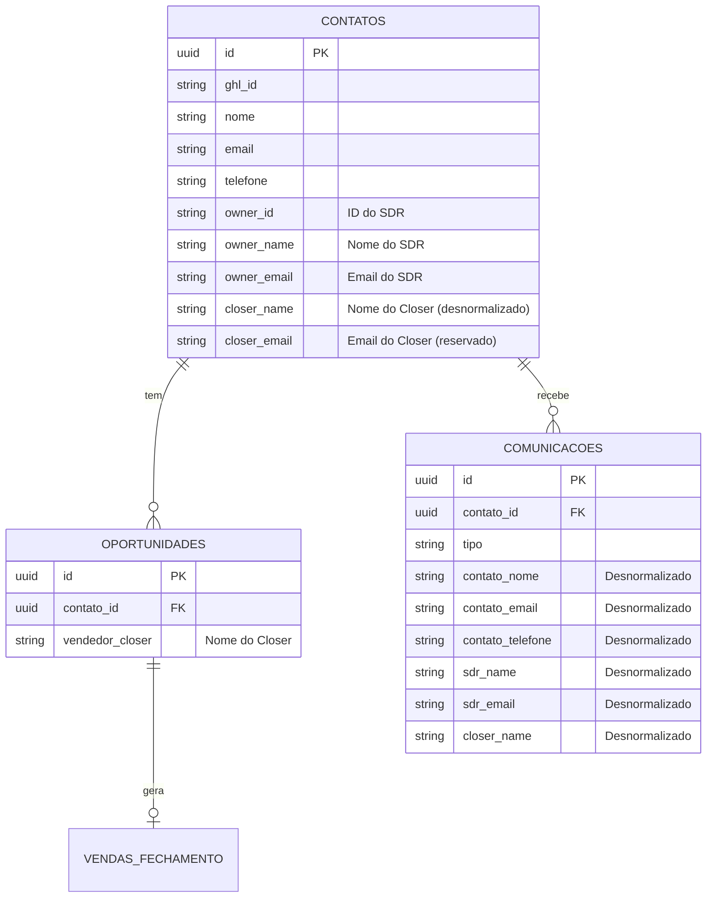

# Plano: Adicionar Colunas Desnormalizadas nas Tabelas Comunicações e Contatos

## Contexto

O usuário solicitou adicionar colunas nas tabelas `comunicacoes` e `contatos` para facilitar consultas, sem precisar de JOINs com `contatos` e `oportunidades`.

## Estrutura Atual

### Tabela `contatos` (colunas existentes de SDR)
- `owner_id` - ID do SDR responsável
- `owner_name` - Nome do SDR responsável
- `owner_email` - Email do SDR

### Tabela `oportunidades`
- `vendedor_closer` - Nome do Closer/Vendedor

## Mudanças Implementadas

### 1. Tabela `comunicacoes` - Colunas Desnormalizadas

| Coluna | Tipo | Origem | Descrição |
|--------|------|--------|-----------|
| `contato_nome` | TEXT | `contatos.nome` | Nome do contato |
| `contato_email` | TEXT | `contatos.email` | Email do contato |
| `contato_telefone` | TEXT | `contatos.telefone` | Telefone do contato |
| `sdr_name` | TEXT | `contatos.owner_name` | Nome do SDR responsável |
| `sdr_email` | TEXT | `contatos.owner_email` | Email do SDR |
| `closer_name` | TEXT | `contatos.closer_name` | Nome do Closer/Vendedor |

### 2. Tabela `contatos` - Novas Colunas de Closer

| Coluna | Tipo | Origem | Descrição |
|--------|------|--------|-----------|
| `closer_name` | TEXT | `oportunidades.vendedor_closer` | Nome do Closer/Vendedor (da oportunidade mais recente) |
| `closer_email` | TEXT | *(reservado para uso futuro)* | Email do Closer |

## Arquivos de Migration

### Ordem de Execução

1. `20260303170000_add_comunicacoes_denormalized_columns.sql`
   - Adiciona colunas desnormalizadas na tabela `comunicacoes`

2. `20260303170002_add_closer_to_contatos.sql`
   - Adiciona colunas `closer_name` e `closer_email` na tabela `contatos`
   - Faz backfill inicial com dados existentes

3. `20260303170200_backfill_comunicacoes_denormalized.sql`
   - Preenche colunas desnormalizadas em registros existentes de `comunicacoes`

4. `20260303170300_update_extrair_dados_ghl_with_closer.sql`
   - Atualiza função `extrair_dados_ghl` para:
     - Atualizar `closer_name` no `contatos` quando processar oportunidades
     - Usar colunas desnormalizadas do `contatos` nas comunicações

## Diagrama de Relacionamentos



## Fluxo de Dados

### Inserção de Novos Dados

1. **Webhook de Contato** → Insere/atualiza `contatos` com `owner_name`, `owner_email`
2. **Webhook de Oportunidade** → Insere/atualiza `oportunidades` com `vendedor_closer`
3. **Após processar oportunidade** → Atualiza `contatos.closer_name` com o closer da oportunidade mais recente
4. **Webhook de Comunicação** → Insere em `comunicacoes` com dados desnormalizados do `contatos`

### Consulta Simplificada

```sql
-- Antes (com JOINs)
SELECT c.nome, c.email, c.owner_name as sdr, o.vendedor_closer as closer
FROM comunicacoes cm
JOIN contatos c ON c.id = cm.contato_id
LEFT JOIN oportunidades o ON o.contato_id = c.id;

-- Depois (sem JOINs)
SELECT contato_nome, contato_email, sdr_name, closer_name
FROM comunicacoes;
```

## Benefícios

1. **Consultas mais simples**: Não precisa de JOIN para ver dados básicos
2. **Performance**: Dados desnormalizados evitam JOINs em queries frequentes
3. **Histórico preservado**: Mesmo se o contato mudar de SDR/Closer, o registro mantém quem fez a comunicação naquele momento
4. **Determinismo**: O closer é obtido da oportunidade mais recente, evitando resultados arbitrários

## Considerações

- **Desnormalização**: Os dados ficam duplicados, mas isso é aceitável para fins de auditoria e performance
- **Atualização**: Quando o contato muda de owner, os registros antigos mantêm o SDR original (comportamento correto para histórico)
- **Closer**: O closer é atualizado no contato quando uma nova oportunidade é processada, usando a mais recente

## Correções Realizadas

### Migration Ordering
- **Problema**: A migration `161500` referenciava colunas que só existiam na migration `170000`
- **Solução**: Renomeado para `170100` para executar após a criação das colunas

### Backfill Determinístico
- **Problema**: O backfill usava `LEFT JOIN` sem ordenação, podendo selecionar qualquer oportunidade
- **Solução**: Usado subquery com `ORDER BY created_at DESC` para selecionar a oportunidade mais recente

### Colunas do Closer no Contatos
- **Problema**: Usuário solicitou identificação do lead e SDR/Closer na tabela de contatos
- **Solução**: Adicionadas colunas `closer_name` e `closer_email` na tabela `contatos`
