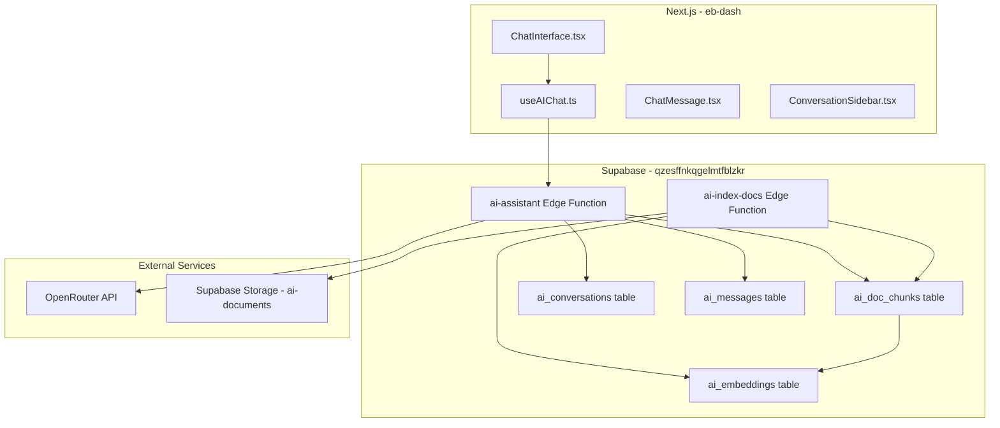

# AI Assistant Implementation Plan

| Campo | Valor |
|-------|-------|
| **Versão** | 1.0 |
| **Data** | 2026-02-26 |
| **Status** | Plano de Implementação |
| **Projeto Supabase** | `qzesffnkqgelmtfblzkr` |
| **Baseado em** | `docs/AI-ASSISTANT-ESTUDO-INDEXACAO-E-UX.md` |

---

## Estado Atual Verificado

### Banco de Dados (Confirmado via MCP)

| Tabela | Status | Rows | RLS |
|--------|--------|------|-----|
| `ai_doc_chunks` | ✅ Existe | 0 | Enabled |
| `ai_doc_index_status` | ✅ Existe | 0 | Enabled |
| `ai_conversations` | ✅ Existe | 3 | Enabled |
| `ai_messages` | ✅ Existe | 6 | Enabled |
| `ai_embeddings` | ✅ Existe | 0 | Enabled |

### Edge Functions (Confirmado via MCP)

| Function | Status | verify_jwt | Version |
|----------|--------|------------|---------|
| `ai-assistant` | ✅ ACTIVE | false | 6 |
| `ai-index-docs` | ✅ ACTIVE | true | 1 |

### Funções PostgreSQL

- `match_ai_docs()` - ✅ Existe e funcional
  - Parâmetros: `p_query_embedding`, `p_match_threshold` (default 0.7), `p_match_count` (default 10)
  - Retorna: `id`, `doc_path`, `chunk_index`, `content`, `similarity`

---

## Diagrama de Arquitetura



---

## Sprint 1: Fazer Funcionar (Blockers)

### 1.1 Criar Script de Indexação de Documentos

**Arquivo:** `scripts/index-docs.js`

**Objetivo:** Ler todos os arquivos `.md` da pasta `docs/` e enviá-los para a Edge Function `ai-index-docs`.

**Implementação:**
```javascript
// scripts/index-docs.js
import fs from 'fs';
import path from 'path';
import crypto from 'crypto';

const SUPABASE_URL = 'https://qzesffnkqgelmtfblzkr.supabase.co';
const SUPABASE_SERVICE_KEY = process.env.SUPABASE_SERVICE_ROLE_KEY;

async function indexDocuments() {
  const docsDir = path.join(process.cwd(), 'docs');
  const files = fs.readdirSync(docsDir)
    .filter(f => f.endsWith('.md'));
  
  for (const file of files) {
    const filePath = path.join(docsDir, file);
    const content = fs.readFileSync(filePath, 'utf-8');
    const hash = crypto.createHash('sha256').update(content).digest('hex');
    
    await fetch(`${SUPABASE_URL}/functions/v1/ai-index-docs/index`, {
      method: 'POST',
      headers: {
        'Authorization': `Bearer ${SUPABASE_SERVICE_KEY}`,
        'Content-Type': 'application/json'
      },
      body: JSON.stringify({
        doc_path: `docs/${file}`,
        content,
        file_hash: hash
      })
    });
  }
}
```

**Comando:** `node scripts/index-docs.js`

---

### 1.2 Configurar OPENROUTER_API_KEY

**Local:** Supabase Dashboard → Edge Functions → Secrets

**Valor:** A chave da API do OpenRouter deve ser configurada como secret `OPENROUTER_API_KEY`.

**Verificação:** 
```bash
supabase secrets list --project-ref qzesffnkqgelmtfblzkr
```

---

### 1.3 Corrigir Race Condition de Autenticação

**Arquivo:** `eb-dash/hooks/useAIChat.ts`

**Problema:** O hook chama `loadConversations()` antes da sessão estar hidratada, causando fallback para anon key e erro401.

**Solução:**

```typescript
// Linhas 76-112 - Adicionar estado de hidratação
const [isSessionLoading, setIsSessionLoading] = useState(true);

useEffect(() => {
  let mounted = true;
  
  const initializeSession = async () => {
    const { data: { session } } = await supabase.auth.getSession();
    if (mounted) {
      setIsSessionLoading(false);
      if (session) {
        loadConversations(session.access_token);
      }
    }
  };
  
  initializeSession();
  
  const { data: { subscription } } = supabase.auth.onAuthStateChange(
    (event, session) => {
      if (event === 'SIGNED_IN' && session) {
        loadConversations(session.access_token);
      }
    }
  );
  
  return () => {
    mounted = false;
    subscription.unsubscribe();
  };
}, []);
```

---

### 1.4 Corrigir currentConversation.id = 'new'

**Arquivo:** `eb-dash/hooks/useAIChat.ts`

**Problema:** Após o stream, o ID da conversa não é atualizado com o valor real retornado pelo backend.

**Solução:**

```typescript
// Linhas 277-284 - Extrair conversationId do stream SSE
// O backend envia um evento especial com o conversationId:
// data: {"type": "conversation_created", "conversationId": "uuid"}

const processStreamLine = (line: string) => {
  if (line.startsWith('data: ')) {
    const data = JSON.parse(line.slice(6));
    
    if (data.type === 'conversation_created') {
      setCurrentConversation(prev => ({
        ...prev,
        id: data.conversationId
      }));
    }
    // ... resto do processamento
  }
};
```

---

## Sprint 2: Fazer Confiável

### 2.1 Separar Estados de Loading

**Arquivo:** `eb-dash/hooks/useAIChat.ts`

**Mudança:** Separar `isLoading` em:
- `isLoadingConversations` - Carregando lista de conversas
- `isLoadingMessages` - Carregando mensagens de uma conversa
- `isSendingMessage` - Enviando mensagem

```typescript
const [isLoadingConversations, setIsLoadingConversations] = useState(false);
const [isLoadingMessages, setIsLoadingMessages] = useState(false);
const [isSendingMessage, setIsSendingMessage] = useState(false);

// Derived state for backward compatibility
const isLoading = isLoadingConversations || isLoadingMessages;
```

---

### 2.2 Badge de Status da Base de Conhecimento

**Arquivo:** `eb-dash/components/ai-assistant/ChatInterface.tsx`

**Implementação:**

```typescript
// Adicionar ao header
<div className="flex items-center gap-2">
  <Badge variant={docCount > 0 ? "default" : "destructive"}>
    {docCount > 0 ? `📚 ${docCount} docs` : "⚠️ Sem contexto"}
  </Badge>
</div>

// Query para obter contagem
const { data: docStats } = useQuery({
  queryKey: ['ai-doc-stats'],
  queryFn: async () => {
    const { count } = await supabase
      .from('ai_doc_index_status')
      .select('*', { count: 'exact', head: true });
    return { docCount: count || 0 };
  }
});
```

---

### 2.3 Implementar Citações de Fonte

**Arquivo:** `eb-dash/components/ai-assistant/ChatMessage.tsx`

**Mudança:** Renderizar `relevantDocs` array com links clicáveis.

```typescript
{message.relevantDocs && message.relevantDocs.length > 0 && (
  <div className="mt-3 pt-3 border-t border-border">
    <p className="text-xs text-muted-foreground mb-2">📄 Baseado em:</p>
    <div className="flex flex-wrap gap-2">
      {message.relevantDocs.map((doc, i) => (
        <Badge key={i} variant="outline" className="text-xs">
          {doc}
        </Badge>
      ))}
    </div>
  </div>
)}
```

---

### 2.4 Corrigir Sidebar Toggle (Desktop)

**Arquivo:** `eb-dash/components/ai-assistant/ChatInterface.tsx`

**Mudança:**

```typescript
// Adicionar estado
const [sidebarVisible, setSidebarVisible] = useState(true);

// Corrigir handler do botão
<Button
  variant="ghost"
  size="icon"
  onClick={() => setSidebarVisible(!sidebarVisible)}
>
  <PanelLeft className="h-5 w-5" />
</Button>

// Condicionalmente renderizar sidebar
{sidebarVisible && (
  <ConversationSidebar ... />
)}
```

---

## Sprint 3: Fazer Polido

### 3.1 Redesenhar Tela de Boas-Vindas

**Arquivo:** `eb-dash/components/ai-assistant/ChatInterface.tsx`

**Melhorias:**
- Avatar mais elaborado com gradiente
- Lista de capacidades reais baseada em documentos indexados
- Estado vazio quando não há documentos
- Quick action cards maiores e mais visíveis

---

### 3.2 Cursor Animado Durante Streaming

**Arquivo:** `eb-dash/components/ai-assistant/ChatMessage.tsx`

**Implementação:**

```typescript
{isStreaming && (
  <span className="inline-block w-2 h-4 bg-primary animate-pulse ml-1" />
)}
```

---

### 3.3 Metadados por Resposta

**Arquivo:** `eb-dash/components/ai-assistant/ChatMessage.tsx`

**Implementação:**

```typescript
{message.modelUsed && (
  <div className="flex items-center gap-2 text-xs text-muted-foreground mt-2">
    <span>{message.modelUsed}</span>
    {message.tokensUsed && <span>· {message.tokensUsed} tokens</span>}
    {message.latency && <span>· {message.latency}s</span>}
    <button onClick={() => copyToClipboard(message.content)}>
      <Copy className="h-3 w-3" />
    </button>
  </div>
)}
```

---

### 3.4 Sidebar com Preview de Mensagem

**Arquivo:** `eb-dash/components/ai-assistant/ConversationSidebar.tsx`

**Mudança:** Buscar última mensagem de cada conversa e exibir preview.

---

## Checklist de Execução

### Pré-requisitos
- [x] Verificar projeto Supabase correto: `qzesffnkqgelmtfblzkr`
- [x] Verificar tabelas existem
- [x] Verificar Edge Functions deployadas
- [x] Verificar função `match_ai_docs()` existe

### Sprint 1
- [x] Criar `scripts/index-docs.js`
- [x] Configurar `OPENROUTER_API_KEY` nos secrets (já configurado)
- [ ] Executar script de indexação
- [ ] Verificar `ai_doc_chunks` populado
- [x] Corrigir race condition em `useAIChat.ts`
- [x] Corrigir bug do `currentConversation.id`

### Sprint 2
- [x] Separar estados de loading
- [x] Implementar badge de status
- [x] Implementar citações de fonte (já existia)
- [x] Corrigir sidebar toggle

### Sprint 3
- [x] Redesenhar tela de boas-vindas (parcialmente)
- [x] Adicionar cursor animado (já existia)
- [x] Adicionar metadados por resposta (já existia)
- [ ] Melhorar sidebar com preview

### Arquivos Criados/Modificados
- `scripts/index-docs.js` - Script de indexação de documentos
- `eb-dash/hooks/useAIChat.ts` - Correções de auth e estados
- `eb-dash/components/ai-assistant/ChatInterface.tsx` - UI improvements
- `eb-dash/app/api/ai-assistant/doc-count/route.ts` - API para contagem de docs
- `docs/SUPABASE-PROJECT-ID.md` - Documentação do projeto ID

---

## Referências

- [AI-ASSISTANT-ESTUDO-INDEXACAO-E-UX.md](../docs/AI-ASSISTANT-ESTUDO-INDEXACAO-E-UX.md) - Estudo completo
- [AI-ASSISTANT-PRD.md](../docs/AI-ASSISTANT-PRD.md) - PRD original
- [SUPABASE-PROJECT-ID.md](../docs/SUPABASE-PROJECT-ID.md) - Documentação do projeto ID
- [useAIChat.ts](../eb-dash/hooks/useAIChat.ts) - Hook principal
- [ChatInterface.tsx](../eb-dash/components/ai-assistant/ChatInterface.tsx) - Interface principal
