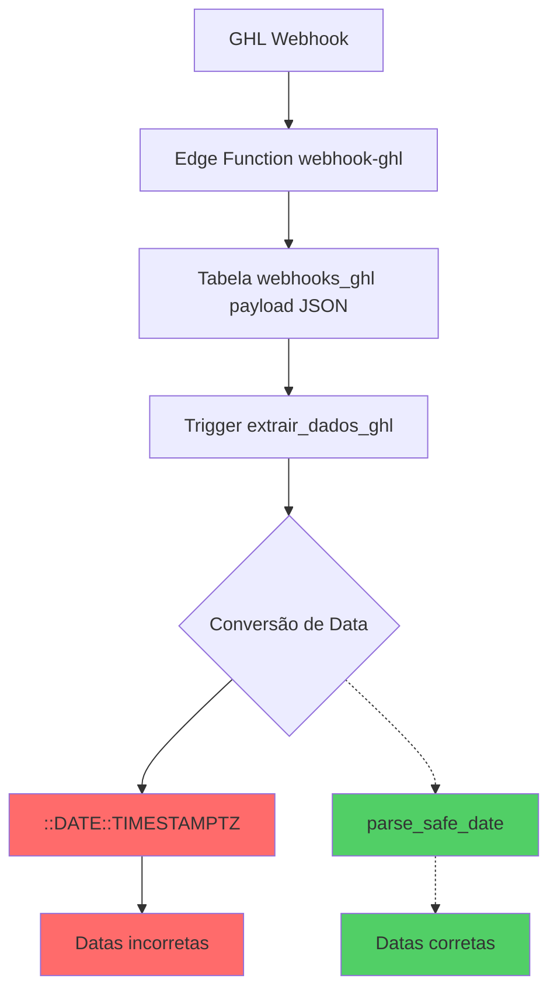

# Auditoria Completa: Tratamento de Datas em Webhooks GHL

## Data: 2026-02-27
## Status: ✅ CORRIGIDO - Migrações Criadas

---

## 1. Resumo Executivo

### 🔴 PROBLEMA CRÍTICO IDENTIFICADO

A função `parse_safe_date()` foi criada para resolver o bug de inversão mês/dia, **mas NÃO está sendo usada** na função principal de extração `extrair_dados_ghl()`.

### Impacto
- **30+ campos de data** ainda usam conversão direta `::DATE::TIMESTAMPTZ`
- Novos webhooks continuarão a ter datas incorretas
- O bug de inversão mês/dia persiste para novos dados

---

## 2. Análise Detalhada

### 2.1 Função Segura Existe mas Não Está Sendo Usada

| Arquivo | Conteúdo | Status |
|---------|----------|--------|
| `20260227110000_create_safe_date_parse.sql` | Cria `parse_safe_date()` | ✅ Criada |
| `20260226400100_fix_extrair_dados_ghl_com_fallbacks.sql` | Usa `::DATE::TIMESTAMPTZ` | ❌ Não usa a função |

### 2.2 Campos Afetados (30+ campos de data)

#### Datas MQL - Pipeline Pré-Vendas
| Campo Original | Campo Atual | Tipo de Conversão | Risco |
|----------------|-------------|-------------------|-------|
| `data_mql_lead_recebido` | `data_lead_recebido` | `::DATE::TIMESTAMPTZ` | 🔴 Alto |
| `data_mql_contato_1` | `data_tentativa_1` | `::DATE::TIMESTAMPTZ` | 🔴 Alto |
| `data_mql_contato_2` | `data_tentativa_2` | `::DATE::TIMESTAMPTZ` | 🔴 Alto |
| `data_mql_contato_3` | `data_tentativa_3` | `::DATE::TIMESTAMPTZ` | 🔴 Alto |
| `data_mql_contato_4` | `data_tentativa_4` | `::DATE::TIMESTAMPTZ` | 🔴 Alto |
| `data_mql_contato_5` | `data_tentativa_5` | `::DATE::TIMESTAMPTZ` | 🔴 Alto |
| `data_mql_contato_6` | `data_tentativa_6` | `::DATE::TIMESTAMPTZ` | 🔴 Alto |
| `data_mql_contato_7` | `data_tentativa_7` | `::DATE::TIMESTAMPTZ` | 🔴 Alto |
| `data_mql_contato_8` | `data_tentativa_8` | `::DATE::TIMESTAMPTZ` | 🔴 Alto |
| `data_mql_no_show` | `data_no_show` | `::DATE::TIMESTAMPTZ` | 🔴 Alto |
| `data_mql_conectado` | `data_conectado` | `::DATE::TIMESTAMPTZ` | 🔴 Alto |
| `data_mql_perdido` | `data_perdido` | `::DATE::TIMESTAMPTZ` | 🔴 Alto |
| `data_mql_qualificado` | `data_qualificado` | `::DATE::TIMESTAMPTZ` | 🔴 Alto |
| `data_mql_reuniao_marcada` | `data_agendamento_reuniao` | `::DATE::TIMESTAMPTZ` | 🔴 Alto |
| `data_pendencias_preenchimento` | `data_pendencias_preenchimento` | `::DATE::TIMESTAMPTZ` | 🔴 Alto |

#### Datas SQL - Pipeline de Vendas
| Campo Original | Campo Atual | Tipo de Conversão | Risco |
|----------------|-------------|-------------------|-------|
| `data_sql_no_show` | `data_no_show_vendas` | `::DATE::TIMESTAMPTZ` | 🔴 Alto |
| `data_sql_perdido` | `data_perdido_vendas` | `::DATE::TIMESTAMPTZ` | 🔴 Alto |
| `data_sql_reuniao_agendada` | `data_agendamento_vendas` | `::DATE::TIMESTAMPTZ` | 🔴 Alto |
| `data_sql_reuniao_realizada` | `data_realizacao_vendas` | `::DATE::TIMESTAMPTZ` | 🔴 Alto |
| `data_sql_negociacao` | `data_negociacao` | `::DATE::TIMESTAMPTZ` | 🔴 Alto |
| `data_sql_fechada` | `data_fechado` | `::DATE::TIMESTAMPTZ` | 🔴 Alto |

#### Datas de Reunião
| Campo | Tipo de Conversão | Risco |
|-------|-------------------|-------|
| `data_reuniao_agendada` | `::DATE::TIMESTAMPTZ` | 🔴 Alto |
| `data_reuniao_realizada` | `::DATE::TIMESTAMPTZ` | 🔴 Alto |

#### Datas de Contato (tabela contatos)
| Campo | Tipo de Conversão | Risco |
|-------|-------------------|-------|
| `date_created` | `::TIMESTAMPTZ` direto | 🟡 Médio |

---

## 3. Causa Raiz do Problema

### O que acontece com `::DATE::TIMESTAMPTZ`

```sql
-- String do webhook: "2026-02-12" (12 de fevereiro)
-- PostgreSQL com DateStyle = 'ISO, MDY' pode interpretar como:
-- 12 de fevereiro (correto) OU 2 de dezembro (incorreto)
```

### Por que `parse_safe_date()` resolve

```sql
CREATE OR REPLACE FUNCTION public.parse_safe_date(p_date_string text)
RETURNS timestamptz AS $$
BEGIN
    -- 1. Tenta ISO8601 timestamp completo (ex: 2026-02-13T01:17:19.806Z)
    -- 2. Tenta ISO date com formato explícito YYYY-MM-DD
    -- 3. Tenta formato brasileiro DD/MM/YYYY
    -- 4. Tenta formato americano MM/DD/YYYY
END;
$$ LANGUAGE plpgsql IMMUTABLE;
```

---

## 4. Fluxo de Dados Atual



---

## 5. Plano de Correção

### Fase 1: Atualizar Função `extrair_dados_ghl()`

**Arquivo:** `supabase/migrations/20260227120000_fix_extrair_dados_ghl_use_safe_date.sql`

Substituir TODAS as ocorrências de:
```sql
))::DATE::TIMESTAMPTZ
```

Por:
```sql
), parse_safe_date(extract_custom_field(w.payload->'customData', ARRAY[...]))
```

### Fase 2: Backfill de Dados Existentes

**Arquivo:** `supabase/migrations/20260227130000_backfill_dates_with_safe_parse.sql`

Reprocessar todos os webhooks para corrigir datas históricas.

### Fase 3: Validação

Queries de validação para verificar se a correção funcionou.

---

## 6. Lista Completa de Substituições Necessárias

### Na função `extrair_dados_ghl()` - INSERT

```sql
-- ANTES (problemático)
COALESCE(
    (extract_custom_field(w.payload->'customData', ARRAY[
        '{{ opportunity.mqlleads_recebidos }}',
        '{{opportunity.mqlleads_recebidos}}'
    ]))::TIMESTAMPTZ,
    (extract_custom_field(w.payload->'customData', ARRAY[
        '{{ opportunity.d_mqlleads_recebidos }}',
        '{{opportunity.d_mqlleads_recebidos}}'
    ]))::DATE::TIMESTAMPTZ,
    (w.payload->>'date_created')::TIMESTAMPTZ
) as data_mql_lead_recebido,

-- DEPOIS (correto)
COALESCE(
    parse_safe_date(extract_custom_field(w.payload->'customData', ARRAY[
        '{{ opportunity.mqlleads_recebidos }}',
        '{{opportunity.mqlleads_recebidos}}'
    ])),
    parse_safe_date(extract_custom_field(w.payload->'customData', ARRAY[
        '{{ opportunity.d_mqlleads_recebidos }}',
        '{{opportunity.d_mqlleads_recebidos}}'
    ])),
    (w.payload->>'date_created')::TIMESTAMPTZ
) as data_mql_lead_recebido,
```

### Campos que precisam de correção

1. `data_mql_lead_recebido` / `data_lead_recebido`
2. `data_mql_contato_1` a `data_mql_contato_8` / `data_tentativa_1` a `data_tentativa_8`
3. `data_mql_no_show` / `data_no_show`
4. `data_mql_conectado` / `data_conectado`
5. `data_mql_perdido` / `data_perdido`
6. `data_mql_qualificado` / `data_qualificado`
7. `data_mql_reuniao_marcada` / `data_agendamento_reuniao`
8. `data_pendencias_preenchimento`
9. `data_sql_no_show` / `data_no_show_vendas`
10. `data_sql_perdido` / `data_perdido_vendas`
11. `data_sql_reuniao_agendada` / `data_agendamento_vendas`
12. `data_sql_reuniao_realizada` / `data_realizacao_vendas`
13. `data_sql_negociacao` / `data_negociacao`
14. `data_sql_fechada` / `data_fechado`
15. `data_reuniao_agendada`
16. `data_reuniao_realizada`

---

## 7. Riscos e Mitigações

| Risco | Probabilidade | Impacto | Mitigação |
|-------|---------------|---------|-----------|
| Novos webhooks com datas erradas | Alta | Alto | Aplicar correção imediatamente |
| Backfill demorar muito | Média | Baixo | Executar em batches |
| Dados históricos incorretos | Alta | Médio | Reprocessar todos os webhooks |

---

## 8. Próximos Passos

1. [ ] Criar migration para atualizar `extrair_dados_ghl()` usando `parse_safe_date()`
2. [ ] Criar migration de backfill para reprocessar webhooks existentes
3. [ ] Executar validação de dados
4. [ ] Monitorar novos webhooks

---

## 9. Conclusão

A função `parse_safe_date()` foi criada corretamente, mas **não foi integrada** à função principal de extração. Isso significa que:

- ✅ A correção técnica existe
- ❌ A correção não está ativa
- 🔴 Novos webhooks ainda terão o problema de inversão de data

**Ação recomendada:** Aplicar a correção imediatamente.
