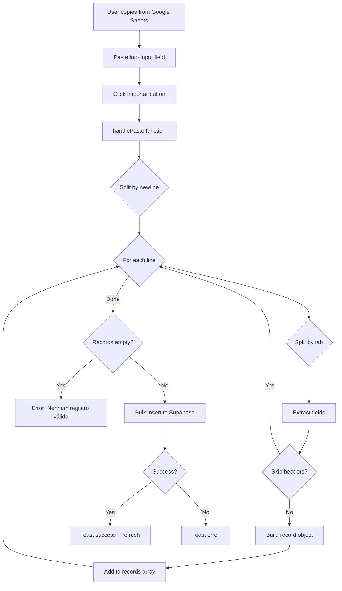

# CSV Paste Functionality Plan for Traqueamento Page

## Overview

This document outlines the plan to add CSV paste functionality alongside the existing Google Sheets paste feature in the traqueamento page (`eb-dash/app/(dashboard)/traqueamento/page.tsx`).

---

## 1. Current Implementation Analysis

### 1.1 Google Sheets Paste Pattern

The current implementation uses a consistent pattern across all sub-tabs:

```typescript
// State for paste data
const [pasteData, setPasteData] = useState('')

// Handler function
const handlePaste = async () => {
  if (!pasteData) { toast.error('Cole os dados do Sheets'); return }
  setSaving(true)
  const workspaceId = await getWorkspaceId(supabase)
  if (!workspaceId) { toast.error('Workspace não encontrado'); setSaving(false); return }
  
  // Parse: Split by newline, then by tab
  const lines = pasteData.split('\n').filter(l => l.trim())
  const records: Array<...> = []
  
  for (const line of lines) {
    const parts = line.split('\t')  // Tab-separated values
    if (parts.length < MIN_COLUMNS) continue
    
    // Extract and validate fields
    const field1 = parts[0].trim()
    const field2 = parts[1].trim()
    // ... more fields as needed
    
    // Skip header rows
    if (field1.toLowerCase() === 'nome') continue
    
    records.push({ workspace_id: workspaceId, ... })
  }
  
  // Bulk insert
  if (records.length === 0) { toast.error('Nenhum registro válido'); setSaving(false); return }
  const { error } = await supabase.from(TABLE_NAME).insert(records as never)
  // ... handle success/error
}
```

### 1.2 Affected Components (14 paste handlers found)

| Component | Line Range | Columns Expected | Table |
|-----------|------------|------------------|-------|
| [`SlugUtmSubTab`](../eb-dash/app/(dashboard)/traqueamento/page.tsx:194) | 194-214 | Nome, Slug | utm_slugs |
| [`UtmSourceAdsSubTab`](../eb-dash/app/(dashboard)/traqueamento/page.tsx:334) | 334-367 | Nome, Slug, utm_source, public_code | utm_sources |
| [`UtmSourceOrganicoSubTab`](../eb-dash/app/(dashboard)/traqueamento/page.tsx:494) | 494-522 | Nome, Slug, utm_source | utm_sources_plain |
| [`UtmCampaignSubTab`](../eb-dash/app/(dashboard)/traqueamento/page.tsx:638) | 638-690 | Nome, utm_campaign, page_code | utm_campaigns |
| [`UtmMediumSubTab`](../eb-dash/app/(dashboard)/traqueamento/page.tsx:775) | 775-823 | Nome, utm_medium | utm_mediums |
| [`UtmTermSubTab`](../eb-dash/app/(dashboard)/traqueamento/page.tsx:898) | 898-946 | Nome, utm_term | utm_terms |
| [`ObjetivoAdsSubTab`](../eb-dash/app/(dashboard)/traqueamento/page.tsx:1022) | 1022-1070 | Nome, objective_code | utm_objectives |
| [`OrigemTab - handlePasteOrigens`](../eb-dash/app/(dashboard)/traqueamento/page.tsx:1154) | 1154-1165 | Nome (single column) | utm_origins |
| [`OrigemTab - handlePasteAssignments`](../eb-dash/app/(dashboard)/traqueamento/page.tsx:1167) | 1167-1189 | Slug Nome, Origin Nome | utm_source_origin_assignments |
| [`AdsCatalogoSubTab`](../eb-dash/app/(dashboard)/traqueamento/page.tsx:1677) | 1677-1705 | Mês, Objetivo, Público, Criativo, Página, Medium, URL | ads_catalog |
| [`OrganicoCatalogoSubTab`](../eb-dash/app/(dashboard)/traqueamento/page.tsx:1958) | 1958-1999 | Similar to AdsCatalogo | organic_catalog |

### 1.3 Current Data Flow



---

## 2. Proposed Architecture

### 2.1 Design Goals

1. **Auto-Detection**: Automatically detect whether pasted content is TSV (Google Sheets) or CSV format
2. **Reusability**: Create a shared parsing utility to reduce code duplication
3. **Backward Compatibility**: Existing Google Sheets paste must continue to work unchanged
4. **User Experience**: Seamless experience - no toggles or mode switches required

### 2.2 Detection Strategy

```typescript
// Auto-detect format based on content analysis
function detectFormat(content: string): 'tsv' | 'csv' {
  const lines = content.split('\n').filter(l => l.trim())
  if (lines.length === 0) return 'tsv' // default
  
  const firstLine = lines[0]
  const tabCount = (firstLine.match(/\t/g) || []).length
  const commaCount = (firstLine.match(/,/g) || []).length
  const semicolonCount = (firstLine.match(/;/g) || []).length
  
  // If tabs present and more than commas, it's TSV (Google Sheets)
  if (tabCount > 0 && tabCount >= commaCount) return 'tsv'
  
  // If semicolons are more than commas (common in Brazilian locale)
  if (semicolonCount > commaCount) return 'csv' // Will use ; as delimiter
  
  // Default to comma-separated CSV
  return 'csv'
}
```

### 2.3 CSV Parsing Considerations

CSV parsing is more complex than simple splitting because of:

1. **Quoted fields**: `"Field with, comma"` 
2. **Escaped quotes**: `"Field with ""quotes"""`
3. **Multiple delimiters**: `,` vs `;` (Brazilian locale uses `;`)
4. **Line breaks in fields**: `"Field\nwith newline"`

### 2.4 New Utility Function

Create a shared parsing utility at [`eb-dash/lib/utils/parsers.ts`](../eb-dash/lib/utils/parsers.ts):

```typescript
// eb-dash/lib/utils/parsers.ts

export type ParsedRow = string[]
export type ParseResult = {
  rows: ParsedRow[]
  format: 'tsv' | 'csv'
  delimiter: string
}

/**
 * Parse pasted content from either Google Sheets (TSV) or CSV format
 */
export function parseDelimitedContent(content: string): ParseResult {
  const format = detectFormat(content)
  const delimiter = format === 'tsv' ? '\t' : detectCSVDelimiter(content)
  
  const rows: ParsedRow[] = []
  const lines = content.split('\n').filter(l => l.trim())
  
  for (const line of lines) {
    if (format === 'tsv') {
      rows.push(line.split('\t').map(cell => cell.trim()))
    } else {
      rows.push(parseCSVLine(line, delimiter))
    }
  }
  
  return { rows, format, delimiter }
}

/**
 * Parse a single CSV line handling quoted fields
 */
function parseCSVLine(line: string, delimiter: string): string[] {
  const cells: string[] = []
  let current = ''
  let inQuotes = false
  
  for (let i = 0; i < line.length; i++) {
    const char = line[i]
    
    if (inQuotes) {
      if (char === '"') {
        // Check for escaped quote
        if (line[i + 1] === '"') {
          current += '"'
          i++ // Skip next quote
        } else {
          inQuotes = false
        }
      } else {
        current += char
      }
    } else {
      if (char === '"') {
        inQuotes = true
      } else if (char === delimiter) {
        cells.push(current.trim())
        current = ''
      } else {
        current += char
      }
    }
  }
  
  cells.push(current.trim())
  return cells
}

/**
 * Detect CSV delimiter (comma vs semicolon for Brazilian locale)
 */
function detectCSVDelimiter(content: string): string {
  const firstLine = content.split('\n')[0]
  const commaCount = (firstLine.match(/,/g) || []).length
  const semicolonCount = (firstLine.match(/;/g) || []).length
  
  return semicolonCount > commaCount ? ';' : ','
}

/**
 * Detect if content is TSV (Google Sheets) or CSV
 */
function detectFormat(content: string): 'tsv' | 'csv' {
  const firstLine = content.split('\n')[0]
  const tabCount = (firstLine.match(/\t/g) || []).length
  const commaCount = (firstLine.match(/,/g) || []).length
  const semicolonCount = (firstLine.match(/;/g) || []).length
  
  // If tabs present and >= other delimiters, it's TSV
  if (tabCount > 0 && tabCount >= commaCount && tabCount >= semicolonCount) {
    return 'tsv'
  }
  
  return 'csv'
}
```

---

## 3. Implementation Plan

### Phase 1: Create Shared Parser Utility

**File**: [`eb-dash/lib/utils/parsers.ts`](../eb-dash/lib/utils/parsers.ts) (new file)

**Tasks**:
1. Create the parsing utility functions
2. Add comprehensive JSDoc documentation
3. Export types and functions

### Phase 2: Create Custom Hook (Optional but Recommended)

**File**: [`eb-dash/hooks/usePasteImport.ts`](../eb-dash/hooks/usePasteImport.ts) (new file)

```typescript
// eb-dash/hooks/usePasteImport.ts
import { useState, useCallback } from 'react'
import { toast } from 'sonner'
import { parseDelimitedContent, ParsedRow } from '@/lib/utils/parsers'
import { createClient } from '@/lib/supabase/client'

interface UsePasteImportOptions<T> {
  tableName: string
  minColumns: number
  headerPatterns: string[]  // e.g., ['nome', 'slug']
  mapRowToRecord: (row: ParsedRow, workspaceId: string) => T | null
  getWorkspaceId: () => Promise<string | null>
}

interface UsePasteImportReturn {
  pasteData: string
  setPasteData: (data: string) => void
  saving: boolean
  handlePaste: () => Promise<void>
  lastImportCount: number
}

export function usePasteImport<T>({
  tableName,
  minColumns,
  headerPatterns,
  mapRowToRecord,
  getWorkspaceId,
}: UsePasteImportOptions<T>): UsePasteImportReturn {
  const [pasteData, setPasteData] = useState('')
  const [saving, setSaving] = useState(false)
  const [lastImportCount, setLastImportCount] = useState(0)
  const supabase = createClient()
  
  const handlePaste = useCallback(async () => {
    if (!pasteData) {
      toast.error('Cole os dados')
      return
    }
    
    setSaving(true)
    const workspaceId = await getWorkspaceId()
    if (!workspaceId) {
      toast.error('Workspace não encontrado')
      setSaving(false)
      return
    }
    
    const { rows, format } = parseDelimitedContent(pasteData)
    const records: T[] = []
    
    for (const row of rows) {
      if (row.length < minColumns) continue
      
      // Skip header rows
      const firstCell = row[0]?.toLowerCase() || ''
      if (headerPatterns.some(pattern => firstCell.includes(pattern))) continue
      
      const record = mapRowToRecord(row, workspaceId)
      if (record) records.push(record)
    }
    
    if (records.length === 0) {
      toast.error('Nenhum registro válido')
      setSaving(false)
      return
    }
    
    const { error } = await supabase.from(tableName).insert(records as never)
    
    if (error) {
      toast.error(`Erro: ${error.message}`)
    } else {
      toast.success(`${records.length} registros importados (${format.toUpperCase()})`)
      setPasteData('')
      setLastImportCount(records.length)
    }
    
    setSaving(false)
  }, [pasteData, tableName, minColumns, headerPatterns, mapRowToRecord, getWorkspaceId, supabase])
  
  return { pasteData, setPasteData, saving, handlePaste, lastImportCount }
}
```

### Phase 3: Update UI Labels

**File**: [`eb-dash/app/(dashboard)/traqueamento/page.tsx`](../eb-dash/app/(dashboard)/traqueamento/page.tsx)

Update the Label components to indicate both formats are supported:

```diff
- <Label>Colar do Google Sheets (Nome [Tab] Slug)</Label>
+ <Label>Colar do Google Sheets ou CSV (Nome, Slug)</Label>
```

Or keep it generic:
```diff
- <Label>Colar do Google Sheets (Nome [Tab] Slug)</Label>
+ <Label>Importar dados (Google Sheets ou CSV)</Label>
```

### Phase 4: Migrate Components (Gradual Approach)

Start with one component as a pilot, then migrate others:

**Pilot**: [`SlugUtmSubTab`](../eb-dash/app/(dashboard)/traqueamento/page.tsx:158) (simplest, 2 columns)

```typescript
// Before (current implementation)
const handlePaste = async () => {
  // ... existing tab-split logic
}

// After (with CSV support)
import { parseDelimitedContent } from '@/lib/utils/parsers'

const handlePaste = async () => {
  if (!pasteData) { toast.error('Cole os dados'); return }
  setSaving(true)
  const workspaceId = await getWorkspaceId(supabase)
  if (!workspaceId) { toast.error('Workspace não encontrado'); setSaving(false); return }
  
  const { rows, format } = parseDelimitedContent(pasteData)
  const records: { workspace_id: string; nome: string; slug: string }[] = []
  
  for (const row of rows) {
    if (row.length < 2) continue
    const nome = row[0].trim()
    const slug = row[1].trim()
    if (nome.toLowerCase().includes('nome') || slug.toLowerCase().includes('slug')) continue
    if (nome && slug) {
      records.push({ 
        workspace_id: workspaceId, 
        nome, 
        slug: slug.toLowerCase().replace(/\s+/g, '-') 
      })
    }
  }
  
  if (records.length === 0) { toast.error('Nenhum registro válido'); setSaving(false); return }
  const { error } = await supabase.from('utm_slugs').insert(records as never)
  if (error) { 
    toast.error(`Erro: ${error.message}`) 
  } else { 
    toast.success(`${records.length} slugs importados (${format.toUpperCase()})`)
    setPasteData(''); 
    fetchData() 
  }
  setSaving(false)
}
```

---

## 4. Edge Cases to Handle

### 4.1 CSV-Specific Edge Cases

| Edge Case | Example | Solution |
|-----------|---------|----------|
| Quoted fields with delimiter | `"Nome, Sobrenome"` | Use proper CSV parser |
| Escaped quotes | `"Texto com ""aspas"""` | Handle `""` as escaped quote |
| Semicolon delimiter (Brazil) | `Nome;Slug` | Auto-detect delimiter |
| Mixed line endings | `\r\n` vs `\n` | Normalize line endings |
| Trailing delimiter | `Nome,Slug,` | Handle empty trailing cells |
| BOM in UTF-8 | `\uFEFFNome,Slug` | Strip BOM character |
| Empty lines between rows | `Nome,Slug\n\nOutro,Slug2` | Filter empty lines |

### 4.2 Validation Edge Cases

| Edge Case | Solution |
|-----------|----------|
| Header row detection | Check first cell against known header patterns |
| Partial rows | Skip rows with fewer than minimum columns |
| Duplicate entries | Let Supabase handle via unique constraints |
| Invalid data types | Validate before insert, show error |

---

## 5. Files to Modify

### New Files

| File | Purpose |
|------|---------|
| [`eb-dash/lib/utils/parsers.ts`](../eb-dash/lib/utils/parsers.ts) | CSV/TSV parsing utilities |
| [`eb-dash/hooks/usePasteImport.ts`](../eb-dash/hooks/usePasteImport.ts) | (Optional) Reusable paste hook |

### Modified Files

| File | Changes |
|------|---------|
| [`eb-dash/app/(dashboard)/traqueamento/page.tsx`](../eb-dash/app/(dashboard)/traqueamento/page.tsx) | Import parser, update handlePaste functions, update labels |

---

## 6. Testing Checklist

- [ ] Google Sheets paste still works (tab-separated)
- [ ] CSV with comma delimiter works
- [ ] CSV with semicolon delimiter works (Brazilian Excel)
- [ ] Quoted fields are parsed correctly
- [ ] Header rows are skipped
- [ ] Invalid rows are skipped with appropriate message
- [ ] Success message shows format detected
- [ ] Empty paste shows error
- [ ] Partial rows (fewer columns) are skipped

---

## 7. Rollout Strategy

### Option A: Big Bang (All at once)
- Implement parser utility
- Update all 14 handlePaste functions in a single PR
- Risk: Higher chance of regression

### Option B: Gradual Migration (Recommended)
1. Implement parser utility first
2. Migrate one component (SlugUtmSubTab) as pilot
3. Test thoroughly
4. Migrate remaining components in batches
5. Lower risk, easier to debug

---

## 8. Code Snippets for Key Changes

### 8.1 Parser Utility Import

```typescript
// Add at top of page.tsx
import { parseDelimitedContent } from '@/lib/utils/parsers'
```

### 8.2 Updated handlePaste Template

```typescript
const handlePaste = async () => {
  if (!pasteData) { toast.error('Cole os dados do Sheets ou CSV'); return }
  setSaving(true)
  const workspaceId = await getWorkspaceId(supabase)
  if (!workspaceId) { toast.error('Workspace não encontrado'); setSaving(false); return }
  
  // Parse content (auto-detects TSV vs CSV)
  const { rows, format } = parseDelimitedContent(pasteData)
  
  // Build records array
  const records: Array<RECORD_TYPE> = []
  for (const row of rows) {
    if (row.length < MIN_COLUMNS) continue
    
    // Extract fields
    const field1 = row[0]?.trim()
    const field2 = row[1]?.trim()
    // ... more fields
    
    // Skip header rows
    if (HEADER_PATTERNS.some(p => field1?.toLowerCase().includes(p))) continue
    
    // Validate and build record
    if (field1 && field2) {
      records.push({
        workspace_id: workspaceId,
        // ... field mappings
      })
    }
  }
  
  if (records.length === 0) { 
    toast.error('Nenhum registro válido'); 
    setSaving(false); 
    return 
  }
  
  const { error } = await supabase.from(TABLE_NAME).insert(records as never)
  if (error) { 
    toast.error(`Erro: ${error.message}`) 
  } else { 
    toast.success(`${records.length} registros importados (${format.toUpperCase()})`)
    setPasteData('')
    fetchData() 
  }
  setSaving(false)
}
```

### 8.3 UI Label Updates

```typescript
// Before
<Label>Colar do Google Sheets (Nome [Tab] Slug)</Label>

// After
<Label>Importar dados (Google Sheets ou CSV)</Label>
< p className="text-xs text-muted-foreground mt-1">
  Formatos: Tab-separated (Sheets) ou CSV (Excel)
</p>
```

---

## 9. Summary

This plan introduces CSV paste support through:

1. **A new parsing utility** that auto-detects format (TSV vs CSV)
2. **Minimal changes to existing components** - only the parsing logic changes
3. **Backward compatibility** - Google Sheets paste continues to work
4. **Better UX** - users don't need to know the format, it just works

The implementation is low-risk because:
- No database schema changes
- No new dependencies required
- Existing functionality preserved
- Can be rolled out gradually
