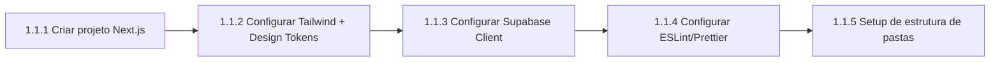
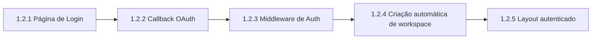
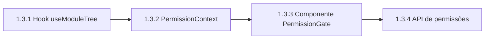
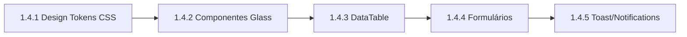
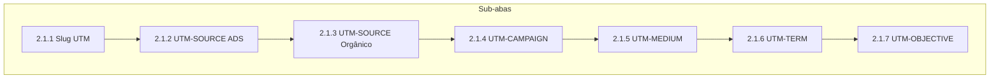
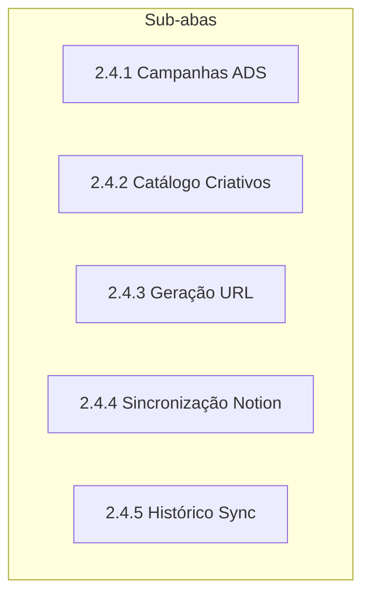

# Plano de Execução: Dashboard Empire

> **PRD de Referência:** [PRD-DASHBOARD-EMPIRE.md](../docs/PRD-DASHBOARD-EMPIRE.md)
> **Design System:** [DESIGN_TOKENS.md](../docs/DESIGN_TOKENS.md)
> **Data:** 2026-02-25

---

## Visão Geral

Este plano divide a implementação do Dashboard Empire em **fases**, **épicas** e **tasks**. Cada task é uma unidade de trabalho que pode ser executada de forma independente, mas com dependências claras.

---

## Estado Atual

### ✅ Já Implementado (Migrations)

| Componente | Status | Arquivo |
|------------|--------|---------|
| Tabela `workspaces` | ✅ Criada | `20260225100000_create_workspaces_and_members.sql` |
| Tabela `workspace_members` | ✅ Criada | `20260225100000_create_workspaces_and_members.sql` |
| Tabela `dashboard_user_permissions` | ✅ Criada | `20260225100100_create_dashboard_permissions.sql` |
| Tabela `dashboard_user_lead_filters` | ✅ Criada | `20260225100200_create_dashboard_lead_filters.sql` |
| 17 tabelas do módulo Traqueamento | ✅ Criadas | `20260225100300_create_tracking_module_tables.sql` |
| Tabela `permission_audit_log` | ✅ Criada | `20260225100400_create_permission_audit_log.sql` |
| RLS em todas as tabelas | ✅ Configurado | Nas migrations acima |

### ❌ Pendente de Implementação

- Projeto Next.js (frontend)
- Sistema de autenticação
- UI do dashboard
- APIs internas
- Edge Functions (Notion, Switchy)
- Testes

---

## Fase 1: Fundação (MVP)

### Épica 1.1: Setup do Projeto

| Task | Descrição | Dependências | Prioridade |
|------|-----------|--------------|------------|
| 1.1.1 | Criar projeto Next.js 14+ com App Router | - | Bloqueante |
| 1.1.2 | Configurar Tailwind CSS com design tokens do DESIGN_TOKENS.md | 1.1.1 | Bloqueante |
| 1.1.3 | Configurar Supabase Client (browser e server) | 1.1.1 | Bloqueante |
| 1.1.4 | Configurar ESLint, Prettier e regras de tokenização | 1.1.1 | Alta |
| 1.1.5 | Criar estrutura de pastas conforme arquitetura | 1.1.1 | Alta |

### Épica 1.2: Autenticação e Workspace

| Task | Descrição | Dependências | Prioridade |
|------|-----------|--------------|------------|
| 1.2.1 | Criar página de login com Supabase Auth | 1.1.3 | Bloqueante |
| 1.2.2 | Implementar callback OAuth | 1.2.1 | Bloqueante |
| 1.2.3 | Criar middleware de proteção de rotas | 1.2.2 | Bloqueante |
| 1.2.4 | Implementar criação automática de workspace no primeiro login | 1.2.2 | Bloqueante |
| 1.2.5 | Criar layout autenticado com sidebar | 1.2.3 | Alta |

### Épica 1.3: Sistema de Permissões

| Task | Descrição | Dependências | Prioridade |
|------|-----------|--------------|------------|
| 1.3.1 | Criar hook `useModuleTree()` para buscar módulos permitidos | 1.2.5 | Alta |
| 1.3.2 | Criar `PermissionContext` para gerenciar estado de permissões | 1.3.1 | Alta |
| 1.3.3 | Criar componente `PermissionGate` para controle de UI | 1.3.2 | Alta |
| 1.3.4 | Criar API interna `/api/modules/tree` | 1.2.3 | Alta |

### Épica 1.4: Componentes Base de UI

| Task | Descrição | Dependências | Prioridade |
|------|-----------|--------------|------------|
| 1.4.1 | Implementar CSS variables dos design tokens | 1.1.2 | Bloqueante |
| 1.4.2 | Criar componentes de glassmorfismo (glass, glass-elevated, etc.) | 1.4.1 | Alta |
| 1.4.3 | Criar componente DataTable com todas as features do TABELAS-DADOS.md | 1.4.2 | Alta |
| 1.4.4 | Criar componentes de formulário (Input, Select, Button) | 1.4.2 | Alta |
| 1.4.5 | Criar sistema de Toast/Notifications | 1.4.2 | Alta |
| 1.4.6 | Criar componente de Modal | 1.4.2 | Alta |
| 1.4.7 | Criar componente de Skeleton/Loading | 1.4.2 | Média |

---

## Fase 2: Módulo TRAQUEAMENTO

### Épica 2.1: Aba CODS UTM

| Task | Descrição | Tabela | Dependências |
|------|-----------|--------|--------------|
| 2.1.1 | Sub-aba Slug UTM | `utm_slugs` | 1.4.3 |
| 2.1.2 | Sub-aba UTM-SOURCE ADS | `utm_sources` | 2.1.1 |
| 2.1.3 | Sub-aba UTM-SOURCE Orgânico | `utm_sources_plain` | 2.1.2 |
| 2.1.4 | Sub-aba UTM-CAMPAIGN | `utm_campaigns` | 2.1.3 |
| 2.1.5 | Sub-aba UTM-MEDIUM | `utm_mediums` | 2.1.4 |
| 2.1.6 | Sub-aba UTM-TERM | `utm_terms` | 2.1.5 |
| 2.1.7 | Sub-aba UTM-OBJECTIVE | `utm_objectives` | 2.1.6 |

**Features comuns a todas as sub-abas:**
- Colar do Google Sheets
- Validação anti-duplicata
- Geração automática de códigos
- CRUD completo
- Upsert idempotente

### Épica 2.2: Aba ORIGEM

| Task | Descrição | Tabela | Dependências |
|------|-----------|--------|--------------|
| 2.2.1 | Sub-aba Origens | `utm_origins` | 2.1.3 |
| 2.2.2 | Sub-aba Atribuição Origem | `utm_source_origin_assignments` | 2.2.1 |

### Épica 2.3: Aba PROCESSO DE VENDAS

| Task | Descrição | Tabela | Dependências |
|------|-----------|--------|--------------|
| 2.3.1 | Sub-aba Processos | `sales_processes` | 2.1.4 |
| 2.3.2 | Sub-aba Atribuição Processo | `sales_process_assignments` | 2.3.1 |

### Épica 2.4: Aba ANÚNCIOS

| Task | Descrição | Tabela | Dependências |
|------|-----------|--------|--------------|
| 2.4.1 | Sub-aba Campanhas ADS | `ads_campaigns` | 2.1.7 |
| 2.4.2 | Sub-aba Catálogo de Criativos | `ads_catalog` | 2.4.1 |
| 2.4.3 | Geração automática de URL UTM | - | 2.4.2 |
| 2.4.4 | Sub-aba Sincronização Notion | `notion_creatives` | 2.4.2 |
| 2.4.5 | Sub-aba Histórico de Sync | `notion_sync_runs` | 2.4.4 |

### Épica 2.5: Aba ORGÂNICO

| Task | Descrição | Tabela | Dependências |
|------|-----------|--------|--------------|
| 2.5.1 | Sub-aba Catálogo Orgânico | `organic_catalog` | 2.1.3 |
| 2.5.2 | Sub-aba Sincronização Notion Orgânico | `notion_creatives` | 2.5.1 |

### Épica 2.6: Aba FUNIS

| Task | Descrição | Tabela | Dependências |
|------|-----------|--------|--------------|
| 2.6.1 | Seção Lista de Funis | `funnels` | 2.1.4 |
| 2.6.2 | Seção Hierarquia de Funis | `utm_campaigns.funnels` | 2.6.1 |
| 2.6.3 | Implementar rename em cascata | - | 2.6.1 |

---

## Fase 3: Integrações

### Épica 3.1: Integração Notion

| Task | Descrição | Dependências |
|------|-----------|--------------|
| 3.1.1 | Criar Edge Function `notion-creatives-sync` | 2.4.2 |
| 3.1.2 | Configurar variáveis de ambiente Notion | 3.1.1 |
| 3.1.3 | Implementar CRON 2x/dia | 3.1.1 |
| 3.1.4 | UI para trigger manual de sync | 3.1.1 |

### Épica 3.2: Integração Switchy

| Task | Descrição | Dependências |
|------|-----------|--------------|
| 3.2.1 | Criar Edge Function `switchy-shorten` | 2.4.3 |
| 3.2.2 | Configurar variáveis de ambiente Switchy | 3.2.1 |
| 3.2.3 | Integrar encurtamento no salvamento do catálogo | 3.2.1 |

---

## Fase 4: Sistema de Acesso (UI)

### Épica 4.1: Gestão de Membros

| Task | Descrição | Dependências |
|------|-----------|--------------|
| 4.1.1 | Página de listagem de membros | 1.3.3 |
| 4.1.2 | Modal de convite de membro | 4.1.1 |
| 4.1.3 | API de convite | 4.1.2 |

### Épica 4.2: Gestão de Permissões

| Task | Descrição | Dependências |
|------|-----------|--------------|
| 4.2.1 | UI para configurar permissões por módulo | 4.1.1 |
| 4.2.2 | UI para configurar filtros de leads | 4.2.1 |

---

## Fase 5: Testes e Qualidade

### Épica 5.1: Testes de Integração

| Task | Descrição | Dependências |
|------|-----------|--------------|
| 5.1.1 | Teste de isolamento de workspace (AC-002) | Fase 2 completa |
| 5.1.2 | Teste de permissões de módulo (AC-003) | 5.1.1 |
| 5.1.3 | Teste de filtro de leads (AC-004) | 5.1.2 |
| 5.1.4 | Teste de geração de códigos (AC-001) | 5.1.1 |

### Épica 5.2: Testes E2E

| Task | Descrição | Dependências |
|------|-----------|--------------|
| 5.2.1 | Setup Playwright/Cypress | 1.1.1 |
| 5.2.2 | Teste de fluxo de login | 5.2.1 |
| 5.2.3 | Teste de CRUD de UTM slugs | 5.2.1 |
| 5.2.4 | Teste de colar do Sheets | 5.2.3 |

---

## Resumo de Tasks por Fase

| Fase | Épicas | Tasks | Prioridade |
|------|--------|-------|------------|
| **1. Fundação** | 4 | 20 | Bloqueante |
| **2. Traqueamento** | 6 | 18 | MUST |
| **3. Integrações** | 2 | 7 | SHOULD |
| **4. Acesso UI** | 2 | 5 | SHOULD |
| **5. Testes** | 2 | 8 | MUST |

**Total: 58 tasks**

---

## Próximos Passos Imediatos

1. **Criar projeto Next.js** (Task 1.1.1)
2. **Configurar Design Tokens** (Task 1.1.2)
3. **Configurar Supabase Client** (Task 1.1.3)
4. **Implementar Login** (Task 1.2.1)

---

## Critérios de Aceitação por Task

Cada task deve satisfazer os seguintes critérios antes de ser considerada completa:

### Para Tasks de UI:
- [ ] Implementa todas as funcionalidades descritas
- [ ] Usa apenas design tokens (sem cores hard-coded)
- [ ] Responsiva (mobile-first)
- [ ] Acessível (WCAG 2.1 AA)
- [ ] Estados de loading/error/empty

### Para Tasks de API:
- [ ] Validação de input
- [ ] Tratamento de erros
- [ ] Logs adequados
- [ ] Documentação no código

### Para Tasks de Edge Functions:
- [ ] Variáveis de ambiente documentadas
- [ ] Tratamento de erros robusto
- [ ] Logs estruturados
- [ ] Rate limiting se aplicável

---

## Riscos e Mitigações

| Risco | Probabilidade | Mitigação |
|-------|---------------|-----------|
| Scope creep | Alta | Seguir PRD rigidamente, novas features vão para Fase 6+ |
| Problemas com Notion API | Média | Implementar sync manual como fallback |
| Performance com muitos registros | Média | Paginação server-side desde o início |
