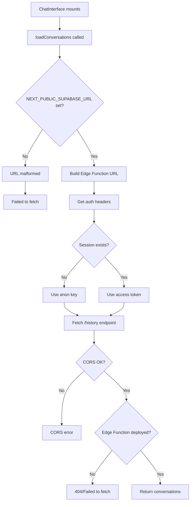

# Fix Plan: Chat Error "Failed to fetch"

## Error Summary

**Error Message:** `Chat error: "Failed to fetch"`
**Location:** [`useAIChat.ts`](eb-dash/hooks/useAIChat.ts:309) - `loadConversations` function
**Component:** [`ChatInterface.tsx`](eb-dash/components/ai-assistant/ChatInterface.tsx:74) - calls `loadConversations()` on mount

## Root Cause Analysis

The "Failed to fetch" error is a **network-level error** that occurs before the request completes. This can be caused by:

### 1. Missing Environment Variables (Most Likely)

The [`getEdgeFunctionUrl()`](eb-dash/hooks/useAIChat.ts:68) function relies on:
```typescript
const supabaseUrl = process.env.NEXT_PUBLIC_SUPABASE_URL;
```

If `NEXT_PUBLIC_SUPABASE_URL` is not set in `.env.local`, the URL becomes `undefined/functions/v1/ai-assistant`, causing a malformed URL error.

### 2. CORS Configuration Mismatch

The Edge Function's CORS configuration at [`index.ts:780-810`](supabase/functions/ai-assistant/index.ts:780) allows:
- `http://localhost:3000`
- `http://127.0.0.1:3000`
- `http://localhost:5173`
- Supabase URL

If the Next.js dev server runs on a different port, CORS will block the request.

### 3. Edge Function Not Deployed

The `ai-assistant` Edge Function exists locally but may not be deployed to the Supabase project.

### 4. Authentication Issues

The [`getAuthHeaders()`](eb-dash/hooks/useAIChat.ts:76) function tries to get the session, but if the user is not authenticated, it falls back to anon key. However, the Edge Function's [`authenticateUser()`](supabase/functions/ai-assistant/index.ts:508) expects a valid JWT.

---

## Diagnostic Steps

### Step 1: Check Environment Variables

Verify `.env.local` exists and contains:
```bash
NEXT_PUBLIC_SUPABASE_URL=https://your-project.supabase.co
NEXT_PUBLIC_SUPABASE_ANON_KEY=your-anon-key
```

### Step 2: Check Edge Function Deployment

Run in terminal:
```bash
supabase functions list --project-ref your-project-ref
```

Or check via Supabase Dashboard > Edge Functions.

### Step 3: Check Browser Network Tab

Open DevTools > Network tab and look for:
- Request URL (is it malformed?)
- CORS errors (red text)
- HTTP status codes

### Step 4: Check Console for Additional Errors

Look for `[AI Chat]` prefixed messages that indicate:
- Session status
- Token expiration
- URL configuration issues

---

## Fix Implementation

### Fix 1: Add Defensive URL Validation

**File:** [`eb-dash/hooks/useAIChat.ts`](eb-dash/hooks/useAIChat.ts:68)

```typescript
const getEdgeFunctionUrl = useCallback(() => {
  const supabaseUrl = process.env.NEXT_PUBLIC_SUPABASE_URL;
  if (!supabaseUrl) {
    console.error('[AI Chat] NEXT_PUBLIC_SUPABASE_URL is not configured');
    throw new Error('NEXT_PUBLIC_SUPABASE_URL is not configured');
  }
  return `${supabaseUrl}/functions/v1/ai-assistant`;
}, []);
```

### Fix 2: Improve Error Handling in loadConversations

**File:** [`eb-dash/hooks/useAIChat.ts`](eb-dash/hooks/useAIChat.ts:304)

```typescript
const loadConversations = useCallback(async () => {
  setIsLoading(true);
  
  try {
    // Validate URL before making request
    let url: string;
    try {
      url = getEdgeFunctionUrl();
    } catch (urlError) {
      throw new Error('Configuração do Supabase ausente. Verifique as variáveis de ambiente.');
    }
    
    const headers = await getAuthHeaders();
    const response = await fetch(`${url}/history`, {
      method: 'GET',
      headers,
    });
    
    if (!response.ok) {
      const errorData = await response.json().catch(() => ({}));
      throw new Error(errorData.error || `Erro ${response.status}: ${response.statusText}`);
    }
    
    const data = await response.json();
    setConversations(data.conversations || []);
    
  } catch (err) {
    // More descriptive error messages
    let errorMessage = 'Unknown error';
    if (err instanceof TypeError && err.message === 'Failed to fetch') {
      errorMessage = 'Não foi possível conectar ao servidor. Verifique sua conexão ou se o Edge Function está implantado.';
    } else if (err instanceof Error) {
      errorMessage = err.message;
    }
    setError(errorMessage);
    onError?.(errorMessage);
  } finally {
    setIsLoading(false);
  }
}, [getAuthHeaders, getEdgeFunctionUrl, onError]);
```

### Fix 3: Add Edge Function URL to CORS Allowed Origins

**File:** [`supabase/functions/ai-assistant/index.ts`](supabase/functions/ai-assistant/index.ts:786)

Add the Next.js dev server URL to allowed origins:

```typescript
const defaultOrigins = [
  supabaseUrl,
  'http://localhost:3000',
  'http://127.0.0.1:3000',
  'http://localhost:5173',
  'http://localhost:3001', // Add if using different port
];
```

### Fix 4: Deploy Edge Function

If not deployed, run:

```bash
supabase functions deploy ai-assistant --project-ref your-project-ref
```

---

## Recommended Implementation Order

1. **Immediate:** Add defensive URL validation (Fix 1) and improve error messages (Fix 2)
2. **Verify:** Check environment variables are set correctly
3. **Deploy:** Ensure Edge Function is deployed to Supabase
4. **Configure:** Update CORS if needed for dev server port

---

## Verification Steps

After implementing fixes:

1. Restart Next.js dev server
2. Clear browser cache
3. Navigate to Assistant page
4. Check browser console for `[AI Chat]` messages
5. Verify conversations load in sidebar

---

## Architecture Reference



---

## Files to Modify

| File | Change |
|------|--------|
| [`eb-dash/hooks/useAIChat.ts`](eb-dash/hooks/useAIChat.ts) | Add URL validation, improve error handling |
| [`supabase/functions/ai-assistant/index.ts`](supabase/functions/ai-assistant/index.ts) | Update CORS origins if needed |
| [`eb-dash/.env.local`](eb-dash/.env.local) | Verify environment variables |
