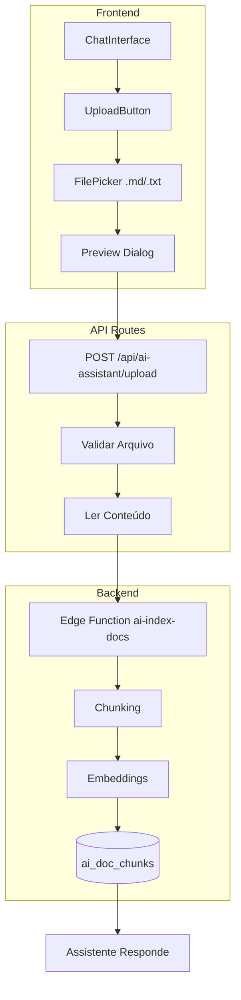
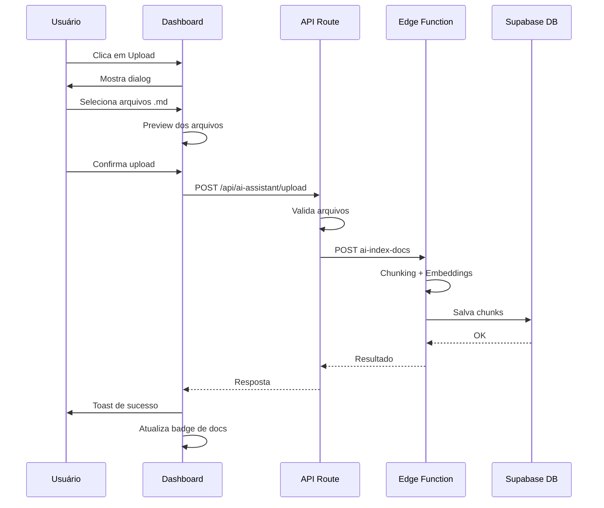

# Plano: Upload de Arquivos pelo Dashboard do Assistente

| Campo | Valor |
|-------|-------|
| **Data** | 2026-02-26 |
| **Status** | Proposta |
| **Prioridade** | Alta |

---

## Problema

O usuário deseja fazer upload de arquivos (documentos) para o assistente de IA diretamente pela interface do dashboard, mas essa funcionalidade **não existe** na implementação atual.

### Estado Atual

- O [`ChatInput.tsx`](../eb-dash/components/ai-assistant/ChatInput.tsx) só permite entrada de texto
- A indexação de documentos só pode ser feita via script CLI: `node scripts/index-docs.js`
- Não há interface para gerenciar documentos na base de conhecimento

---

## Solução Proposta

Adicionar funcionalidade de upload de arquivos .md/.txt diretamente na interface do assistente, permitindo que usuários autorizados adicionem documentos à base de conhecimento.

---

## Arquitetura



---

## Arquivos a Modificar/Criar

### 1. Novos Arquivos

| Arquivo | Descrição |
|---------|-----------|
| `eb-dash/components/ai-assistant/DocumentUploader.tsx` | Componente de upload com drag-and-drop |
| `eb-dash/app/api/ai-assistant/upload/route.ts` | API route para receber uploads |
| `eb-dash/components/ai-assistant/DocumentManager.tsx` | Interface para gerenciar documentos indexados |

### 2. Arquivos a Modificar

| Arquivo | Mudança |
|---------|---------|
| `eb-dash/components/ai-assistant/ChatInterface.tsx` | Adicionar botão de upload no header |
| `eb-dash/components/ai-assistant/ChatInput.tsx` | Adicionar botão de anexo ao lado do input |
| `eb-dash/hooks/useAIChat.ts` | Adicionar função de refresh do docCount |

---

## Especificação Técnica

### 1. DocumentUploader.tsx

```typescript
interface DocumentUploaderProps {
  onUploadComplete: (result: UploadResult) => void;
  onUploadError: (error: string) => void;
  allowedTypes: string[];  // ['.md', '.txt']
  maxSizeMB: number;       // 5MB default
}
```

**Features:**
- Drag-and-drop zone
- Preview do conteúdo antes de confirmar
- Barra de progresso durante upload
- Validação de tipo e tamanho
- Múltiplos arquivos simultâneos

### 2. API Route: /api/ai-assistant/upload

```typescript
// POST /api/ai-assistant/upload
interface UploadRequest {
  files: File[];
  clearExisting?: boolean;
}

interface UploadResponse {
  success: boolean;
  summary: {
    totalFiles: number;
    succeeded: number;
    failed: number;
    totalChunks: number;
  };
  results: Array<{
    path: string;
    success: boolean;
    chunksCreated: number;
    error?: string;
  }>;
}
```

**Fluxo:**
1. Receber arquivos via FormData
2. Validar usuário autenticado e permissão
3. Ler conteúdo de cada arquivo
4. Chamar Edge Function `ai-index-docs`
5. Retornar resultado

### 3. Integração no ChatInterface

**Localização do botão:**
- Header ao lado do badge de documentos
- Ou no ChatInput ao lado do botão de enviar

**Comportamento:**
- Click → Abre dialog de upload
- Upload completo → Atualiza badge de documentos
- Erro → Mostra toast de erro

---

## Fluxo de Usuário



---

## Permissões

O upload deve ser restrito a usuários com permissão de admin:

```typescript
// Verificar no PermissionContext
const canUploadDocs = permissions.includes('admin') || permissions.includes('manage_knowledge_base');
```

---

## Checklist de Implementação

### Fase 1: Componentes Base
- [ ] Criar `DocumentUploader.tsx` com drag-and-drop
- [ ] Criar `DocumentManager.tsx` para listar documentos
- [ ] Adicionar ícone de upload no `ChatInterface`

### Fase 2: API Route
- [ ] Criar `/api/ai-assistant/upload/route.ts`
- [ ] Implementar validação de arquivos
- [ ] Integrar com Edge Function `ai-index-docs`

### Fase 3: Integração
- [ ] Conectar componente com API
- [ ] Atualizar badge após upload
- [ ] Adicionar feedback visual de progresso

### Fase 4: Polish
- [ ] Adicionar remoção de documentos
- [ ] Adicionar re-indexação individual
- [ ] Tratamento de erros robusto

---

## Alternativas Consideradas

### Alternativa 1: Supabase Storage
Usar Supabase Storage para armazenar arquivos e trigger para indexar.

**Prós:**
- Armazenamento persistente
- Versionamento de arquivos

**Contras:**
- Mais complexo
- Custo adicional de storage
- Edge Function precisaria ler do Storage

### Alternativa 2: Indexação no Cliente
Processar arquivos no browser e enviar chunks prontos.

**Prós:**
- Menos carga no servidor

**Contras:**
- Embeddings não funcionam no browser
- Segurança comprometida

---

## Estimativa de Esforço

| Fase | Complexidade |
|------|--------------|
| Fase 1: Componentes | Média |
| Fase 2: API Route | Baixa |
| Fase 3: Integração | Baixa |
| Fase 4: Polish | Média |

---

## Decisões Tomadas

| Decisão | Valor | Data |
|---------|-------|------|
| Tipo de arquivos | Apenas `.md` | 2026-02-26 |
| Permissões | Apenas admins | 2026-02-26 |
| Gerenciamento | Sim, permitir remover documentos | 2026-02-26 |
| Status | **APROVADO - Pronto para implementar** | 2026-02-26 |

---

## Próximos Passos

1. Confirmar escopo com o usuário
2. Implementar Fase 1 (componentes)
3. Implementar Fase 2 (API)
4. Testar fluxo completo
5. Deploy em produção
